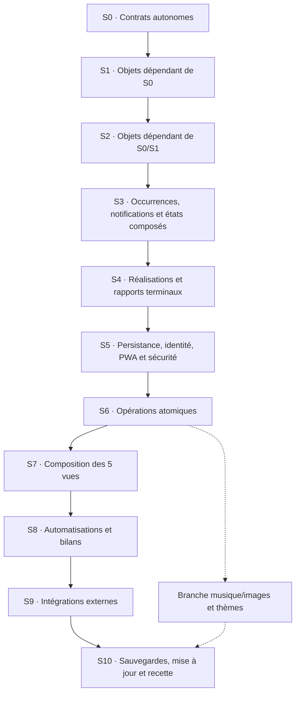

# Roadmap — Application personnelle iPhone (PWA)

> **Statut :** cahier des charges validé pour le démarrage du projet.  
> **GitHub cible :** compte **`Pecose`**, **jamais** l'organisation `T-C-Umbral`.  
> **Dépôt créé :** `Pecose/organiseur-personnel` (public, branche `main`).  
> **Utilisatrice cible :** une personne, sur iPhone.  
> **Budget impératif :** **0 €** d'abonnement, d'hébergement et de compte Apple Developer.  
> **Environnement de développement :** Windows.  
> **Dernière mise à jour :** 2 novembre 2026 (roadmap réordonnée par dépendances ; aucun code d'application développé).

## Tableau de bord des objectifs (lecture humaine)

**Ce tableau est le suivi des objectifs officiel.** Il sert à comparer ce que nous voulons obtenir avec les contrats techniques de [l'architecture](docs/ARCHITECTURE.md). **Validation du périmètre ≠ fonction déjà développée** : toutes les fonctions logicielles ci-dessous restent `PLANNED`. L'agent doit actualiser cette correspondance à chaque évolution approuvée.

| ID objectif | Résultat attendu | Architecture à consulter | Test / jalon | Statut |
|---|---|---|---|---|
| **G01** | PWA installable iPhone, fonctionnement hors ligne et mises à jour | D01/D06/D09 ; F08–F09/F14/F35–F36 ; M01/M79–M83 ; C10/C15–C16 | Tests prévus ; **S5/S10** | À développer |
| **G02** | **Calendrier hebdomadaire** 6 jours visibles + dimanche dépliable, choix de date, connexion bidirectionnelle **Google Agenda** | D04/D11–D13/D21 ; O24–O31/O37 ; F21/F37/F45–F47 ; M103–M120/M127–M128/M150/M156 ; C20–C27/C33 | Tests prévus ; **S7/S9A** | À développer |
| **G03** | **Tâches** non horaires/non cycliques, avec ou sans date, édition et report facultatif | D15/D18 ; O31–O33/O36 ; F22/F48/F51 ; M121–M125/M135–M138 ; C27–C30 | Tests prévus ; **S6–S8** | À développer |
| **G04** | Firebase : compte, données essentielles, synchronisation et restauration | D05/D08 ; O01/O15–O16/O31–O36 ; F27–F30/F34/F39 ; M16–M27/M70–M72/M89–M90 ; C02–C05/C17 | Tests prévus ; **S5/S10** | À développer (Firebase préparé) |
| **G05** | Rappels et notifications iPhone, avec limites Web Push documentées | D07 ; O06/O14/O19/O22/O31–O33 ; F23/F33/F35/F37 ; M41–M44/M75–M78/M81/M84–M88/M100 ; C11–C14/C18–C19 | Tests prévus ; **S9B** | À développer |
| **G06** | Musiques Suno, lecteur, playlists et favoris | O08–O10/O13/O18 ; F11–F12/F24–F25/F31–F32 ; M46–M63/M92–M94/M99 ; C06–C08 | Tests prévus ; **S6–S8/S10** | À développer |
| **G07** | Galerie, imports d'images et thèmes saisonniers | O07/O10–O13 ; F13/F26/F31 ; M64–M69/M95–M98 ; C06–C07 | Tests prévus ; **S6–S8** | À développer |
| **G08** | Export, changement d'iPhone et mises à jour sans perte de données | D08/D09 ; O16/O21 ; F34–F36 ; M70–M74/M82–M83 ; C09–C10/C16–C17 | Tests prévus ; **S10** | À développer |
| **G09** | Gouvernance, confidentialité, gratuité et traçabilité | D02/D03/D10/D13 ; F00–F05/F39 ; AGENTS.md ; règles §0 de l'architecture | Tests prévus ; **S0/S5/S10** | Documentation approuvée ; tests à faire |
| **G10** | **Jour central**, date choisie, une seule liste visuelle en **deux groupes : sans horaire, puis avec horaire chronologique** | D14–D16/D22 ; O20/O31–O33/O37 ; F19/F48/F51/F53 ; M124/M128–M131/M148–M149 ; C27–C28 | Tests prévus ; **S7** | À développer |
| **G11** | **Habitudes** répétées selon jours/fréquences, avec ou sans heure, validation par occurrence | D15/D17 ; O05/O31–O33 ; F49 ; M126/M130/M132–M134/M139/M151 ; C28/C31 | Tests prévus ; **S2–S3/S6–S8** | À développer |
| **G12** | **Listes** de courses, bagages, etc., liées à plusieurs activités sans validation du parent | D20 ; O31/O34–O35 ; F50 ; M142–M146/M152/M159–M160 ; C29 | Tests prévus ; **S1/S6–S7** | À développer |
| **G13** | **Bilan mensuel** filtrable par 1, 2 ou 3 étoiles ; réalisations confirmées et présumées distinguées | D19 ; O31–O33/O38 ; F52/F56 ; M140/M147 ; C32 | Tests prévus ; **S4/S8** | À développer |
| **G14** | **Ergonomie sobre** : couleurs apaisantes, arrondis, icône éditable à gauche, coche à droite, navigation simple | D14/D17/D22 ; F19–F20/F53 ; M149/M153 ; C27–C28 | Tests prévus ; **S7** | À développer |

**Légende :** `À développer` = spécifié, pas fonctionnel ; `En cours` = développement commencé et non validé ; `Validé` = testé dans l'environnement cible. Si un objectif n'a aucune correspondance technique, l'agent doit **STOP**, demander un accord explicite, actualiser **d'abord** l'architecture, puis ce tableau et enfin coder.

## 1. Vision et décisions actées

Construire un organisateur personnel doux, personnalisable et agréable à utiliser, réunissant :

- un **calendrier hebdomadaire** (lundi–samedi, dimanche dépliable) avec synchronisation bidirectionnelle à Google Agenda après connexion volontaire (sans dépendance à Apple Calendar) ;
- un **objet unique d'activité** qui devient une tâche, une habitude, ou un événement selon ses horaires et répétitions ;
- des **rappels et notifications**, y compris quand l'application est fermée sous réserve des limites iOS ; une **validation auto proposée dès qu'un horaire est défini**, toujours réversible ;
- une **bibliothèque de musiques personnelles Suno**, avec lecteur et playlists ;
- une **bibliothèque d'images** et des thèmes changeant selon les saisons ;
- un **stockage local**, une utilisation hors ligne et une **sauvegarde automatique de l'agenda et des tâches** ;
- une **restauration sur un nouvel iPhone** après reconnexion au compte ;
- une **page Jour** affichant date choisie, éléments sans horaire puis horaires, avec **report groupé facultatif des tâches oubliées la veille**, listes liées et bilan mensuel par étoiles ;
- un système de **mise à jour** de l'application et de ses médias fournis par défaut depuis GitHub.

### Choix techniques validés

| Domaine | Choix | Pourquoi |
|---|---|---|
| Distribution | **PWA installable sur iPhone via Safari** | Pas de compilation macOS, pas d'IPA ni d'abonnement Apple Developer, pas de renouvellement de signature tous les sept jours |
| Code source | **GitHub, compte `Pecose`** | Versionnement du code, de la roadmap et des ressources distribuées |
| Hébergement de l'interface | **GitHub Pages** | Hébergement HTTPS statique gratuit ; aucun PC ni serveur personnel à laisser allumé |
| Authentification | **Firebase Authentication** (adresse e-mail et mot de passe) | Une identité pour retrouver les sauvegardes ; adresse `@icloud.com` possible |
| Sauvegarde synchronisée | **Cloud Firestore, formule Firebase Spark** | Sauvegardes automatiques de l'agenda, des tâches et des métadonnées légères dans les quotas gratuits |
| Google Agenda | **Google Calendar API / OAuth** via Worker sécurisé | Connexion et lecture/écriture bidirectionnelles, d'abord à l'ouverture, puis périodiquement à distance ; sans facturation |
| Données locales | **IndexedDB + persistance Firestore côté navigateur** | Accès hors ligne ; bibliothèque de fichiers personnels sur l'iPhone |
| Notifications planifiées | **Web Push iOS + Cloudflare Workers/Cron**, à valider en prototype | Rappels possibles sans PC allumé, dans les quotas gratuits des services |
| Multimédia | **Fichiers Suno personnels et images locales** | Lecture et personnalisation sans dépendance à Deezer |

**Firebase Hosting n'est pas nécessaire** puisque GitHub Pages sert l'application. **Spark est le nom de la formule gratuite**, tandis que **Firestore est la base de données**. Le code GitHub peut être public, mais les données personnelles ne doivent jamais s'y trouver.

### Hors périmètre pour la V1

- Synchronisation obligatoire avec Apple Calendar ou iCloud.
- Distribution App Store, TestFlight, compilation `.ipa`, hébergement personnel ou abonnement payant.
- Intégration Deezer (abandonnée pour la V1 au profit des morceaux Suno personnels).
- Sauvegarde automatique des gros fichiers audio et image sur Firebase : **Cloud Storage for Firebase ne fait pas partie de l'approche gratuite Spark retenue**.
- Réveil natif garanti à heure exacte lorsque le téléphone est hors ligne : **une PWA ne peut pas promettre ce comportement**.

## 2. Principes d'expérience utilisateur

### Navigation principale : cinq onglets exactement

La barre principale contient **Calendrier | Tâches | Jour | Habitudes | Listes**, **Jour au centre** et ouvert par défaut à **la date actuelle**. Pas d'onglet « Événements » : les événements sont des **activités horaires** visibles dans le Calendrier et Jour. Pas de rubrique « À planifier » dans Jour.

1. **Calendrier** : semaine compacte avec cases **lundi à samedi** ; **dimanche dépliable** par indication visible. Titres des éléments si l'espace le permet, sinon compteurs (« 2 événements, 3 habitudes »). Un jour touché ouvre la page **Jour** à cette date.
2. **Tâches** : inventaire des activités non récurrentes et sans horaire, **datées ou non**. Création, modification, importance (1–3 étoiles), icône et liste associée, planification facultative.
3. **Jour** : pour la date sélectionnée, **une seule liste cohérente avec deux groupes maximum** : **Sans horaire**, puis **Avec horaire**, trié chronologiquement. Tâches datées, événements horaires et occurrences des habitudes sont mélangés **sans séparateurs par type** ; les tâches sans aucune date restent dans Tâches. Bouton retour **Aujourd'hui**.
4. **Habitudes** : toutes les règles récurrentes, quotidien/hebdomadaire avec jours précis/mensuel/annuel selon choix, heure facultative, date de début/fin éventuelle, historique des réalisations par occurrence. Une habitude du mercredi à 19 h figure aussi parmi les événements de ce mercredi.
5. **Listes** : listes libres (courses, matériel, voyages…) et articles cochables, réutilisables et associables à une ou plusieurs activités ; consultables directement depuis l'activité concernée.

**Accès secondaire** : Musique (lecteur Suno et playlists), Décoration (images et saisons), Paramètres (compte, Google Agenda, notifications, exports), Bilan mensuel. Ces fonctions subsistent mais **n'ajoutent pas d'onglets principaux**.

### Comportement de l'objet unique

Un seul objet `Activity` O31, portant titre, description, icône/image personnalisable, étoiles 1–3, liste liée, date facultative, horaire début/fin facultatif, répétition facultative, notification et règle de validation. Les vues Tâches/Habitudes/Événements sont des **filtres**, pas trois copies. Ajouter un horaire transforme l'affichage, **pas l'identifiant**.

- **Icône à gauche** : appuyer ouvre tous les réglages de l'activité.
- **Coche à droite** : validation manuelle ou correction ; une habitude est cochée par **occurrence**.
- **Avec horaire** : la validation automatique est proposée **activée par défaut** ; l'utilisatrice peut la désactiver. Utiliser fin si elle existe, sinon l'heure prévue ; statut « présumé accompli » réversible, pas une preuve.
- **Sans horaire** : validation manuelle. Si une **tâche datée d'hier** (non récurrente, non horaire) n'a pas été faite, une **seule proposition groupée** permet de la reporter à aujourd'hui, de la laisser hier ou de redemander plus tard. Aucun report silencieux, aucune copie, aucune fenêtre par tâche.
- **Étoiles et bilan** : filtre de 1 à 3 étoiles, ordre **3→2→1 puis dates** et distinction des éléments validés automatiquement.
- **Listes** : les articles peuvent être cochés séparément ; l'activité « Faire les courses » ne se valide pas automatiquement parce que toute sa liste est cochée.

### Design et gestes

**Très arrondi, couleurs apaisantes (vert sauge, crème, bleu poudré, lavande…), lisible et peu chargé.** La sélection de date et les actions doivent rester explicites. Défilement vertical naturel ; glissement horizontal éventuel si testé sur iPhone, sans imposer de geste à deux doigts. Garder suffisamment d'espace tactile autour des icônes et coches.

### Contenus dynamiques

- L'utilisatrice peut **ajouter, modifier, supprimer et classer** ses images et musiques sans modifier le code.
- Les ressources **incluses dans l'application** et celles **importées par l'utilisatrice** sont identifiées séparément.
- À l'installation initiale : **2 ou 3 musiques et 2 ou 3 images** de démonstration/ambiance, sous réserve des droits de diffusion des œuvres.
- Les futures mises à jour peuvent ajouter de nouveaux contenus par défaut, **sans effacer** les contenus personnels.
- Les fonds peuvent évoluer automatiquement selon la saison, avec choix manuel prioritaire si l'utilisatrice le souhaite.

## 3. Stockage, synchronisation et sécurité

### Répartition des données

| Donnée | Local sur iPhone | Firestore (auto) | Export / restauration |
|---|---|---|---|
| **Activités uniques O31** (tâches datées ou non, habitudes, événements horaires) | Oui | **Oui** + liaison Google Agenda **sur événements horaires concernés uniquement** | Oui |
| Réalisations par occurrence, décisions de report et listes libres | Oui | **Oui** | Oui |
| Tâches, listes, statuts | Oui | **Oui** | Oui |
| Préférences, thèmes choisis, favoris et playlists (métadonnées) | Oui | Oui, en volume léger | Oui |
| Images et décorations importées | **Oui** | Non | **Oui, archive utilisateur** |
| Fichiers audio Suno importés | **Oui** | Non | **Oui, archive utilisateur** |
| Fichiers de départ intégrés au site | Cache de l'application | Non | Retéléchargement depuis GitHub Pages |

### Comportement attendu

- **Enregistrement local immédiat** à chaque modification, sans bouton « Sauvegarder » nécessaire.
- **Synchronisation automatique Firestore** quand le réseau est disponible ; mise en attente des écritures hors ligne selon les capacités et réglages de persistance du navigateur.
- Afficher les états : **Enregistré localement / Synchronisation en cours / Synchronisé / Erreur**.
- Associer toutes les données du cloud à l'**UID Firebase** de l'utilisatrice ; règles Firestore limitant lecture et écriture à `request.auth.uid` correspondant.
- Aucune clé privée, aucun mot de passe et aucun identifiant de service Cloudflare dans GitHub ou le code accessible au navigateur. Les paramètres publics Firebase ne sont pas en soi des secrets, **les règles de sécurité sont indispensables**.
- Prévoir **export JSON de l'agenda et des tâches**, sauvegardes datées et restauration contrôlée : synchroniser une erreur ou une suppression n'est pas équivalent à disposer d'une sauvegarde historique.
- Prévoir un **export/import d'archive multimédia** vers l'application Fichiers / iCloud Drive, distinct de la synchronisation automatique de Firestore.
- Tester réellement les pertes de cache et la réinstallation : **IndexedDB sur iOS n'est pas un stockage d'archives garanti**.

### Modèle de données initial (à ajuster)

```text
users/{uid}/activities/{activityId}             # O31 activité canonique
users/{uid}/activityCompletions/{id}           # O33 historique par occurrence
users/{uid}/checklists/{checklistId}           # O34 listes libres
users/{uid}/checklists/{checklistId}/items/{id} # O35 articles
users/{uid}/carryOverDecisions/{id}            # O36 report des tâches de la veille
users/{uid}/playlists/{playlistId}
users/{uid}/preferences/profile
users/{uid}/reminders/{reminderId}
users/{uid}/googleCalendarConnection/status     # statut liaison non secret
users/{uid}/googleCalendarSync/state            # serveur uniquement
users/{uid}/googleOAuthGrant/primary             # secret chiffré, serveur uniquement
users/{uid}/googleCalendarConflicts/{conflictId} # résolution de conflits
```

Les playlists cloud contiennent **des références/métadonnées** ; les fichiers musicaux personnels restent dans le stockage local. Après changement de téléphone, les listes peuvent être retrouvées, mais les fichiers personnels doivent être réimportés à partir de l'archive ; afficher clairement les morceaux manquants.

## 4. Rappels, alarmes et notifications

### Ce qui est prévu

- Pendant que la PWA est ouverte : rappels visibles dans l'interface, sons/indicateurs si l'utilisatrice l'autorise.
- PWA installée sur l'écran d'accueil : demander l'autorisation de **Web Push** par une action explicite de l'utilisatrice.
- Pour les événements à venir : un programme **Cloudflare Worker avec Cron Trigger** vérifie périodiquement les rappels à envoyer et sollicite l'envoi push, même si le PC de développement est éteint.
- Gérer le fuseau horaire (`Europe/Paris` par défaut à confirmer), les changements d'heure, les rappels récurrents et l'absence de doublons ; **un rappel lié à activityId et occurrenceKey**. 
- Traiter les expirations/renouvellements d'abonnement push et les refus d'autorisation.
- Dans les paramètres : bouton **Envoyer un rappel de test** et statut de disponibilité des notifications.

### Limites à annoncer sans ambiguïté

- Un push dépend du réseau, des réglages de notifications, des modes Concentration et des services du système ; **ni son heure exacte ni une sonnerie longue ne sont garanties**.
- **Un réveil hors ligne, application fermée, à heure exacte ne peut pas être garanti en PWA.** Pour cette fonction, il faudrait changer de stratégie technique (application iOS native avec API d'alarmes appropriée) ou recourir à l'application Horloge de l'iPhone.
- Si les essais iPhone échouent ou si l'utilisatrice exige des réveils critiques, **la décision technologique doit être réévaluée avant de poursuivre**.

### Prototype obligatoire (jalon bloquant)

- Installer la PWA sur le **véritable iPhone** de l'utilisatrice.
- Tester un rappel à **+2 minutes**, application fermée, écran verrouillé.
- Tester hors ligne et en mode Concentration ; consigner ce qui arrive réellement.
- Tester une répétition, un changement d'heure simulé et le non-envoi de doublons.

## 5. Bibliothèque musicale et images

### Musique Suno

- Accepter les **fichiers personnels autorisés à être utilisés** (MP3/M4A et autres formats effectivement compatibles avec Safari iOS).
- Import depuis **Fichiers**, conservation locale des fichiers (IndexedDB), titres, artistes, pochettes et tags.
- Playlists créables et modifiables, favoris, recherche, tri, réorganisation.
- Lecteur intégré : lecture, pause, piste suivante/précédente, barre de progression, volume selon possibilités du navigateur, répétition et lecture aléatoire.
- **Tester très tôt** la lecture quand l'écran se verrouille, les commandes de l'écran verrouillé et l'enchaînement des titres : iOS/PWA peut limiter certaines interactions en arrière-plan.
- Fournir quelques morceaux de base dans les ressources de l'application, après vérification des droits Suno applicables à leur publication publique sur GitHub Pages.

### Images / décoration

- Galerie avec catégories et tags ; import depuis Photos/Fichiers.
- Fonds d'écran internes à l'application (pas modification automatique du fond du système iOS).
- Thèmes de printemps, été, automne et hiver ; sélection automatique selon la date avec possibilité de forcer un thème.
- Personnalisation des couleurs, de la disposition et des éléments décoratifs dans une mesure raisonnable pour l'ergonomie.
- Petit éditeur de création dans l'application (**phase ultérieure**) : composition simple, recadrage, redimensionnement, texte ; **pas de génération IA d'images distante incluse dans la promesse de gratuité**.
- Compression/redimensionnement des images à l'import pour ne pas saturer le stockage local.

## 6. Mises à jour depuis GitHub

- Sources hébergées sous `Pecose/organiseur-personnel` (nom provisoire).
- **GitHub Pages** sert les fichiers statiques HTTPS et le manifeste PWA.
- **Service worker** avec stratégie de cache versionnée : l'application s'ouvre hors ligne après une première installation complète réussie.
- Quand une nouvelle version est publiée : notification **« Nouvelle version disponible »**, bouton « Mettre à jour » et remplacement contrôlé des caches de l'application.
- Les mises à jour du code et des ressources par défaut **ne doivent pas toucher aux stores IndexedDB utilisateur ni supprimer ses données personnelles**.
- Les nouveaux fichiers fournis par défaut sont catalogués avec identifiant et version ; éviter les doublons.
- Réserver les mises à jour multimédias volumineuses à un téléchargement explicite si nécessaire (réseau et stockage).
- Pour changer de téléphone : Safari → URL GitHub Pages → partage → **Ajouter à l'écran d'accueil / Ouvrir comme app** → connexion Firebase → restauration des données cloud → réimport éventuel de la bibliothèque multimédia.

## 7. Roadmap par **strates de dépendances** (ordre de construction)

> **Règle d'exécution :** on ne commence pas par « faire un écran ». On commence par **les objets qui n'ont besoin d'aucun autre objet du projet**, puis les objets qui ne dépendent que de ceux déjà terminés. Après viennent les services, les opérations, les vues, les automatisations et les intégrations. Une strate est **bloquée** tant que ses prérequis, tests et références architecturales ne sont pas validés. Ce chapitre **remplace l'ancien ordre par fonctionnalités** sans supprimer leur périmètre.
>
> **Statut :** architecture **PLANIFIÉE**, application **non développée**. Les identifiants **O/F/M/C/T/D** sont ceux du [registre architectural](docs/ARCHITECTURE.md) ; **aucun nouveau contrat n'est introduit ici**. Seules les entités **O01, O05–O38 sauf O02–O04**, soit **35 objets actifs**, doivent être réalisées. **O02, O03 et O04 sont SUPERSEDED**, ne jamais les coder.
>
> Un « objet autonome » veut dire **autonome vis-à-vis des autres objets métier**. Déclarer le type `AuthUser` (O01) ne signifie pas que Firebase Authentication est opérationnel. De même, une interface type ne nécessite pas que Firestore, Cloudflare ou Safari soient déjà configurés.

### Vue générale : graphe de progression



Les flèches pleines donnent l'**ordre de livraison recommandé et ses portes de validation**. La branche médias est **indépendante** de l'agenda et peut être construite dès S6 ; elle ne doit pas attendre artificiellement Google Agenda ni les notifications. Les tests PWA/iPhone de faisabilité peuvent être anticipés en lecture/prototype contrôlé pour déceler tôt un risque, sans inverser l'ordre de production des objets.

### Inventaire exhaustif des **strates d'objets**

| Strate | Objets à définir et valider | Dépendances autorisées | Résultat attendu |
|---|---|---|---|
| **S0** | **O01** identité (contrat), **O05** règle de répétition, **O07** préférences, **O10** blob média, **O13** catalogue, **O15** statut sync, **O16** enveloppe sauvegarde, **O17** version, **O18** état lecteur, **O20** route, **O22** diagnostic notification, **O24** lien Google, **O29** changement Google, **O34** définition de liste, **O37** date sélectionnée | **Aucun autre objet actif** (15) | Types élémentaires stables, validations simples |
| **S1** | **O08** piste, **O11** image, **O12** thème, **O14** abonnement push, **O21** manifeste média, **O25** curseur Google, **O27** grant OAuth chiffré, **O28** état OAuth, **O31** activité unique, **O35** article de liste | S0 seulement (10) | Objets composés sans dépendance circulaire |
| **S2** | **O09** playlist, **O23** connexion Google, **O26** conflit Google, **O32** occurrence d'activité, **O36** décision de report | S0–S1 seulement (5) | Relations et répétitions décrites avec identifiants stables |
| **S3** | **O06** rappel lié à une occurrence, **O30** rapport de synchro Google, **O33** réalisation d'occurrence | S0–S2 seulement (3) | Rappels, historiques et états indépendants par occurrence |
| **S4** | **O19** reçu d'envoi, **O38** bilan mensuel calculé | S0–S3 seulement (2) | Modèle métier complet : **35/35 objets actifs** |

**Lecture stricte :** l'appartenance à S0–S4 concerne d'abord la **définition typée et les règles pures** (F17/F18), pas encore les écritures dans une base. Un identifiant de relation (`activityId`, `checklistId`, `uid`) est vérifié ensuite dans les opérations de la strate S6 ; il ne faut pas créer le serveur avant d'avoir stabilisé les formes des données. Les objets Google/Push sont **modélisés** ici, mais leur activation n'arrive qu'à S9.

### Porte de validation commune (obligatoire après chaque strate)

- [ ] Le **registre d'architecture** contient chaque objet/fonction/fichier utilisé ; aucun nouvel ID implicite, aucune signature modifiée sans autorisation préalable.
- [ ] Tous les **prérequis de la strate** sont effectivement terminés, pas seulement notés « prévus ».
- [ ] Les types, règles métier, relations et migrations concernées sont vérifiés ; aucune dépendance circulaire.
- [ ] Les tests ciblés de la strate passent ; erreurs et comportements limites documentés.
- [ ] La roadmap indique **validé / en cours / bloqué**, avec preuve (test, commit, essai iPhone quand applicable) ; **seulement ensuite** commencer la suivante.

### S0 — Objets totalement autonomes (aucun objet métier requis)

**Dépend de : rien dans ce projet.** Phase de contrat, zéro API appelée, zéro donnée envoyée.

- [ ] Définir dans **F17** les **15 types autonomes** du tableau, leurs champs obligatoires, valeurs optionnelles et invariants.
- [ ] Définir les utilitaires purs de date et fuseau dans **F18** : **M28/M29/M45/M67** ; une répétition quotidienne/hebdomadaire/mensuelle/annuelle est décrite sans fabriquer d'activité réelle.
- [ ] Définir les contrats d'erreur/retour `Result`, le type `LocalDate`, les instants UTC et les règles de test sans choisir implicitement de bibliothèque.
- [ ] Faire valider toute décision de framework, gestionnaire de dépendances ou nouveau fichier **avant** installation, conformément à `AGENTS.md`.
- [ ] Tester les validations de types, durées, dates locales et changement d'heure (T01), avec exemples sans Firebase.

**Sortie S0 :** chaque objet de base est autonome, les fonctions de date sont testables isolément et les noms/signatures correspondent au registre.

### S1 — Objets composés **uniquement de S0**

**Prérequis : S0 validée.** Les références sont des identifiants, **pas** des appels réseau.

- [ ] Définir **O31 Activity**, avec date facultative, heure facultative, récurrence facultative, icône à gauche, étoiles 1–3 et liste associée, sans avoir à créer trois classes Tâche/Habitude/Événement.
- [ ] Définir O08/O11/O12 (médias et thème), O14 (push), O21 (archive), O25/O27/O28 (Google sécurisé) et O35 (élément de liste).
- [ ] Tester **M124** (classification : tâche sans heure ni répétition ; habitude répétée ; événement horaire) et **M157** (validation de l'activité) en calcul pur.
- [ ] Vérifier que `Activity` conserve un **seul identifiant** malgré les changements de catégorie, et qu'aucun mot de passe/jeton n'est placé dans un modèle public.

**Sortie S1 :** les objets composés sont corrects, sans requérir S2 ou Firestore.

### S2 — Objets dépendant des structures précédentes

**Prérequis : S0–S1 validées.**

- [ ] Définir O32 occurrence d'activité et O36 décision de report, construits à partir d'O31.
- [ ] Définir O09 playlist à partir d'O08 ; O23 connexion Google à partir d'O01/O25 ; O26 conflit Google à partir d'O31/O24.
- [ ] Tester **M130** : occurrences récurrentes **bornées**, mercredi à 19 h en heure locale, jours spécifiques, fin de mois et fuseaux.
- [ ] Tester **M131** : logique pure de regroupement **sans horaire puis horaire croissant**, sans séparation par type métier.

**Sortie S2 :** toutes les relations et occurrences sont déterministes, pas d'activité clonée au passage d'une date.

### S3 — États rattachés aux occurrences

**Prérequis : S0–S2 validées.**

- [ ] Définir O33 `ActivityCompletion` **par occurrence** : en attente, manuellement fait, automatiquement présumé, annulé.
- [ ] Définir O06 rappel par `activityId + occurrenceKey` ; définir O30 rapport de synchronisation Google sans exposer de données privées.
- [ ] Tester les règles pures de **M133** : une heure de fin l'emporte sur l'heure de début ; `autoComplete` peut être désactivé ; une annulation manuelle doit primer sur l'automatisme.
- [ ] Vérifier que la validation du mercredi n'achève ni le mercredi suivant, ni toute une série.

**Sortie S3 :** états et rappels se rattachent à une occurrence stable, sans erreur de récurrence.

### S4 — Objets terminaux et rapports dérivés

**Prérequis : S0–S3 validées.**

- [ ] Définir O19 reçu de notification dépendant d'O06, et O38 bilan dérivé d'O31/O32/O33.
- [ ] Préparer les règles pures de classement : activités **3 étoiles, puis 2, puis 1**, ordre chronologique à priorité égale, filtre étoile 1/2/3.
- [ ] Distinguer dans les résultats **réalisation confirmée** et **validation seulement présumée** ; ne jamais faire de `MonthlyReview` une seconde source de vérité.
- [ ] Repasser les **35 objets actifs** en revue et confirmer que les trois anciens O02–O04 sont exclus.

**Sortie S4 :** modèle des données complet, contrats vérifiés, **aucun objet métier supplémentaire nécessaire** aux étapes suivantes sans nouvelle approbation.

### S5 — Adapter les objets aux services et au téléphone

**Prérequis : S0–S4 validées.** Ici seulement arrivent les dépendances techniques externes.

- [ ] Valider l'outil de compilation TypeScript et les fichiers **F06–F09/F14** ; préparer l'app shell, les icônes et le manifeste PWA pour Safari.
- [ ] Ajouter **Firebase Auth** (M16–M20/M90) et **Firestore** (M21–M27/M89), le mode hors ligne Safari et les états O15 ; préparer **F39** et tester les **refus entre deux UID** (T05).
- [ ] N'autoriser les écritures Firestore qu'après validation des règles d'accès, des collections O31–O36 et des champs réellement autorisés.
- [ ] Préparer **IndexedDB F31** (M46), catalogue embarqué F32 (M50/M51), cache PWA et service worker F35 (M79/M80).
- [ ] Premier prototype iPhone : installation Safari, fermeture/réouverture, **PC éteint**, réseau absent, limites de stockage ; tester tôt la lecture d'un fichier Suno sur écran verrouillé pour décider si la PWA reste adaptée, sans promettre la lecture ininterrompue.
- [ ] Vérifier **0 €**, GitHub Pages `Pecose`, Firebase Spark et absence de secrets dans le dépôt.

**Sortie S5 :** des **adaptateurs sûrs et testés** existent pour stocker/lire les objets ; aucun CRUD métier ou écran final ne dépend de stubs trompeurs.

### S6 — Fonctions élémentaires sur **un seul objet à la fois**

**Prérequis : S5 et types S0–S4 validés.** Sous-ordre : **dépôt sécurisé → CRUD central → opérations spécialisées**.

- [ ] Activités : **M121–M126/M138–M142/M157**. Créer, lire, modifier, supprimer, classer, dater, répéter, étoiler, changer icône et associer une liste **sans changer l'ID**.
- [ ] Listes : **M143–M146/M159–M160**. Définir une liste et ses articles, cases cochables, accès par ID, détachement sans effacer l'activité, pas de validation automatique du parent.
- [ ] Réalisations : **M132/M134/M155/M158**. Créer/annuler une coche pour une seule occurrence ; persister le refus de recochage automatique. L'automatisation complète attend S8.
- [ ] Préparer l'accès aux rappels **M41–M44** avec activité/occurrence comme propriétaires ; l'envoi réel attend S9.
- [ ] **Branche indépendante médias** (si la branche est activée dès maintenant) : M47–M57, M64–M65 et M95 pour blobs, métadonnées, imports et listes ; tests IndexedDB, aucune image/MP3 personnelle stockée dans Firestore.
- [ ] Tester CRUD offline et retour du réseau, sauvegarde par UID, absence de doublon et présence des mêmes relations après reconnexion (T02/T03/T05/T18).

**Sortie S6 :** chaque objet peut être manipulé correctement sans dépendre d'un écran complexe.

### S7 — Assembler les objets dans les **cinq vues**

**Prérequis : S6 validée.** Les écrans lisent les services déjà testés, pas l'inverse.

- [ ] Router/état/UI F15/F16/F19/F20/F53 (M02–M15, M148–M153) : **Calendrier | Tâches | Jour | Habitudes | Listes**, avec Jour central et sélectionné au premier lancement.
- [ ] **Jour** (M129/M131/M149) : date choisie O37, **sans horaire d'abord**, horaires croissants ensuite ; **aucun** troisième groupe « À planifier ».
- [ ] **Calendrier** (M127/M128/M150/M156) : **lundi–samedi** visibles, **dimanche dépliable**, libellés ou compteurs ; toucher un jour affiche Jour à cette date ; raccourci Aujourd'hui.
- [ ] **Tâches / Habitudes / Listes** (M07/M125/M126/M143/M151/M152) : trois filtres/vues des données déjà stockées, **pas trois stockages**.
- [ ] En-tête, icônes personnalisées **à gauche** ouvrant la fiche complète, boutons de validation **à droite**, formulaire détaillé sans surcharge, navigation accessible à une main, styles arrondis et couleurs apaisantes (G10/G14).
- [ ] **Branche médias/visuels indépendante :** écran Musique M08/M58–M63/M92–M94/M99 et écran Décoration M09/M66–M69/M96–M98, accessibles **hors** de la barre de cinq onglets.
- [ ] Tester sur iPhone tactile/lecteur d'écran, sélection de dates et occurrences récurrentes (T08/T15/T18/T20).

**Sortie S7 :** les **cinq pages sont navigables**, Jour affiche exactement les données du jour et reste minimaliste.

### S8 — Fonctions qui combinent plusieurs objets / historiques

**Prérequis : S7 validée.** Dérouler les sous-fonctions dans l'ordre, afin de ne pas introduire de cycle.

- [ ] **Autovalidation** : M133 (décision) → M158 (écriture `auto_assumed`) → M154 (réconciliation au retour de l'app). Proposer l'option **activée** à l'ajout d'une heure ; désactivable ; fin avant début ; correction M134 persistante.
- [ ] **Tâches oubliées** : M135 (candidates datées d'hier, sans heure et sans récurrence) → M136 (panneau groupé) → M137 (choix `move/keep/later`) ; conserver l'ID, ne pas répéter les fenêtres à chaque rechargement.
- [ ] **Bilan mensuel** M147 : O38 calculé à partir de O31/O32/O33 ; 3→2→1 étoiles puis chronologie ; filtres et distinction entre validation présumée/confirmée.
- [ ] Terminer **musique, thèmes, archivage local** indépendamment des rappels et Google si la branche est prête ; valider fichiers par défaut redistribuables et import des médias personnalisés.
- [ ] Tests intégrés T16–T20 : récurrence horaire, réversibilité d'une coche, refus de report, liste liée, bilan mensuel, changement de date et navigation.

**Sortie S8 :** toute l'expérience quotidienne est utilisable **sans Google Calendar ni Cloudflare**, en local puis avec Firebase.

### S9 — Branches externes dépendantes du noyau

**Prérequis communs : S5 (sécurité), S6 (CRUD) et S8 (règles métier)**. Ces deux branches peuvent être développées **en parallèle** entre elles, mais chacune a son propre jalon.

**S9A — Google Agenda bidirectionnel (G02)**
- [ ] Valider API Google Calendar, **consentement OAuth distinct de Firebase Auth**, scopes limités et conditions de jeton durable. Compte Google de l'utilisatrice connecté volontairement.
- [ ] Mettre en œuvre **M103–M120** : flux OAuth serveur, `state` unique, grant O27 chiffré, curseur O25, liaison O24, conflits O26, reprise `410 Gone`, identifiants stables et suppression contrôlée.
- [ ] **O31 horaire ↔ Google Agenda** en deux sens, sans exporter systématiquement les tâches non horaires ni toutes les habitudes ; exceptions et fuseaux testés.
- [ ] Fonctionnement PWA ouverte d'abord ; puis, uniquement si le Worker gratuit est configuré et validé, **synchronisation distante périodique** quand elle est fermée. Pas de promesse de temps réel.
- [ ] Tests **T10–T14**, sécurité des jetons et absence de doublons/conflits silencieux.

**S9B — Notifications Web Push et rappels (G05)**
- [ ] Configurer plus tard Cloudflare Workers/Cron **gratuit** et ses secrets pour F37/F38, en réutilisant les protections prévues, **aucun compte requis avant cette strate**.
- [ ] Implémenter **M75–M78/M81/M84–M88/M100** : consentement de la PWA installée, abonnement O14, rappels O06, reçus O19, préventions de doublon, envois de test et renouvellement.
- [ ] Tester iPhone fermé/verrouillé, réseau absent, modes Concentration, décalage possible, fuseau et répétitions (T07). **Push ≠ alarme système hors ligne**.

**Sortie S9 :** chaque intégration distante n'est validée qu'après ses propres tests et garde-fous ; aucun coût activé sans nouveau consentement explicite.

### S10 — Restauration, versionnement et recette finale

**Prérequis : S8 validée et branches S9 livrées ou explicitement différées.**

- [ ] Export JSON **M70–M72** des données synchronisées ; tester schémas, fusion/restauration et confirmation avant écrasement (T04).
- [ ] Export/import multimédia **M73–M74** vers Fichiers/iCloud Drive ; tester de gros fichiers et cas où les MP3/images ne sont plus sur l'iPhone.
- [ ] **M82–M83** : version GitHub Pages/PWA, mise à jour sans effacer IndexedDB ni Firestore, catalogue de base versionné et non dupliqué.
- [ ] Refaire tous les scénarios de la **matrice de recette §8**, du PC Windows éteint jusqu'au changement d'iPhone ; tester offline → online, notifications, musique verrouillée et permissions.
- [ ] Vérifier sécurité par UID, secrets non publiés, consentement Google, règles Firestore, quotas Spark/Cloudflare, **coût 0 €**.
- [ ] Documenter installation Safari, sauvegarde média, changement d'iPhone et limites iOS. Cocher un objectif G01–G14 **seulement** avec preuve de tests, liens/commits et date.

**Sortie S10 :** application livrable, données restaurables, limites connues ; aucune fonctionnalité déclarée terminée sans son test final.

### Politique d'avancement pour les agents

1. **Commencer par la première strate incomplète** dans la branche concernée, sans sauter directement à une interface ou une intégration qui dépend d'objets absents.
2. Vérifier les **références du registre et les dépendances** de chaque sous-opération. En cas de contrat manquant/contradictoire : **STOP, proposer l'architecture, demander l'accord de l'utilisateur**, puis documenter/committer **avant** le code.
3. **Ne pas imposer de dépendance artificielle** : après S5, la branche médias peut avancer sans Google Agenda ; les intégrations Google et Push sont indépendantes entre elles.
4. Noter pour chaque strate : **état, prérequis validés, tests exécutés, problèmes restants et preuve de livraison**. Ne pas confondre **types définis**, **services opérationnels**, **interfaces affichées** et **fonctionnalité effectivement testée sur l'iPhone**.


## 8. Matrice de tests de recette

| Scénario | Résultat attendu |
|---|---|
| Installation depuis Safari | Icône sur l'écran d'accueil, ouverture comme application |
| PC éteint | Application et services cloud continuent de fonctionner |
| Mode avion après premier chargement | Agenda, tâches, médias déjà chargés et décor disponibles |
| Création d'une tâche sans réseau | Enregistrée localement puis synchronisée à la reconnexion |
| Navigation cinq onglets | Calendrier, Tâches, **Jour central**, Habitudes, Listes, dans cet ordre |
| Choix d'une date | Toucher une case du calendrier ouvre Jour à cette date ; retour Aujourd'hui visible |
| Calendrier 6+1 | Six jours du lundi au samedi, dimanche dépliable ; libellés ou compteurs |
| Page Jour | Deux groupes uniquement, sans heure puis avec heure croissante, sans troisième bloc |
| Tâche → événement → habitude horaire | Même identifiant O31, pas de doublon, exemple théâtre mercredi 19 h |
| Icône / validation | Icône à gauche ouvre la fiche complète ; coche à droite valide l'occurrence |
| Autovalidation | Proposée activée à l'ajout d'heure ; heure de fin privilégiée ; annulation persistante |
| Tâche oubliée hier | Fenêtre groupée, report facultatif par tâche, aucune copie ni harcèlement |
| Liste associée | Ouvrable depuis l'activité ; coches d'articles indépendantes de l'activité |
| Bilan mensuel | Tri 3→2→1 étoiles, chronologie, filtres ; validations auto présentées comme présumées |
| Nouveau téléphone, même compte | Agenda, tâches, préférences et playlists-métadonnées récupérés |
| Google Agenda → PWA | Nouveau rendez-vous / modification / suppression visibles après synchronisation | 
| PWA → Google Agenda | Événements créés, modifiés et supprimés reflétés sans doublon | 
| Google Agenda, application fermée | Synchronisation seulement après mise en place du Worker planifié ; délais non instantanés |
| Conflit ou OAuth expiré | Signaler l'erreur, conserver les données, proposer résolution ou reconnexion |
| Nouvelle installation sans archive multimédia | Médias de base présents ; imports personnels explicitement signalés comme manquants |
| Export/import de bibliothèque | Fichiers personnels retrouvés dans l'application |
| Notification à une heure donnée | Reçue si les services/conditions le permettent ; retard/absence correctement documentés |
| Musique et écran verrouillé | Comportement testé sur le vrai iPhone, limites consignées |
| Mise à jour GitHub Pages | Code/fonds par défaut mis à jour sans effacer les imports et données |
| Mauvais compte Firebase | Impossible d'accéder aux données de l'utilisatrice |
| Règles Firestore | Lecture/écriture non autorisées rejetées |

## 9. Coûts et contraintes non négociables

| Service | Cible | Condition |
|---|---:|---|
| GitHub (dépôt + Pages) | 0 € | Dépôt public pour le site Pages gratuit selon l'offre retenue ; contenu distribué public |
| Firebase Authentication + Firestore (Spark) | 0 € | Dans les quotas gratuits ; ne pas activer Blaze ni des produits payants |
| Cloudflare Workers/Cron | 0 € | Dans les quotas et capacités gratuites du service ; sera nécessaire au backend OAuth Google et plus tard aux notifications |
| Google Calendar API / OAuth | 0 € prévu | Dans quotas gratuits, consentement et éventuelle vérification applicables ; ne jamais payer sans accord |
| Stockage local iPhone | 0 € | Capacité disponible et politiques de purge iOS ; archive exportable indispensable |
| Apple Developer Program | 0 € | **Non utilisé** : PWA et non application native |
| Serveur personnel, Mac, abonnement | 0 € | **Non utilisés** |

**Important :** le « 0 € » est une **contrainte de conception**, pas une garantie contractuelle à perpétuité. Si une plateforme modifie ses tarifs ou retire une fonction gratuite, on cherchera une alternative gratuite avant toute dépense.

## 10. Ordre de démarrage et discipline des dépendances

**Priorité absolue : S0**, puis **S1, S2, S3 et S4** pour construire et tester le graphe complet des **35 objets actifs**. **Aucun travail de code n'a commencé à ce jour.** Après validation des contrats : **S5** (persistence/auth/PWA), **S6** (CRUD), **S7** (les cinq onglets), **S8** (autovalidation, reports, bilans), **S9A/S9B** (Google Agenda et notifications), **S10** (sauvegardes et recette). La branche médias peut débuter à S6 en parallèle du cœur quotidien.

**La progression est conditionnelle**, pas calendaire : si une dépendance manque ou si un test échoue, la strate suivante attend. Une difficulté de faisabilité iPhone (musique verrouillée ou Web Push) peut être testée tôt en prototype sans prétendre que les services métier aval sont développés.

**Fonctionnement humain :** le tableau de bord G01–G14 en tête de roadmap indique la valeur attendue, mais **la section 7 dicte l'ordre concret de fabrication**. `docs/ARCHITECTURE.md` reste l'unique source pour les signatures et les dépendances exactes, et `AGENTS.md` impose l'autorisation explicite avant tout ajout hors architecture.

> **Choix encore à arbitrer** : nom final de l'application, palette exacte, détail de la présentation des listes longues et des reports plus anciens qu'hier, tolérance aux limites de la musique/verrouillage et des notifications PWA. Aucune décision non prise ne doit être présentée comme implémentée.
