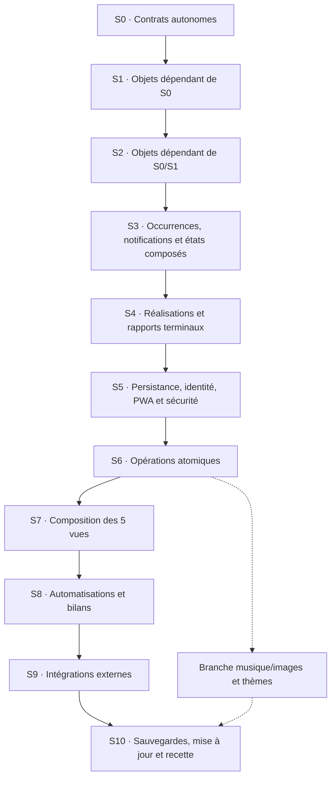

# Roadmap — Application personnelle iPhone (PWA)

> **Statut :** implémentation des strates S0–S8 avancée, **non testée et non déployée** ; S9 partiellement codée, S10 planifiée.  
> **GitHub cible :** compte **`Pecose`**, **jamais** l'organisation `T-C-Umbral`.  
> **Dépôt créé :** `Pecose/organiseur-personnel` (public, branche `main`).  
> **Utilisatrice cible :** une personne, sur iPhone.  
> **Budget impératif :** **0 €** d'abonnement, d'hébergement et de compte Apple Developer.  
> **Environnement de développement :** Windows.  
> **Dernière mise à jour :** 3 novembre 2026 (S8/D24 codée ; recette globale D23 différée).

## Tableau de bord des objectifs (lecture humaine)

**Ce tableau est le suivi des objectifs officiel.** Il sert à comparer ce que nous voulons obtenir avec les contrats techniques de [l'architecture](docs/ARCHITECTURE.md). **Validation du périmètre ≠ fonctionnalité validée** : les strates S0–S8 comportent désormais du code **non testé**. S9 dispose d'un code préparatoire non testé ; S10 reste à développer. L'agent doit actualiser cette correspondance à chaque évolution approuvée.

| ID objectif | Résultat attendu | Architecture à consulter | Test / jalon | Statut |
|---|---|---|---|---|
| **G01** | PWA installable iPhone, fonctionnement hors ligne et mises à jour | D01/D06/D09 ; F08–F09/F14/F35–F36 ; M01/M79–M83 ; C10/C15–C16 | T06 ; **S5/S10** | À développer |
| **G02** | **Calendrier hebdomadaire** 6 jours visibles + dimanche dépliable, choix de date, connexion bidirectionnelle **Google Agenda** | D04/D11–D13/D21 ; O24–O31/O37 ; F21/F37/F45–F47 ; M103–M120/M127–M128/M150/M156 ; C20–C27/C33 | T10–T15 ; **S7/S9A** | Partiellement codé, non testé : S9/D25 |
| **G03** | **Tâches** non horaires/non cycliques, avec ou sans date, édition et report facultatif | D15/D18 ; O31–O33/O36 ; F22/F48/F51 ; M121–M125/M135–M138 ; C27–C30 | T02/T15/T17 ; **S6–S8** | Codé (reports groupés), non testé S8/D23 |
| **G04** | Firebase : compte, données essentielles, synchronisation et restauration | D05/D08 ; O01/O15–O16/O31–O36 ; F27–F30/F34/F39 ; M16–M27/M70–M72/M89–M90 ; C02–C05/C17 | T04/T05/T09 ; **S5/S10** | À développer (Firebase préparé) |
| **G05** | Rappels et notifications iPhone, avec limites Web Push documentées | D07 ; O06/O14/O19/O22/O31–O33 ; F23/F33/F35/F37 ; M41–M44/M75–M78/M81/M84–M88/M100 ; C11–C14/C18–C19 | T07/T16 ; **S9B** | Partiellement codé, non testé : S9/D25 |
| **G06** | Musiques Suno, lecteur, playlists et favoris | O08–O10/O13/O18 ; F11–F12/F24–F25/F31–F32 ; M46–M63/M92–M94/M99 ; C06–C08 | T03/T08 ; **S6–S8/S10** | À développer |
| **G07** | Galerie, imports d'images et thèmes saisonniers | O07/O10–O13 ; F13/F26/F31 ; M64–M69/M95–M98 ; C06–C07 | T03 ; **S6–S8** | À développer |
| **G08** | Export, changement d'iPhone et mises à jour sans perte de données | D08/D09 ; O16/O21 ; F34–F36 ; M70–M74/M82–M83 ; C09–C10/C16–C17 | T04/T06/T09 ; **S10** | À développer |
| **G09** | Gouvernance, confidentialité, gratuité et traçabilité | D02/D03/D10/D13 ; F00–F05/F39 ; AGENTS.md ; règles §0 de l'architecture | T05/T07/T10 ; **S0/S5/S10** | Documentation approuvée ; tests à faire |
| **G10** | **Jour central**, date choisie, une seule liste visuelle en **deux groupes : sans horaire, puis avec horaire chronologique** | D14–D16/D22 ; O20/O31–O33/O37 ; F19/F48/F51/F53 ; M124/M128–M131/M148–M149 ; C27–C28 | T15/T20 ; **S7** | Codé partiellement, non testé (S7/D23) |
| **G11** | **Habitudes** répétées selon jours/fréquences, avec ou sans heure, validation par occurrence | D15/D17 ; O05/O31–O33 ; F49 ; M126/M130/M132–M134/M139/M151 ; C28/C31 | T01/T16 ; **S2–S3/S6–S8** | À développer |
| **G12** | **Listes** de courses, bagages, etc., liées à plusieurs activités sans validation du parent | D20 ; O31/O34–O35 ; F50 ; M142–M146/M152/M159–M160 ; C29 | T18 ; **S1/S6–S7** | À développer |
| **G13** | **Bilan mensuel** filtrable par 1, 2 ou 3 étoiles ; réalisations confirmées et présumées distinguées | D19 ; O31–O33/O38 ; F52/F56 ; M140/M147 ; C32 | T19 ; **S4/S8** | Codé (bilan filtrable), non testé S8/D23 |
| **G14** | **Ergonomie sobre** : couleurs apaisantes, arrondis, icône éditable à gauche, coche à droite, navigation simple | D14/D17/D22 ; F19–F20/F53 ; M149/M153 ; C27–C28 | T20 ; **S7** | Codé partiellement, non testé (S7/D23) |

**Légende :** `À développer` = spécifié, pas fonctionnel ; `En cours` = développement commencé et non validé ; `Validé` = testé dans l'environnement cible. Si un objectif n'a aucune correspondance technique, l'agent doit **STOP**, demander un accord explicite, actualiser **d'abord** l'architecture, puis ce tableau et enfin coder.

## 1. Vision et décisions actées

Construire un organisateur personnel doux, personnalisable et agréable à utiliser, réunissant :

- un **calendrier hebdomadaire** (lundi–samedi, dimanche dépliable) avec synchronisation bidirectionnelle à Google Agenda après connexion volontaire (sans dépendance à Apple Calendar) ;
- un **objet unique d'activité** qui devient une tâche, une habitude, ou un événement selon ses horaires et répétitions ;
- des **rappels et notifications**, y compris quand l'application est fermée sous réserve des limites iOS ; une **validation auto proposée dès qu'un horaire est défini**, toujours réversible ;
- une **bibliothèque de musiques personnelles Suno**, avec lecteur et playlists ;
- une **bibliothèque d'images** et des thèmes changeant selon les saisons ;
- un **stockage local**, une utilisation hors ligne et une **sauvegarde automatique de l'agenda et des tâches** ;
- une **restauration sur un nouvel iPhone** après reconnexion au compte ;
- une **page Jour** affichant date choisie, éléments sans horaire puis horaires, avec **report groupé facultatif des tâches oubliées la veille**, listes liées et bilan mensuel par étoiles ;
- un système de **mise à jour** de l'application et de ses médias fournis par défaut depuis GitHub.

### Choix techniques validés

| Domaine | Choix | Pourquoi |
|---|---|---|
| Distribution | **PWA installable sur iPhone via Safari** | Pas de compilation macOS, pas d'IPA ni d'abonnement Apple Developer, pas de renouvellement de signature tous les sept jours |
| Code source | **GitHub, compte `Pecose`** | Versionnement du code, de la roadmap et des ressources distribuées |
| Hébergement de l'interface | **GitHub Pages** | Hébergement HTTPS statique gratuit ; aucun PC ni serveur personnel à laisser allumé |
| Authentification | **Firebase Authentication** (adresse e-mail et mot de passe) | Une identité pour retrouver les sauvegardes ; adresse `@icloud.com` possible |
| Sauvegarde synchronisée | **Cloud Firestore, formule Firebase Spark** | Sauvegardes automatiques de l'agenda, des tâches et des métadonnées légères dans les quotas gratuits |
| Google Agenda | **Google Calendar API / OAuth** via Worker sécurisé | Connexion et lecture/écriture bidirectionnelles, d'abord à l'ouverture, puis périodiquement à distance ; sans facturation |
| Données locales | **IndexedDB + persistance Firestore côté navigateur** | Accès hors ligne ; bibliothèque de fichiers personnels sur l'iPhone |
| Notifications planifiées | **Web Push iOS + Cloudflare Workers/Cron**, à valider en prototype | Rappels possibles sans PC allumé, dans les quotas gratuits des services |
| Multimédia | **Fichiers Suno personnels et images locales** | Lecture et personnalisation sans dépendance à Deezer |

**Firebase Hosting n'est pas nécessaire** puisque GitHub Pages sert l'application. **Spark est le nom de la formule gratuite**, tandis que **Firestore est la base de données**. Le code GitHub peut être public, mais les données personnelles ne doivent jamais s'y trouver.

### Hors périmètre pour la V1

- Synchronisation obligatoire avec Apple Calendar ou iCloud.
- Distribution App Store, TestFlight, compilation `.ipa`, hébergement personnel ou abonnement payant.
- Intégration Deezer (abandonnée pour la V1 au profit des morceaux Suno personnels).
- Sauvegarde automatique des gros fichiers audio et image sur Firebase : **Cloud Storage for Firebase ne fait pas partie de l'approche gratuite Spark retenue**.
- Réveil natif garanti à heure exacte lorsque le téléphone est hors ligne : **une PWA ne peut pas promettre ce comportement**.

## 2. Principes d'expérience utilisateur

### Navigation principale : cinq onglets exactement

La barre principale contient **Calendrier | Tâches | Jour | Habitudes | Listes**, **Jour au centre** et ouvert par défaut à **la date actuelle**. Pas d'onglet « Événements » : les événements sont des **activités horaires** visibles dans le Calendrier et Jour. Pas de rubrique « À planifier » dans Jour.

1. **Calendrier** : semaine compacte avec cases **lundi à samedi** ; **dimanche dépliable** par indication visible. Titres des éléments si l'espace le permet, sinon compteurs (« 2 événements, 3 habitudes »). Un jour touché ouvre la page **Jour** à cette date.
2. **Tâches** : inventaire des activités non récurrentes et sans horaire, **datées ou non**. Création, modification, importance (1–3 étoiles), icône et liste associée, planification facultative.
3. **Jour** : pour la date sélectionnée, **une seule liste cohérente avec deux groupes maximum** : **Sans horaire**, puis **Avec horaire**, trié chronologiquement. Tâches datées, événements horaires et occurrences des habitudes sont mélangés **sans séparateurs par type** ; les tâches sans aucune date restent dans Tâches. Bouton retour **Aujourd'hui**.
4. **Habitudes** : toutes les règles récurrentes, quotidien/hebdomadaire avec jours précis/mensuel/annuel selon choix, heure facultative, date de début/fin éventuelle, historique des réalisations par occurrence. Une habitude du mercredi à 19 h figure aussi parmi les événements de ce mercredi.
5. **Listes** : listes libres (courses, matériel, voyages…) et articles cochables, réutilisables et associables à une ou plusieurs activités ; consultables directement depuis l'activité concernée.

**Accès secondaire** : Musique (lecteur Suno et playlists), Décoration (images et saisons), Paramètres (compte, Google Agenda, notifications, exports), Bilan mensuel. Ces fonctions subsistent mais **n'ajoutent pas d'onglets principaux**.

### Comportement de l'objet unique

Un seul objet `Activity` O31, portant titre, description, icône/image personnalisable, étoiles 1–3, liste liée, date facultative, horaire début/fin facultatif, répétition facultative, notification et règle de validation. Les vues Tâches/Habitudes/Événements sont des **filtres**, pas trois copies. Ajouter un horaire transforme l'affichage, **pas l'identifiant**.

- **Icône à gauche** : appuyer ouvre tous les réglages de l'activité.
- **Coche à droite** : validation manuelle ou correction ; une habitude est cochée par **occurrence**.
- **Avec horaire** : la validation automatique est proposée **activée par défaut** ; l'utilisatrice peut la désactiver. Utiliser fin si elle existe, sinon l'heure prévue ; statut « présumé accompli » réversible, pas une preuve.
- **Sans horaire** : validation manuelle. Si une **tâche datée d'hier** (non récurrente, non horaire) n'a pas été faite, une **seule proposition groupée** permet de la reporter à aujourd'hui, de la laisser hier ou de redemander plus tard. Aucun report silencieux, aucune copie, aucune fenêtre par tâche.
- **Étoiles et bilan** : filtre de 1 à 3 étoiles, ordre **3→2→1 puis dates** et distinction des éléments validés automatiquement.
- **Listes** : les articles peuvent être cochés séparément ; l'activité « Faire les courses » ne se valide pas automatiquement parce que toute sa liste est cochée.

### Design et gestes

**Très arrondi, couleurs apaisantes (vert sauge, crème, bleu poudré, lavande…), lisible et peu chargé.** La sélection de date et les actions doivent rester explicites. Défilement vertical naturel ; glissement horizontal éventuel si testé sur iPhone, sans imposer de geste à deux doigts. Garder suffisamment d'espace tactile autour des icônes et coches.

### Contenus dynamiques

- L'utilisatrice peut **ajouter, modifier, supprimer et classer** ses images et musiques sans modifier le code.
- Les ressources **incluses dans l'application** et celles **importées par l'utilisatrice** sont identifiées séparément.
- À l'installation initiale : **2 ou 3 musiques et 2 ou 3 images** de démonstration/ambiance, sous réserve des droits de diffusion des œuvres.
- Les futures mises à jour peuvent ajouter de nouveaux contenus par défaut, **sans effacer** les contenus personnels.
- Les fonds peuvent évoluer automatiquement selon la saison, avec choix manuel prioritaire si l'utilisatrice le souhaite.

## 3. Stockage, synchronisation et sécurité

### Répartition des données

| Donnée | Local sur iPhone | Firestore (auto) | Export / restauration |
|---|---|---|---|
| **Activités uniques O31** (tâches datées ou non, habitudes, événements horaires) | Oui | **Oui** + liaison Google Agenda **sur événements horaires concernés uniquement** | Oui |
| Réalisations par occurrence, décisions de report et listes libres | Oui | **Oui** | Oui |
| Tâches, listes, statuts | Oui | **Oui** | Oui |
| Préférences, thèmes choisis, favoris et playlists (métadonnées) | Oui | Oui, en volume léger | Oui |
| Images et décorations importées | **Oui** | Non | **Oui, archive utilisateur** |
| Fichiers audio Suno importés | **Oui** | Non | **Oui, archive utilisateur** |
| Fichiers de départ intégrés au site | Cache de l'application | Non | Retéléchargement depuis GitHub Pages |

### Comportement attendu

- **Enregistrement local immédiat** à chaque modification, sans bouton « Sauvegarder » nécessaire.
- **Synchronisation automatique Firestore** quand le réseau est disponible ; mise en attente des écritures hors ligne selon les capacités et réglages de persistance du navigateur.
- Afficher les états : **Enregistré localement / Synchronisation en cours / Synchronisé / Erreur**.
- Associer toutes les données du cloud à l'**UID Firebase** de l'utilisatrice ; règles Firestore limitant lecture et écriture à `request.auth.uid` correspondant.
- Aucune clé privée, aucun mot de passe et aucun identifiant de service Cloudflare dans GitHub ou le code accessible au navigateur. Les paramètres publics Firebase ne sont pas en soi des secrets, **les règles de sécurité sont indispensables**.
- Prévoir **export JSON de l'agenda et des tâches**, sauvegardes datées et restauration contrôlée : synchroniser une erreur ou une suppression n'est pas équivalent à disposer d'une sauvegarde historique.
- Prévoir un **export/import d'archive multimédia** vers l'application Fichiers / iCloud Drive, distinct de la synchronisation automatique de Firestore.
- Tester réellement les pertes de cache et la réinstallation : **IndexedDB sur iOS n'est pas un stockage d'archives garanti**.

### Modèle de données initial (à ajuster)

```text
users/{uid}/activities/{activityId}             # O31 activité canonique
users/{uid}/activityCompletions/{id}           # O33 historique par occurrence
users/{uid}/checklists/{checklistId}           # O34 listes libres
users/{uid}/checklists/{checklistId}/items/{id} # O35 articles
users/{uid}/carryOverDecisions/{id}            # O36 report des tâches de la veille
users/{uid}/playlists/{playlistId}
users/{uid}/preferences/profile
users/{uid}/reminders/{reminderId}
users/{uid}/googleCalendarConnection/status     # statut liaison non secret
users/{uid}/googleCalendarSync/state            # serveur uniquement
users/{uid}/googleOAuthGrant/primary             # secret chiffré, serveur uniquement
users/{uid}/googleCalendarConflicts/{conflictId} # résolution de conflits
```

Les playlists cloud contiennent **des références/métadonnées** ; les fichiers musicaux personnels restent dans le stockage local. Après changement de téléphone, les listes peuvent être retrouvées, mais les fichiers personnels doivent être réimportés à partir de l'archive ; afficher clairement les morceaux manquants.

## 4. Rappels, alarmes et notifications

### Ce qui est prévu

- Pendant que la PWA est ouverte : rappels visibles dans l'interface, sons/indicateurs si l'utilisatrice l'autorise.
- PWA installée sur l'écran d'accueil : demander l'autorisation de **Web Push** par une action explicite de l'utilisatrice.
- Pour les événements à venir : un programme **Cloudflare Worker avec Cron Trigger** vérifie périodiquement les rappels à envoyer et sollicite l'envoi push, même si le PC de développement est éteint.
- Gérer le fuseau horaire (`Europe/Paris` par défaut à confirmer), les changements d'heure, les rappels récurrents et l'absence de doublons ; **un rappel lié à activityId et occurrenceKey**. 
- Traiter les expirations/renouvellements d'abonnement push et les refus d'autorisation.
- Dans les paramètres : bouton **Envoyer un rappel de test** et statut de disponibilité des notifications.

### Limites à annoncer sans ambiguïté

- Un push dépend du réseau, des réglages de notifications, des modes Concentration et des services du système ; **ni son heure exacte ni une sonnerie longue ne sont garanties**.
- **Un réveil hors ligne, application fermée, à heure exacte ne peut pas être garanti en PWA.** Pour cette fonction, il faudrait changer de stratégie technique (application iOS native avec API d'alarmes appropriée) ou recourir à l'application Horloge de l'iPhone.
- Si les essais iPhone échouent ou si l'utilisatrice exige des réveils critiques, **la décision technologique doit être réévaluée avant de poursuivre**.

### Prototype obligatoire (jalon bloquant)

- Installer la PWA sur le **véritable iPhone** de l'utilisatrice.
- Tester un rappel à **+2 minutes**, application fermée, écran verrouillé.
- Tester hors ligne et en mode Concentration ; consigner ce qui arrive réellement.
- Tester une répétition, un changement d'heure simulé et le non-envoi de doublons.

## 5. Bibliothèque musicale et images

### Musique Suno

- Accepter les **fichiers personnels autorisés à être utilisés** (MP3/M4A et autres formats effectivement compatibles avec Safari iOS).
- Import depuis **Fichiers**, conservation locale des fichiers (IndexedDB), titres, artistes, pochettes et tags.
- Playlists créables et modifiables, favoris, recherche, tri, réorganisation.
- Lecteur intégré : lecture, pause, piste suivante/précédente, barre de progression, volume selon possibilités du navigateur, répétition et lecture aléatoire.
- **Tester très tôt** la lecture quand l'écran se verrouille, les commandes de l'écran verrouillé et l'enchaînement des titres : iOS/PWA peut limiter certaines interactions en arrière-plan.
- Fournir quelques morceaux de base dans les ressources de l'application, après vérification des droits Suno applicables à leur publication publique sur GitHub Pages.

### Images / décoration

- Galerie avec catégories et tags ; import depuis Photos/Fichiers.
- Fonds d'écran internes à l'application (pas modification automatique du fond du système iOS).
- Thèmes de printemps, été, automne et hiver ; sélection automatique selon la date avec possibilité de forcer un thème.
- Personnalisation des couleurs, de la disposition et des éléments décoratifs dans une mesure raisonnable pour l'ergonomie.
- Petit éditeur de création dans l'application (**phase ultérieure**) : composition simple, recadrage, redimensionnement, texte ; **pas de génération IA d'images distante incluse dans la promesse de gratuité**.
- Compression/redimensionnement des images à l'import pour ne pas saturer le stockage local.

## 6. Mises à jour depuis GitHub

- Sources hébergées sous `Pecose/organiseur-personnel` (nom provisoire).
- **GitHub Pages** sert les fichiers statiques HTTPS et le manifeste PWA.
- **Service worker** avec stratégie de cache versionnée : l'application s'ouvre hors ligne après une première installation complète réussie.
- Quand une nouvelle version est publiée : notification **« Nouvelle version disponible »**, bouton « Mettre à jour » et remplacement contrôlé des caches de l'application.
- Les mises à jour du code et des ressources par défaut **ne doivent pas toucher aux stores IndexedDB utilisateur ni supprimer ses données personnelles**.
- Les nouveaux fichiers fournis par défaut sont catalogués avec identifiant et version ; éviter les doublons.
- Réserver les mises à jour multimédias volumineuses à un téléchargement explicite si nécessaire (réseau et stockage).
- Pour changer de téléphone : Safari → URL GitHub Pages → partage → **Ajouter à l'écran d'accueil / Ouvrir comme app** → connexion Firebase → restauration des données cloud → réimport éventuel de la bibliothèque multimédia.

## 7. Roadmap par **strates de dépendances** (ordre de construction)

> **Règle d'exécution (D23, 3 novembre 2026) :** construire les objets et fonctions par **dépendances documentées** ; les **tests de toutes les strates sont regroupés à la recette finale** à la demande de l'utilisateur. Une strate peut être **codée** avant validation technique de la précédente, si ses contrats et dépendances existent dans le code. Son statut reste **NON TESTÉ / NON VALIDÉ**. Aucune activation de Firebase réel, aucune donnée privée, aucun déploiement ou facturation avant validation de sécurité et d'iPhone. Ce chapitre conserve le périmètre initial.
>
> **Statut :** architecture enregistrée ; S0–S9 partiellement codées, non validées sur iPhone et non déployées. Les identifiants **O/F/M/C/T/D** sont ceux du [registre architectural](docs/ARCHITECTURE.md) ; **aucun nouveau contrat n'est introduit ici**. Seules les entités **O01, O05–O38 sauf O02–O04**, soit **35 objets actifs**, doivent être réalisées. **O02, O03 et O04 sont SUPERSEDED**, ne jamais les coder.
>
> Un « objet autonome » veut dire **autonome vis-à-vis des autres objets métier**. Déclarer le type `AuthUser` (O01) ne signifie pas que Firebase Authentication est opérationnel. De même, une interface type ne nécessite pas que Firestore, Cloudflare ou Safari soient déjà configurés.

### État réel d'exécution — 3 novembre 2026

| Strate | État | Réalisé sur GitHub | Validation manquante |
|---|---|---|---|
| **S0** | **VALIDÉE (tests locaux)** | **15/15 objets autonomes**, fonctions M28/M29/M45/M67, suite T01 ; correction de typage `weekday` ; tests locaux sur copie du code | `tsc --strict` puis `node` : **réussite** avec TypeScript 5.8.3 et Node 22.16.0 ; tests à rejouer lors du premier clonage opérationnel du dépôt |
| **S1** | **VALIDÉE (tests locaux)** | **10/10 objets composés** O08/O11/O12/O14/O21/O25/O27/O28/O31/O35 dans F17 ; M124/M157 dans F48 ; tests S1 dans F54 | `tsc --strict` puis Node : **réussite sur copie locale**, classification tâche/habitude/événement, habitude horaire, 16 entrées invalides rejetées ; rejouer depuis clone GitHub en CI plus tard |
| **S2** | **VALIDÉE (tests locaux ciblés)** | **5/5 objets** O09/O23/O26/O32/O36 dans F17, M130 dans F49, M131 dans F51, tests T15/T16 de S2 dans F55 | Sous-ensemble S2 compilé via `tsc --strict` et exécuté sous Node local : récurrences Paris à 19 h, fin de mois, année bissextile, cas New York automne/printemps, groupes Jour ; **compilation sur clone GitHub complet toujours à reproduire** |
| **S3** | **VALIDÉE SUR SON PÉRIMÈTRE LOGIQUE (tests ciblés locaux)** | O06/O30/O33 dans F17, propriété `completion?: ActivityCompletion` approuvée, M133 dans F48, tests ajoutés à F54 | **18 tests ciblés passés** avec `tsc --strict` + Node sur reproduction isolée du prédicat ; **compilation intégrale depuis GitHub à reproduire**. Les mutations/persistances M132/M134/M154/M158 appartiennent aux strates ultérieures |
| **S4** | **MODÈLES COMPLETS, VALIDATION PARTIELLE** | O19 et O38 dans F17, `MonthlyAchievement` basé sur O31/O32/O33, tests T19 publiés dans F56 ; **35/35 objets métier** | Contrat/tri vérifiés avec `tsc --strict` et Node sur copie autonome ; **F56 et toutes les suites du dépôt restent à exécuter sur clone**. M147/Firestore prévu en S8, aucun bilan opérationnel |
| **S5** | **EN COURS : dépendances et services codés, non validés sur appareil** | Accord D10 et commit préalable ; F06 Vite/TS/Firebase ; F14 entrée ; F17 types SDK ; F27 M16 ; F28 M17–M20/M90 ; F29 M21–M24/M89 ; F30 M25–M27 ; F35 M79/M80 ; F42 scénarios T05 pour émulateurs ; F39 toujours non déployé | **Restant :** `npm install`, `npm run build`/tests réels, paramètres Firebase Web du projet, tests UID à l'émulateur, autorisation puis déploiement contrôlé des règles, icônes F10 et test réel iPhone Safari. Sans ces étapes S5 ne peut pas être déclarée validée |
| **S6** | **LARGEMENT CODÉE, NON TESTÉE (D23)** | M121–M126/M132–M134/M138–M146/M155/M157–M160 (M133 et M157 antérieurs) ; M41–M44 ; M47/M48 ; M52–M57 ; M64/M65/M95. Activités, listes archivables, coches, rappels locaux, import musique/image et métadonnées | Restent M49/M69 (suppression média et contrôle des références), sécurisation concurrence M158, recette de toutes les fonctions. **Aucun test ni déploiement** |
| **S7** | **CINQ VUES + PLAYLISTS AVANCÉES CODÉES, NON TESTÉES (D23)** | F14/F15/F16/F19/F20/F21/F51/F53 et F08 : navigation, Jour, calendrier, cinq onglets ; F24 M92/M94 : suppression non destructive et ordre strict des playlists ; F19 : ajouter/retirer/réordonner des titres, suppression avec confirmation | Décoration et sauvegardes incomplètes, M93 et suppression média différés ; iPhone/VoiceOver, build Vite, accès aux données réelles et cache à vérifier en recette. Bilan S8 codé mais non testé |
| **S8** | **CONTRATS D24 CODÉS, NON TESTÉS** | M135–M137, M132/M134/M154/M158 transactionnels, fenêtre groupée Jour et bilan M147/F15 | Recette complète différée D23, aucune utilisation de Firebase réel |
| **S9A** | **CODE D'INTÉGRATION AVANCÉ, NON TESTÉ** | F45/F46 façade PWA + transport de JWT ; F37 routes privées Google OAuth, grant chiffré, statut, sync incrémentale et conflits ; F38 Worker Free sans Cron | Worker, identités, Google OAuth, règles Firestore et scénarios bidirectionnels à valider avant toute activation |
| **S9B** | **CLIENT ET MOTEUR WEB PUSH PRÉPARÉS, ENVOI BLOQUÉ** | F33 M75–M78, F35 M81, F37 M100 RFC8291/VAPID et M84–M88 dans Worker ; M86 lit O06 et réserve O19 en transaction Firestore ; relecture O06/O14 avant envoi | `PUSH_TEST_SECURITY_APPROVED=false` et `CRON_SECURITY_APPROVED=false`, F38 sans Cron ; quotas, races résiduelles, chiffrement et livraison iPhone à éprouver. Aucun envoi/déploiement |
| **S10** | NON DÉMARRÉE | Sauvegardes, mise à jour et recette non engagées | Respecter D23 ; 0 € |

**Commande de reproduction des tests S0 :** exécutée avec succès sur une copie locale contrôlée du code (TypeScript strict + Node). À relancer sur un clone direct du dépôt pour enregistrer un résultat CI de référence.

```bash
tsc --strict --target ES2022 --module commonjs --lib ES2022,DOM --outDir .tmp-s0 src/domain/types.ts src/domain/dates.ts src/features/decor.ts tests/domain.test.ts
node .tmp-s0/tests/domain.test.js
```

La sortie `.tmp-s0/` est un **artefact temporaire de validation**, jamais une source à versionner. **S0 est débloquée** : correction de typage intégrée à GitHub ; S1 peut débuter. Ne pas confondre cette compilation locale avec un workflow CI distant, pas encore prévu.

**Commande de reproduction S0–S2 (sur un clone GitHub à jour) :**

```bash
tsc --strict --target ES2022 --module commonjs --lib ES2022,DOM --outDir .tmp-s2 src/domain/types.ts src/domain/dates.ts src/features/decor.ts src/features/activities.ts src/features/habits.ts src/features/day.ts tests/domain.test.ts tests/activities.test.ts tests/navigation.test.ts
node .tmp-s2/tests/domain.test.js
node .tmp-s2/tests/activities.test.js
node .tmp-s2/tests/navigation.test.js
```

`.tmp-s2/` est un dossier de sortie temporaire non versionné. Les essais S2 sur copie locale ont été concluants (TS 5.8.3 / Node 22.16.0), mais **aucun workflow distant n'a exécuté cette commande**.

**Reproduction S4 sur clone GitHub à jour :** ajouter `tests/monthlyReview.test.ts` à la compilation TypeScript S0–S3, puis lancer `node .tmp-s2/tests/monthlyReview.test.js`. Cette suite vérifie le classement par étoiles, l'ordre chronologique, le filtrage et les statuts présumés, mais **n'exécute pas M147**, qui reste à construire en S8.

**S3, commande de validation sur clone GitHub :** la même compilation `tsc --strict` ci-dessus et les trois tests Node doivent être rejoués après mise à jour de F17/F48/F54 ; les tests S3 sont intégrés à `tests/activities.test.ts`. Les 18 vérifications isolées de M133 ne remplacent pas cette exécution globale.

### Vue générale : graphe de progression



Les flèches pleines donnent l'**ordre de livraison recommandé et ses portes de validation**. La branche médias est **indépendante** de l'agenda et peut être construite dès S6 ; elle ne doit pas attendre artificiellement Google Agenda ni les notifications. Les tests PWA/iPhone de faisabilité peuvent être anticipés en lecture/prototype contrôlé pour déceler tôt un risque, sans inverser l'ordre de production des objets.

### Inventaire exhaustif des **strates d'objets**

| Strate | Objets à définir et valider | Dépendances autorisées | Résultat attendu |
|---|---|---|---|
| **S0** | **O01** identité (contrat), **O05** règle de répétition, **O07** préférences, **O10** blob média, **O13** catalogue, **O15** statut sync, **O16** enveloppe sauvegarde, **O17** version, **O18** état lecteur, **O20** route, **O22** diagnostic notification, **O24** lien Google, **O29** changement Google, **O34** définition de liste, **O37** date sélectionnée | **Aucun autre objet actif** (15) | Types élémentaires stables, validations simples |
| **S1** | **O08** piste, **O11** image, **O12** thème, **O14** abonnement push, **O21** manifeste média, **O25** curseur Google, **O27** grant OAuth chiffré, **O28** état OAuth, **O31** activité unique, **O35** article de liste | S0 seulement (10) | Objets composés sans dépendance circulaire |
| **S2** | **O09** playlist, **O23** connexion Google, **O26** conflit Google, **O32** occurrence d'activité, **O36** décision de report | S0–S1 seulement (5) | Relations et répétitions décrites avec identifiants stables |
| **S3** | **O06** rappel lié à une occurrence, **O30** rapport de synchro Google, **O33** réalisation d'occurrence | S0–S2 seulement (3) | Rappels, historiques et états indépendants par occurrence |
| **S4** | **O19** reçu d'envoi, **O38** bilan mensuel calculé | S0–S3 seulement (2) | Modèle métier complet : **35/35 objets actifs** |

**Lecture stricte :** l'appartenance à S0–S4 concerne d'abord la **définition typée et les règles pures** (F17/F18), pas encore les écritures dans une base. Un identifiant de relation (`activityId`, `checklistId`, `uid`) est vérifié ensuite dans les opérations de la strate S6 ; il ne faut pas créer le serveur avant d'avoir stabilisé les formes des données. Les objets Google/Push sont **modélisés** ici, mais leur activation n'arrive qu'à S9.

### Portes d'avancement et de validation finale (décision D23)

**Pendant le développement, sans exécuter les tests maintenant :**
- [ ] Conserver les contrats F/O/M/C/D et toutes les approbations d'architecture obligatoires, avec commit de documentation préalable aux nouveaux contrats.
- [ ] N'ouvrir une fonction que si **les objets, types et fonctions dont elle dépend sont déjà codés**, même si leurs tests sont reportés ; consigner les hypothèses et les blocages.
- [ ] Marquer **« codé, non testé »**, jamais « validé » par défaut. Une compilation non lancée n'est pas un succès.
- [ ] Ne jamais activer les règles Firebase réelles, importer les données de l'utilisatrice, publier la PWA comme prête ou déclencher de facturation avant la recette de sécurité.

**En toute fin, avant toute mise en service :** exécuter toutes les suites S0–S10, la compilation du dépôt, les tests Firebase Emulator avec deux UID, le mode hors ligne, la restauration, la sécurité et l'installation iPhone. Corriger les échecs, puis seulement cocher les jalons « validé ».

### S0 — Objets totalement autonomes (aucun objet métier requis)

**Dépend de : rien dans ce projet.** Phase de contrat, zéro API appelée, zéro donnée envoyée.

- [x] Définir dans **F17** les **15 types autonomes** du tableau, leurs champs obligatoires, valeurs optionnelles et invariants.
- [x] Définir les utilitaires purs de date et fuseau : **M28/M29/M45 dans F18**, **M67 dans F26**, conformément à l'architecture ; une répétition quotidienne/hebdomadaire/mensuelle/annuelle est décrite sans fabriquer d'activité réelle.
- [x] Définir les contrats d'erreur/retour `Result`, le type `LocalDate`, les instants UTC et les règles de test sans choisir implicitement de bibliothèque.
- [x] **Aucun** framework, gestionnaire de dépendances ni bibliothèque ajoutés à ce stade ; les fichiers créés correspondent aux chemins autorisés. Tout futur choix reste soumis à `AGENTS.md`.
- [x] **T01 validé localement** : TypeScript strict et exécution Node réussis, avec tests récurrences/DST/types ; refaire la même commande sur clone GitHub lors de la mise en place du projet.

**Sortie S0 :** chaque objet de base est autonome, les fonctions de date sont testables isolément et les noms/signatures correspondent au registre.

### S1 — Objets composés **uniquement de S0**

**Prérequis : S0 validée.** Les références sont des identifiants, **pas** des appels réseau.

- [x] Définir **O31 Activity**, avec date facultative, heure facultative, récurrence facultative, icône à gauche, étoiles 1–3 et liste associée, sans avoir à créer trois classes Tâche/Habitude/Événement.
- [x] Définir O08/O11/O12 (médias et thème), O14 (push), O21 (archive), O25/O27/O28 (Google sécurisé) et O35 (élément de liste).
- [x] Tester **M124** (classification : tâche sans heure ni répétition ; habitude répétée ; événement horaire) et **M157** (validation de l'activité) en calcul pur. Résultat : fonctions pures compilées sous TypeScript strict et tests Node locaux passés.
- [x] Vérifier que `Activity` conserve un **seul identifiant** malgré les changements de catégorie, et qu'aucun mot de passe/jeton n'est placé dans un modèle public.

**Sortie S1 :** les objets composés sont corrects, sans requérir S2 ou Firestore.

### S2 — Objets dépendant des structures précédentes

**Prérequis : S0–S1 validées.**

- [x] Définir O32 occurrence d'activité et O36 décision de report, construits à partir d'O31.
- [x] Définir O09 playlist à partir d'O08 ; O23 connexion Google à partir d'O01/O25 ; O26 conflit Google à partir d'O31/O24.
- [x] Tester **M130** : occurrences récurrentes **bornées**, mercredi à 19 h en heure locale, jours spécifiques, fin de mois et fuseaux.
- [x] Tester **M131** : logique pure de regroupement **sans horaire puis horaire croissant**, sans séparation par type métier.

**Sortie S2 :** cinq contrats typés et deux fonctions pures publiés. Tests locaux ciblés réussis, y compris sur les changements d'heure ; pas d'activité clonée. **Limite :** recompiler depuis un clone fidèle de GitHub et rejouer F40/F54/F55 avant d'utiliser ces contrats en production.

### S3 — États rattachés aux occurrences

**Prérequis : S0–S2 validées.**

- [x] Définir O33 `ActivityCompletion` **par occurrence** : en attente, manuellement fait, automatiquement présumé, annulé.
- [x] Définir O06 rappel par `activityId + occurrenceKey` ; définir O30 rapport de synchronisation Google sans exposer de données privées.
- [x] Tester les règles pures de **M133** : une heure de fin l'emporte sur l'heure de début ; `autoComplete` peut être désactivé ; une annulation manuelle doit primer sur l'automatisme.
- [x] Vérifier que la validation du mercredi n'achève ni le mercredi suivant, ni toute une série.

**Blocage levé avec accord de l'utilisateur (2026-11-02)** : la propriété facultative `completion?: ActivityCompletion` a d'abord été enregistrée dans l'architecture, commit `1d37aa9174bdd7ff2509d8b5354f01626f5fc65a`, **avant** la modification de F17 et la création du prédicat M133 dans F48. Les tests F54 vérifient la priorité de l'heure de fin, le démarrage sans fin, les statuts déjà cochés, le refus manuel qui bloque le recochage et l'indépendance de deux mercredis successifs.

**Sortie S3 atteinte sur le périmètre objet/calcul pur :** tous les objets O06/O30/O33 existent et M133 respecte le veto manuel. **Tests ciblés locaux :** 18/18 réussis avec compilation stricte TypeScript 5.8.3 et Node 22.16.0 sur reproduction isolée du prédicat. **Réserve :** la compilation/relecture exhaustive des fichiers directement clonés de GitHub reste à exécuter. Le fonctionnement réel de la coche enregistrée dans Firestore dépend des fonctions planifiées M132/M134/M155/M158 et de S5/S6/S8 ; aucune interface ni notification n'est encore opérationnelle.

### S4 — Objets terminaux et rapports dérivés

**Prérequis : S0–S3 validées.**

- [x] Définir O19 reçu de notification dépendant d'O06, et O38 bilan dérivé d'O31/O32/O33.
- [x] Préparer les règles pures de classement : activités **3 étoiles, puis 2, puis 1**, ordre chronologique à priorité égale, filtre étoile 1/2/3.
- [x] Distinguer dans les résultats **réalisation confirmée** et **validation seulement présumée** ; ne jamais faire de `MonthlyReview` une seconde source de vérité.
- [x] Repasser les **35 objets actifs** en revue et confirmer que les trois anciens O02–O04 sont exclus.

**Sortie S4 :** les **35 contrats d'objets actifs** sont présents, sans O02/O03/O04 (SUPERSEDED). O19 et O38 sont ajoutés sans bibliothèque ni nouvelle collection. Le modèle `MonthlyAchievement` réutilise les champs déjà inscrits O31/O32/O33 et **exclut les statuts `pending` et `manually_undone`** de la catégorie des accomplissements. Un **test de contrat/tri** a été compilé (`tsc --strict`) et exécuté (`node`) sur copie autonome, mais **les tests de dépôt F56 restent à lancer**. Le véritable calcul `M147` (Firestore) est prévu pour **S8**, conformément à ses dépendances. **S4 clôture la modélisation, pas la livraison d'un bilan fonctionnel.**

**Porte de validation avant S5 :** obtenir une compilation stricte du code réel du dépôt, exécuter les suites F40/F54/F55/F56, puis noter les résultats. Sans ces tests de dépôt, S4 est **documentée comme validation partielle**, même si ses quatre sous-livrables de conception sont cochés.

### S5 — Adapter les objets aux services et au téléphone

**Prérequis : S0–S4 validées.** Ici seulement arrivent les dépendances techniques externes.

- [ ] Valider l'outil de compilation TypeScript et les fichiers **F06–F09/F14** ; préparer l'app shell, les icônes et le manifeste PWA pour Safari. **Avancé :** Vite 8 + TypeScript 7 + Firebase 13 autorisés et déclarés en F06 ; F07/F08/F09 et F14 présents, mais pas de compilation vérifiée et pas d'icônes F10.
- [ ] Ajouter **Firebase Auth** (M16–M20/M90) et **Firestore** (M21–M27/M89), le mode hors ligne Safari et les états O15 ; préparer **F39** et tester les **refus entre deux UID** (T05). **Avancé :** M16–M27/M89/M90 sont écrits ; F39 reste non déployé, F42 décrit les deux comptes émulés. **Manque :** paramètres Firebase réels, émulateur disponible, exécution et validation T05.
- [ ] N'autoriser les écritures Firestore qu'après validation des règles d'accès, des collections O31–O36 et des champs réellement autorisés.
- [ ] Préparer **IndexedDB F31** (M46), catalogue embarqué F32 (M50/M51), cache PWA et service worker F35 (M79/M80). **Avancé :** M46 et quatre stores locaux, catalogue F11/F32, F41 simulations non exécutées ; F35 M79/M80 code de cache public et compilation worker prévus dans F06. **Manque :** build, tests Chrome/Safari, cache offline en conditions réelles.
- [ ] Premier prototype iPhone : installation Safari, fermeture/réouverture, **PC éteint**, réseau absent, limites de stockage ; tester tôt la lecture d'un fichier Suno sur écran verrouillé pour décider si la PWA reste adaptée, sans promettre la lecture ininterrompue.
- [ ] Vérifier **0 €**, GitHub Pages `Pecose`, Firebase Spark et absence de secrets dans le dépôt.

**Sortie S5 (NON ATTEINTE) :** des adaptateurs sûrs et testés doivent exister pour stocker/lire les objets ; aucun CRUD métier ou écran final ne doit dépendre de stubs trompeurs.

**Livraison effective du premier lot (2026-11-02) :** fichiers F07/F08/F09/F11/F17/F31/F32/F39/F41 committés ; aucun service externe activé, coût nul, aucune donnée personnelle collectée. `index.html` est **une page d'attente**, et le manifeste **sans icône ni service worker** n'est pas présenté comme PWA installable/compatible hors ligne. Les contrôles statiques JSON et les règles de refus par défaut sont vérifiés sur les fichiers du dépôt, **sans émulateur Firestore**.

**Accord obtenu le 3 novembre 2026 et appliqué dans l'ordre requis :** commit d'architecture D10 `36a8cc37e16ae087be35e81b2b188abb165c3314` **avant** le code F06/F14/F17/F27–F30/F35/F42. Dépendances déclarées : `firebase ^13.1.0`, `vite ^8.3.5`, `typescript ^7.0.2`, sans autre dépendance ajoutée.

**Prérequis concrets de fin S5 (NON EXÉCUTÉS ICI)** : sur un environnement Node 22.12+/24+ connecté à npm, `npm install`, `npm run typecheck`, `npm run build`, essais des suites TS T01/T02/T03/T15/T16/T19 ; démarrer Auth + Firestore Emulator avec les règles F39 et lancer le test F42 avec `FIREBASE_EMULATOR_TEST=1` ; vérifier les quatre paramètres publics réels de Firebase `VITE_FIREBASE_API_KEY`, `VITE_FIREBASE_AUTH_DOMAIN`, `VITE_FIREBASE_PROJECT_ID`, `VITE_FIREBASE_APP_ID` ; valider refus croisés avant toute application des règles sur le véritable Firestore. Enfin, fournir des icônes PWA F10 autorisées, tester Safari sur iPhone, réouverture et réseau coupé, puis vérifier que le cache PWA n'efface pas les médias personnels.

**Limitations de cette livraison :** les dépendances n'ont pas été téléchargées dans l'environnement d'exécution, car l'accès npm/DNS est indisponible ; aucun build, test émulateur ou iPhone n'a donc été exécuté. Aucun site publié, aucune règle déployée, aucune donnée réelle modifiée. La création d'un éventuel workflow GitHub Actions ou d'une configuration supplémentaire de l'émulateur doit suivre l'autorisation de l'architecture avant ajout ; **S5 reste EN COURS**, S6 non démarrée.

### S6 — Fonctions élémentaires sur **un seul objet à la fois**

**Prérequis de code (D23) :** S0–S4 typés, dépôt UID-scope de S5 codé ; **tests et activation de S5 différés à la recette finale**. Sous-ordre : dépôt sécurisé → CRUD central → opérations spécialisées. Toutes les fonctions S6 restent **non testées** jusqu'à cette recette.

- [x] **Code écrit, non testé** : activités M121–M126/M138–M142/M157. Créer, lire, modifier, supprimer logiquement, classer, dater, répéter, étoiler, changer icône et associer une liste sans changer l'ID. **Recette différée D23.**
- [x] **Code écrit, non testé** : M143–M146/M159/M160. M145 détache les activités après confirmation et **archive** la liste sans perdre ses articles ; contrôle de cohérence et reprise après échec partiel à faire en recette.
- [ ] **Code écrit, concurrence non résolue et non testé** : M132/M134/M155/M158. M158 vérifie O32/M133/O33, mais son écriture n'est **pas atomique** face à une annulation sur un autre appareil ; ne pas la considérer prête avant une solution idempotente et les tests de fin. Automatisation globale prévue S8.
- [x] **Code écrit, non testé** : rappels M41–M44 par activité et occurrence, sans envoi Push. Livraison distante et anti-doublons serveur attendent S9B.
- [ ] **Branche médias largement codée, non testée** : M47/M48 (IndexedDB + SHA-256), M52–M57 (musique, playlists/favoris), M64/M65/M95 (images locales et galerie). **M49/M69 restants** : interdiction d'effacer tant que les références cloud/locales ne peuvent pas être vérifiées. Aucun MP3 ni image personnelle transmis à Firestore.
- [ ] **Recette finale différée (D23)** : CRUD offline et retour du réseau, sauvegarde par UID, absence de doublons et liens conservés après reconnexion (T02/T03/T05/T18). Ne pas déclarer cette case réussie sans l'avoir exécutée.

**État S6 : CODAGE AVANCÉ MAIS NON VALIDÉ.** La majorité des fonctions métier d'un objet sont sur GitHub. Les fonctions de suppression définitive de médias **M49/M69** restent volontairement non implémentées afin de ne pas perdre des fichiers toujours liés ; M145 conserve les listes archivées, et **M158 doit être rendu atomique ou protégé contre les courses multi-appareils**. Conformément à **D23**, aucun test ni compilation n'a été lancé dans ce lot. Ne pas déployer ni utiliser les données personnelles avant la recette finale. La strate S7 peut être construite seulement pour les vues qui dépendent déjà des fonctions écrites ; ne pas présenter les autres écrans comme prêts.

### S7 — Assembler les objets dans les **cinq vues**

**Prérequis de code (D23) :** les modèles S0–S4 et les fonctions S5/S6 nécessaires sont écrits, mais **non validés**. Les vues S7 peuvent être développées, leurs tests et ceux de S5/S6 sont réservés à la recette finale. Aucun déploiement Firebase ni accès à des données privées n'est autorisé avant cette recette.

- [x] **Code écrit, non testé** : F14/F15/F16/F19/F20/F53, M01–M15 et M148–M153. Cinq onglets fixes **Calendrier | Tâches | Jour | Habitudes | Listes** ; Jour central à l'ouverture, écrans secondaires hors onglets.
- [x] **Code écrit, non testé** : Jour M129/M131/M149 sélectionne O37, montre exactement deux sections **sans horaire puis horaires croissants**. Les tâches sans date restent dans Tâches, sans troisième groupe.
- [x] **Code écrit, non testé** : calendrier M127/M128/M150/M156 en grille **lundi–samedi 3×2**, dimanche dépliable, compteurs et dates cliquables ; accès Aujourd'hui. La semaine lit les activités en une passe pour ménager les quotas.
- [x] **Code écrit, non testé** : Tâches M07/M125, Habitudes M126/M151 et Listes M143/M152, en réutilisant O31/O34/O35 et aucun stockage supplémentaire. Coches d'articles indépendantes de l'activité.
- [x] **Code écrit, non testé** : en-tête et barre fixe à une main, icône gauche → M153, coche droite → M132/M134, formulaire unifié, styles pastel arrondis F08, zones sûres iPhone et textes accessibles de base. Vérification tactile/lecteur d'écran différée.
- [ ] **Écrans secondaires enrichis, non testés** : Musique M08 permet désormais l'import local M52, la lecture M58–M63/M99, les favoris et la création/consultation de playlists M55/M56 ; Décoration M09 permet l'import M64 et la galerie d'images locales M65/M48. **Restent** gestion complète des playlists M92–M94, thèmes et fond M66/M68/M96, édition graphique M97/M98, suppressions contrôlées M49/M69. La lecture verrouillée Safari/iPhone doit être vérifiée à la recette finale.
- [ ] **Tests différés D23** : compilation réelle, iPhone tactile/VoiceOver, récurrences, date sélectionnée, sécurité Firebase, offline, routes et formulaires (T08/T15/T18/T20) lors de la recette finale.

**État S7 : CINQ VUES + ÉCRANS MÉDIAS PARTIELS CODÉS, NON TESTÉS ET NON DÉPLOYÉS.** Interface présente dans F08/F14/F15/F16/F19–F21/F25/F51/F53. Jour respecte deux groupes, le calendrier 6+1, les cinq onglets D14. Musique dispose d'un **lecteur local codé**, de contrôles, de l'import et de playlists vides ; Décoration de l'import et des aperçus locaux. **Blocages :** aucun Firebase réel, comportement iPhone/audio inconnu, édition avancée des fonds et playlists non terminée, tâche sans date non cochable par absence d'occurrence O32, bilan mensuel S8 absent, concurrence des coches S6. **Tous les tests et builds sont différés à la recette finale D23** ; ne jamais déclarer S7 validée avant cette étape, ni activer un service payant ou des règles cloud réelles.

### S8 — Fonctions qui combinent plusieurs objets / historiques

**Prérequis de code (D23/D24)** : S5–S7 et les objets O31–O38 sont codés mais non validés. Les tests sont regroupés à la recette finale ; aucun déploiement réel Firebase ou service payant.

- [x] **Code écrit, NON TESTÉ** : M133/M132/M134/M158 et M154. L'autovalidation au retour de session/visibilité est bornée aux sept jours civils précédents et 25 tentatives par passage, avec transactions Firestore pour respecter la correction `manually_undone`. La présomption `auto_assumed` reste annulable ; aucune alarme native ni garantie hors connexion.
- [x] **Code écrit, NON TESTÉ** : report groupé de la veille M135/M136/M137. Les types F17 `CarryOverPrompt`/`CarryOverChoice` sont approuvés D24 ; une bannière et un dialogue F19 proposent par tâche **aujourd'hui / rester hier / plus tard**. L'utilisateur doit confirmer, le même O31 garde son ID. Une transaction O31/O33/O36 recontrôle l'état avant déplacement, y compris si une coche a été ajoutée pendant l'affichage. O36 évite les doublons ; `later` peut être reproposé après quatre heures.
- [x] **Code écrit, NON TESTÉ** : bilan mensuel M147/F52 et route F15/F19 `monthlyReview` accessible depuis Paramètres ; filtre par mois et étoiles, tri 3→2→1 puis chronologie, compteur des validations présumées différent des confirmations. Pas de nouvelle collection Firestore.
- [ ] **Fonctions médias et thèmes indépendantes encore incomplètes** : classement et édition avancée des playlists et décors, suppression contrôlée des médias référencés et protections de sauvegarde ; suivre les dépendances M49/M69/M92–M98 sans inventer de contrat.
- [ ] **Recette D23 différée** : compilation intégrale, T16–T20, transactions concurrentes deux appareils, reports de la veille, annulation persistante, changement d'heure, iPhone Safari/VoiceOver, comportement offline, règles UID Firebase. Ne cocher que sur résultats réellement exécutés.

**État S8 : TROIS AJUSTEMENTS D24 CODÉS, STRATE GLOBALE NON TESTÉE ET NON DÉPLOYÉE.** Les fonctions journalières principales sont écrites, mais la sécurité réelle, l'atomicité constatée en émulateur, le cache Safari et les médias restant à terminer exigent encore la recette finale. Le code n'est **pas déclaré fonctionnel en production**. **Budget 0 €**, facturation non activée, données réelles intactes.

### S9 — Branches externes dépendantes du noyau

**Prérequis communs : S5 (sécurité), S6 (CRUD) et S8 (règles métier)**. Ces deux branches peuvent être développées **en parallèle** entre elles, mais chacune a son propre jalon.

**S9A — Google Agenda bidirectionnel (G02)**
- [ ] Valider API Google Calendar, **consentement OAuth distinct de Firebase Auth**, scopes limités et conditions de jeton durable. Compte Google de l'utilisatrice connecté volontairement.
- [ ] **S9A : code avancé, non testé.** Le protocole D25 est enregistré. **F45/F46** implémentent les actions de connexion, synchronisation, statut, conflits, résolution et déliaison. **F37** prépare M104–M113/M115–M120 : JWT Firebase vérifié côté Worker, état OAuth O28 unique, grant O27 chiffré, lecture Google par curseur O25, appariement O24, conflit O26 et écriture conditionnelle ETag. **M114 (synchronisation PWA fermée) reste différée**, et les événements récurrents/exceptionnels ne sont pas synchronisés automatiquement : conflit plutôt que conversion destructrice. OAuth réel et vérifications de sécurité non réalisés.
- [ ] **O31 horaire ↔ Google Agenda** en deux sens, sans exporter systématiquement les tâches non horaires ni toutes les habitudes ; exceptions et fuseaux testés.
- [ ] Fonctionnement PWA ouverte d'abord ; puis, uniquement si le Worker gratuit est configuré et validé, **synchronisation distante périodique** quand elle est fermée. Pas de promesse de temps réel.
- [ ] Tests **T10–T14**, sécurité des jetons et absence de doublons/conflits silencieux.

**S9B — Notifications Web Push et rappels (G05)**
- [ ] Configurer plus tard Cloudflare Workers/Cron **gratuit** et ses secrets pour F37/F38, en réutilisant les protections prévues, **aucun compte requis avant cette strate**.
- [ ] **S9B : client partiel, non testé.** M75–M78 sont écrits dans F33 ; M81/F35 traite le Push générique ; F19 propose l'inscription, le retrait et le test uniquement après geste utilisateur. La route M100/F37 est créée mais **refuse toujours l'envoi** tant que le chiffrement RFC8291, le rythme de test, les reçus O19 et les contrôles T07 ne sont pas disponibles. M84–M88/Cron restent non implémentées. Aucun VAPID privé n'est distribué, aucune notification distante envoyée.
- [ ] Tester iPhone fermé/verrouillé, réseau absent, modes Concentration, décalage possible, fuseau et répétitions (T07). **Push ≠ alarme système hors ligne**.

**État S9 au 4 novembre 2026 : S9A CODAGE AVANCÉ / S9B CLIENT PRÉPARÉ, NON TESTÉS ET NON DÉPLOYÉS.** Contrat HTTP/secret approuvé par D25 et codé dans F37/F45/F46/F38. **Aucune intégration externe n'est opérationnelle** : aucun binding réel configuré, aucun Worker publié, aucun OAuth Google connecté, aucune règle Firestore activée et aucune synchronisation constatée. **Web Push distant reste bloqué explicitement**, car l'encryptage et l'ordonnanceur sûr ne sont pas achevés. Les coûts Cloudflare Workers Free, le statut Google OAuth Testing et les scopes seront vérifiés à la recette D23 avec T05/T07/T10–T14. **0 € impératif ; aucune facturation ou déploiement.**

**S9B, 5 novembre 2026 (code non testé) :** F37 prépare la signature VAPID ES256 et le chiffrement ECDH/HKDF/AES128GCM (RFC8291/8188). M100 prépare le test par appareil avec reçu O19 `test@{deviceId}`, précondition Firestore et délai de dix minutes. `PUSH_TEST_SECURITY_APPROVED=false` interdit toujours tout envoi ; Cron demeure désactivé ; M84–M88 et T07 restent à réaliser. Aucun déploiement ni secret configuré.

**S9B, deuxième progression du 5 novembre 2026 (code préparatoire, non testé) :** F37 contient désormais M84–M88 dans le Worker : recherche des O06 par requête de groupe Firestore non filtrée et bornée (80 documents maximum, arrêt si saturation), sélection de trois candidats au plus par passage, relecture du rappel et verrou O19 avec précondition atomique, envoi chiffré aux abonnements O14, puis reçu d'envoi. Les issues de transport ambiguës ne provoquent aucune répétition automatique ; une réponse HTTP acceptée par le fournisseur n'est pas une preuve d'affichage iOS. **`CRON_SECURITY_APPROVED=false` interdit toute exécution réelle**, même si `ENABLE_CRON` est défini ; aucun déclencheur F38 n'est actif. Le scan borné, le coût Cloudflare Free, l'annulation concurrente, les statuts et la délivrabilité doivent être vérifiés lors de la recette T05/T07. S9 reste **non opérationnelle** sans secrets/configuration/recette, et aucun paiement ou déploiement n'a eu lieu.

**S9, durcissement du 5 novembre 2026 (non testé) :** M87 revérifie O06/O14 juste avant chaque envoi ; M100 revérifie le terminal et finalise O19 avec précondition de version ; M108 protège le curseur O25 contre le remplacement silencieux d'un état plus récent. Reste à sécuriser atomiquement la relation entre annulation du rappel et claim M86, ainsi que les écritures multi-documents de résolution Google et le lot M114 (PWA fermée), sans choisir seul une architecture de verrou supplémentaire. Les barrières `CRON_SECURITY_APPROVED=false` et `PUSH_TEST_SECURITY_APPROVED=false` sont inchangées, F38 n'active aucun déclencheur. Aucune recette ni mise en service.

**Avancement de développement du 5 novembre 2026, sans tests D23 :** F37/M86 réserve désormais les reçus O19 dans une transaction Firestore après lecture de O06, de sorte qu'une modification intervenue pendant le claim invalide la transaction. Ce n'est pas une garantie d'annulation après commit ou envoi externe. F24 ajoute M92 (supprimer une playlist en gardant toutes les pistes/fichiers) et M94 (réordonner seulement les membres existants). F19/M08 propose les commandes correspondantes et ajoute/retire des titres via M55. **M93/M49/M69**, les décors M96–M98, les sauvegardes S10 et M114 restent incomplets ; schémas `BackupScope`, `RestoreReport`, `CropRect`, `DecorLayer` à préciser dans le registre avant tout code les utilisant. `CRON_SECURITY_APPROVED=false`, `PUSH_TEST_SECURITY_APPROVED=false`, aucun déploiement ou recette. Sécurité, coût réel et compilations à vérifier à la fin.

**S9A, progression du 5 novembre 2026 (code non testé) :** M113 inscrit désormais la résolution d'un conflit O26 et les mutations O31 dans un même commit Firestore conditionnel, afin d'éviter les décisions à moitié appliquées. `keepBoth` n'ajoute plus un doublon supplémentaire et conserve une unique liaison Google en détachant la version locale si nécessaire ; `keepLocal` relit le dernier ETag. Les synchronisations multi-utilisateurs fermées M114, limites OAuth/quotas et cas Google complexes restent à traiter. Aucun Google Agenda réel connecté, aucun test ni déploiement.

### S10 — Restauration, versionnement et recette finale

**Prérequis : S8 validée et branches S9 livrées ou explicitement différées.**

- [ ] Export JSON **M70–M72** des données synchronisées ; tester schémas, fusion/restauration et confirmation avant écrasement (T04).
- [ ] Export/import multimédia **M73–M74** vers Fichiers/iCloud Drive ; tester de gros fichiers et cas où les MP3/images ne sont plus sur l'iPhone.
- [ ] **M82–M83** : version GitHub Pages/PWA, mise à jour sans effacer IndexedDB ni Firestore, catalogue de base versionné et non dupliqué.
- [ ] Refaire tous les scénarios de la **matrice de recette §8**, du PC Windows éteint jusqu'au changement d'iPhone ; tester offline → online, notifications, musique verrouillée et permissions.
- [ ] Vérifier sécurité par UID, secrets non publiés, consentement Google, règles Firestore, quotas Spark/Cloudflare, **coût 0 €**.
- [ ] Documenter installation Safari, sauvegarde média, changement d'iPhone et limites iOS. Cocher un objectif G01–G14 **seulement** avec preuve de tests, liens/commits et date.

**Sortie S10 :** application livrable, données restaurables, limites connues ; aucune fonctionnalité déclarée terminée sans son test final.

### Politique d'avancement pour les agents

1. **Commencer par la première strate incomplète** dans la branche concernée, sans sauter directement à une interface ou une intégration qui dépend d'objets absents.
2. Vérifier les **références du registre et les dépendances** de chaque sous-opération. En cas de contrat manquant/contradictoire : **STOP, proposer l'architecture, demander l'accord de l'utilisateur**, puis documenter/committer **avant** le code.
3. **Ne pas imposer de dépendance artificielle** : après S5, la branche médias peut avancer sans Google Agenda ; les intégrations Google et Push sont indépendantes entre elles.
4. Noter pour chaque strate : **état, prérequis validés, tests exécutés, problèmes restants et preuve de livraison**. Ne pas confondre **types définis**, **services opérationnels**, **interfaces affichées** et **fonctionnalité effectivement testée sur l'iPhone**.


## 8. Matrice de tests de recette

| Scénario | Résultat attendu |
|---|---|
| Installation depuis Safari | Icône sur l'écran d'accueil, ouverture comme application |
| PC éteint | Application et services cloud continuent de fonctionner |
| Mode avion après premier chargement | Agenda, tâches, médias déjà chargés et décor disponibles |
| Création d'une tâche sans réseau | Enregistrée localement puis synchronisée à la reconnexion |
| Navigation cinq onglets | Calendrier, Tâches, **Jour central**, Habitudes, Listes, dans cet ordre |
| Choix d'une date | Toucher une case du calendrier ouvre Jour à cette date ; retour Aujourd'hui visible |
| Calendrier 6+1 | Six jours du lundi au samedi, dimanche dépliable ; libellés ou compteurs |
| Page Jour | Deux groupes uniquement, sans heure puis avec heure croissante, sans troisième bloc |
| Tâche → événement → habitude horaire | Même identifiant O31, pas de doublon, exemple théâtre mercredi 19 h |
| Icône / validation | Icône à gauche ouvre la fiche complète ; coche à droite valide l'occurrence |
| Autovalidation | Proposée activée à l'ajout d'heure ; heure de fin privilégiée ; annulation persistante |
| Tâche oubliée hier | Fenêtre groupée, report facultatif par tâche, aucune copie ni harcèlement |
| Liste associée | Ouvrable depuis l'activité ; coches d'articles indépendantes de l'activité |
| Bilan mensuel | Tri 3→2→1 étoiles, chronologie, filtres ; validations auto présentées comme présumées |
| Nouveau téléphone, même compte | Agenda, tâches, préférences et playlists-métadonnées récupérés |
| Google Agenda → PWA | Nouveau rendez-vous / modification / suppression visibles après synchronisation | 
| PWA → Google Agenda | Événements créés, modifiés et supprimés reflétés sans doublon | 
| Google Agenda, application fermée | Synchronisation seulement après mise en place du Worker planifié ; délais non instantanés |
| Conflit ou OAuth expiré | Signaler l'erreur, conserver les données, proposer résolution ou reconnexion |
| Nouvelle installation sans archive multimédia | Médias de base présents ; imports personnels explicitement signalés comme manquants |
| Export/import de bibliothèque | Fichiers personnels retrouvés dans l'application |
| Notification à une heure donnée | Reçue si les services/conditions le permettent ; retard/absence correctement documentés |
| Musique et écran verrouillé | Comportement testé sur le vrai iPhone, limites consignées |
| Mise à jour GitHub Pages | Code/fonds par défaut mis à jour sans effacer les imports et données |
| Mauvais compte Firebase | Impossible d'accéder aux données de l'utilisatrice |
| Règles Firestore | Lecture/écriture non autorisées rejetées |

## 9. Coûts et contraintes non négociables

| Service | Cible | Condition |
|---|---:|---|
| GitHub (dépôt + Pages) | 0 € | Dépôt public pour le site Pages gratuit selon l'offre retenue ; contenu distribué public |
| Firebase Authentication + Firestore (Spark) | 0 € | Dans les quotas gratuits ; ne pas activer Blaze ni des produits payants |
| Cloudflare Workers/Cron | 0 € | Dans les quotas et capacités gratuites du service ; sera nécessaire au backend OAuth Google et plus tard aux notifications |
| Google Calendar API / OAuth | 0 € prévu | Dans quotas gratuits, consentement et éventuelle vérification applicables ; ne jamais payer sans accord |
| Stockage local iPhone | 0 € | Capacité disponible et politiques de purge iOS ; archive exportable indispensable |
| Apple Developer Program | 0 € | **Non utilisé** : PWA et non application native |
| Serveur personnel, Mac, abonnement | 0 € | **Non utilisés** |

**Important :** le « 0 € » est une **contrainte de conception**, pas une garantie contractuelle à perpétuité. Si une plateforme modifie ses tarifs ou retire une fonction gratuite, on cherchera une alternative gratuite avant toute dépense.

## 10. Ordre de démarrage et discipline des dépendances

**Priorité absolue : S0**, puis **S1, S2, S3 et S4** pour construire et tester le graphe complet des **35 objets actifs**. **Ce paragraphe décrivait l'ordre initial : le code S0–S9 est désormais largement présent mais non validé en production.** Après validation des contrats : **S5** (persistence/auth/PWA), **S6** (CRUD), **S7** (les cinq onglets), **S8** (autovalidation, reports, bilans), **S9A/S9B** (Google Agenda et notifications), **S10** (sauvegardes et recette). La branche médias peut débuter à S6 en parallèle du cœur quotidien.

**La progression est conditionnelle**, pas calendaire : si une dépendance manque ou si un test échoue, la strate suivante attend. Une difficulté de faisabilité iPhone (musique verrouillée ou Web Push) peut être testée tôt en prototype sans prétendre que les services métier aval sont développés.

**Fonctionnement humain :** le tableau de bord G01–G14 en tête de roadmap indique la valeur attendue, mais **la section 7 dicte l'ordre concret de fabrication**. `docs/ARCHITECTURE.md` reste l'unique source pour les signatures et les dépendances exactes, et `AGENTS.md` impose l'autorisation explicite avant tout ajout hors architecture.

> **Choix encore à arbitrer** : nom final de l'application, palette exacte, détail de la présentation des listes longues et des reports plus anciens qu'hier, tolérance aux limites de la musique/verrouillage et des notifications PWA. Aucune décision non prise ne doit être présentée comme implémentée.
