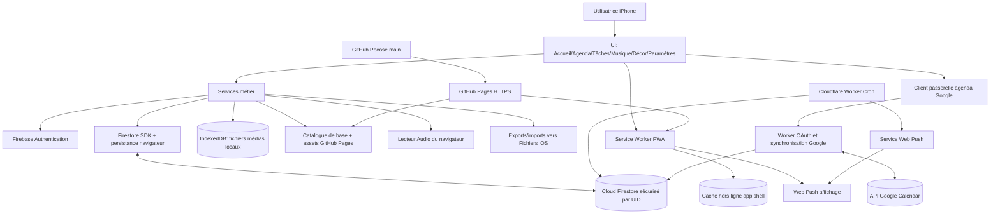

# ARCHITECTURE.md — Registre contractuel intégral

> **Projet :** `Pecose/organiseur-personnel` · **Date de référence :** 2026-11-01  
> **Statut : ARCHITECTURE CIBLE (PLANIFIÉE)**. Le dépôt ne contient actuellement que la documentation. **Aucun chemin, module, type ou fonction ci-dessous ne doit être présenté comme déjà implémenté.**  
> **Document de gouvernance :** [../AGENTS.md](../AGENTS.md) · **Périmètre fonctionnel :** [../ROADMAP.md](../ROADMAP.md).

## 0. Règle de changement obligatoire (BLOCAGE)

**Avant toute modification**, l'agent lit `AGENTS.md`, le présent fichier entier, puis `ROADMAP.md`. Il établit une correspondance entre son changement et les **identifiants enregistrés ici** (fichiers, modules, objets, fonctions, connexions, schémas, dépendances).  

- **Correspondance complète :** travail autorisé *dans le périmètre existant*, avec tests et mise à jour documentaire en cas de modification d'un contrat.
- **Objet, fonction, fichier, connexion, table, champ structurant, API, service, dépendance ou comportement absent, incompatible ou ambigu : STOP**. **Ne rien créer, modifier ou supprimer en anticipation.** Présenter une demande à l'utilisateur, puis **attendre une réponse explicite**.
- Après accord explicite : **modifier et versionner d'abord ce document**, avec identifiants et contrats, puis seulement créer ou modifier le code correspondant. Sans réponse, laisser le dépôt inchangé sur ce périmètre.
- Ne jamais interpréter le silence comme un accord ; pas de solution « temporaire » contournant l'approbation ; pas d'infrastructure payante ou hors `Pecose`.
- Un simple renommage, déplacement, suppression, changement de signature, nouvelle bibliothèque, nouvelle dépendance ou nouvelle interaction compte aussi comme **changement d'architecture** : même procédure.
- Les changements d'implémentation *internes* qui respectent **strictement** les signatures et relations enregistrées sont possibles, sous réserve des tests.

**Demande d'approbation type :**

> **ARRÊT — Architecture non couverte**  
> Besoin : … · Élément absent / incompatible : … · Type : module / objet / fonction / donnée / connexion / dépendance / autre.  
> Proposition : identifiant, chemin, interface (entrées → sorties), appelants, dépendances, effets de bord, tests et impacts sur sécurité/coût/synchronisation.  
> **Autorises-tu l'ajout ou la modification de cet élément dans `docs/ARCHITECTURE.md` avant son implémentation ?** [Oui / Non / À préciser]

## 1. Frontières, décisions prises, états

| Réf. | Contrat immuable sans nouvelle approbation |
|---|---|
| D01 | Application personnelle **PWA iOS via Safari**, installable depuis GitHub Pages, **pas d'IPA/App Store/Mac** |
| D02 | GitHub **`Pecose/organiseur-personnel`**, branche `main`, jamais `T-C-Umbral` |
| D03 | **0 €** : GitHub Pages, Firebase **Spark**, et plus tard Cloudflare Workers en offre gratuite ; pas de facturation activée |
| D04 | Agenda de l'application + **synchronisation bidirectionnelle facultative avec le Google Agenda principal choisi par l'utilisatrice**, après consentement ; pas de synchronisation Apple Calendar ; tâches ; musique Suno ; images ; thèmes |
| D05 | Agenda, tâches et métadonnées légères synchronisés par **Firebase Auth + Firestore** ; fichiers personnels **locaux** |
| D06 | Utilisable hors ligne **après première installation/cache**, sans PC allumé |
| D07 | Rappels **Web Push** avec programmation distante à prototyper ; **pas de réveil natif garanti hors ligne** |
| D08 | Réinstallation sur nouvel iPhone : connexion et restauration des données Firestore ; **réimport** des médias personnels |
| D09 | Ressources de base versionnées, sans écrasement des ressources importées ; aucun secret ni donnée privée dans le dépôt public |
| D10 | Framework UI **non fixé**. Contrats TypeScript logiques ci-dessous ; choisir une dépendance/framework supplémentaire requiert accord préalable |
| D11 | Google Agenda **dans les deux sens**, créations/modifications/suppressions et récurrences ; connexion OAuth Google **distincte** de Firebase Auth ; aucune synchronisation destructive lors de l'association initiale |
| D12 | Synchronisation Google **à l'ouverture et pendant l'utilisation** d'abord ; **à distance lorsque la PWA est fermée** seulement après mise en service d'un Worker/ordonnanceur gratuit, avec accès OAuth sécurisé. Ce n'est pas une synchronisation instantanée garantie |
| D13 | Pour Google Calendar, **moindre privilège, quotas gratuits, consentement et protection des jetons** ; si une exigence impose un paiement, une vérification payante ou un niveau de risque non accepté, STOP et décision de l'utilisateur |
| D14 | Cinq onglets **fixes et dans cet ordre** : **Calendrier · Tâches · Jour (central) · Habitudes · Listes**. Ouverture sur Jour à la date d'aujourd'hui. Musique, décoration et paramètres restent accessibles en navigation secondaire |
| D15 | Un **objet métier unique `Activity`** : tâche = sans horaire ni récurrence (date facultative) ; habitude = récurrence (avec ou sans heure) ; événement = horaire défini (avec ou sans récurrence). Un même objet peut apparaître dans plusieurs vues, **sans duplication** |
| D16 | Jour affiche uniquement les éléments prévus pour la date choisie : **sans horaire d'abord**, puis **avec horaire triés chronologiquement**. Aucun séparateur Habitudes/Tâches/Événements ni bloc « À planifier ». Les tâches sans date demeurent dans l'onglet Tâches |
| D17 | Chaque ligne : **icône personnalisable à gauche, ouvrant la fiche complète** ; **validation à droite**. Ajouter une heure propose une validation automatique préactivée, désactivable et réversible ; fin si prévue, sinon heure de début. Une validation automatique reste une **présomption** |
| D18 | À l'entrée sur Aujourd'hui, une **seule fenêtre groupée** peut proposer le report des **tâches de la veille sans horaire, non récurrentes et inachevées** : déplacer à aujourd'hui, conserver à hier ou redemander plus tard. Pas de report automatique ni de doublon |
| D19 | Importance facultative **1 à 3 étoiles** ; bilan mensuel des réalisations triées 3→2→1 puis chronologiquement, filtre par nombre d'étoiles, distinction entre réalisations confirmées et présumées |
| D20 | **Listes libres** indépendantes (courses, bagages…), associables à une activité via un ID stable ; cocher les articles ne termine pas automatiquement l'activité |
| D21 | Calendrier **semaine** : six cases lundi–samedi et dimanche accessible par **dépliage visible** ; noms si la place le permet, sinon compteurs. Toucher un jour affiche cette date sur Jour ; bouton « Aujourd'hui » pour revenir |
| D22 | Interface minimaliste : formes très arrondies, couleurs apaisantes, lecture claire ; gestes facultatifs et explicites, **aucun geste à deux doigts obligatoire** |

**États :** `PLANNED` = spécifié mais absent du dépôt ; `IMPLEMENTED` = présent et conforme (et testé s'il s'agit de code) ; `DEPRECATED` = suppression autorisée et historisée. **F00–F02 et F04–F05 existent déjà (documentation)** ; **F03 est retiré** ; **F06–F56 et les fonctions M01–M160 restent `PLANNED`, sauf les anciennes signatures M30–M44/M91/M101–M102 qui sont `SUPERSEDED` et ne doivent pas être implémentées** à la date ci-dessus. Passer de `PLANNED` à `IMPLEMENTED` ne nécessite pas un nouvel accord si le contrat reste identique.

**Source de vérité :** `AGENTS.md` pour le processus, **ce fichier** pour les contrats d'architecture, `ROADMAP.md` pour l'ordre des livraisons. En cas de conflit : STOP et demande utilisateur.

## 2. Arborescence cible exhaustive (registre des artefacts)

Les chemins sont **proposés/planifiés**, non présumés existants. Les répertoires ne contiennent que les fichiers inscrits ci-dessous ; tout autre fichier source non généré nécessite un accord. Les fichiers générés `dist/**`, caches et artefacts de compilation ne sont **pas** des objets architecturaux.

```text
/                                         # dépôt Pecose/organiseur-personnel
├── README.md                              [F00] présentation
├── ROADMAP.md                             [F01] calendrier de réalisation (existe)
├── AGENTS.md                              [F02] consignes IA canoniques
├── .github/copilot-instructions.md        [F04] pointeur pour Copilot
├── docs/ARCHITECTURE.md                   [F05] présent registre
├── package.json                           [F06] scripts et dépendances (choix à valider)
├── tsconfig.json                          [F07] configuration TypeScript
├── index.html                             [F08] point d'entrée web
├── manifest.webmanifest                   [F09] manifeste PWA
├── public/icons/                          [F10] icônes installables, fichiers à cataloguer
├── public/catalog/catalog.json            [F11] registre médias par défaut
├── public/catalog/audio/                  [F12] 2–3 musiques de départ autorisées
├── public/catalog/images/                 [F13] 2–3 images de départ autorisées
├── src/main.ts                            [F14] bootstrap
├── src/app/router.ts                      [F15] routes et navigation
├── src/app/state.ts                       [F16] état transversal
├── src/domain/types.ts                    [F17] types contractuels
├── src/domain/dates.ts                    [F18] calendriers/fuseaux/récurrences
├── src/ui/screens.ts                      [F19] Jour/Calendrier/Tâches/Habitudes/Listes + écrans secondaires
├── src/ui/components.ts                   [F20] composants UI communs
├── src/features/agenda.ts                 [F21] calendrier semaine et adaptation Google
├── src/features/tasks.ts                  [F22] filtre Tâches sur activités unifiées
├── src/features/reminders.ts              [F23] logique rappels
├── src/features/music.ts                  [F24] catalogue musical et playlists
├── src/features/player.ts                 [F25] lecteur audio
├── src/features/decor.ts                  [F26] fonds, saisons et galerie
├── src/services/firebase.ts               [F27] initialisation Firebase client
├── src/services/auth.ts                   [F28] session Auth
├── src/services/cloudRepository.ts        [F29] accès Firestore par UID
├── src/services/sync.ts                   [F30] états de synchronisation
├── src/storage/mediaDb.ts                 [F31] IndexedDB pour médias personnels
├── src/storage/catalog.ts                 [F32] contenus fournis par défaut
├── src/services/push.ts                   [F33] inscription Push côté PWA
├── src/services/backup.ts                 [F34] exports/imports et validation
├── src/pwa/service-worker.ts              [F35] cache offline, push, mise à jour
├── src/pwa/update.ts                      [F36] vérification des versions
├── workers/reminders/src/index.ts         [F37] tâche Cloudflare Cron + Web Push (phase 4)
├── workers/reminders/wrangler.toml         [F38] déploiement Worker (sans secrets)
├── firestore.rules                        [F39] règles de confidentialité par UID
├── tests/domain.test.ts                   [F40] dates, récurrences, tâches
├── tests/storage.test.ts                  [F41] IndexedDB, import/export
├── tests/security.test.ts                 [F42] sécurité/règles Firestore
├── tests/offline.test.ts                  [F43] synchronisation et PWA
├── tests/reminders.test.ts                [F44] rappels, double-envoi, DST
├── src/features/googleCalendar.ts         [F45] façade métier, liaison/conciliation agenda Google
├── src/services/googleCalendarBridge.ts   [F46] appels HTTP sécurisés de la PWA vers le Worker
├── tests/googleCalendar.test.ts           [F47] OAuth, CRUD, conflits, synchronisation Google
├── src/features/activities.ts             [F48] entité unique, horaires, étoiles, statuts
├── src/features/habits.ts                 [F49] récurrences et occurrences
├── src/features/checklists.ts            [F50] listes indépendantes et leurs articles
├── src/features/day.ts                   [F51] date choisie, deux groupes, report
├── src/features/monthlyReview.ts          [F52] bilan mensuel des accomplissements
├── src/ui/dayComponents.ts                [F53] icône gauche, validation droite, édition
├── tests/activities.test.ts               [F54] activités, complétions, report, récurrences
├── tests/navigation.test.ts               [F55] onglets, semaine 6+1, date sélectionnée
└── tests/monthlyReview.test.ts            [F56] étoiles, filtres et états présumés
```

**F03 était l'alias `agent.md`, supprimé par demande explicite de l'utilisateur (2026-11-01) ; son identifiant reste réservé pour traçabilité et ne doit pas être réutilisé.**

**Règle :** les fichiers `F06`–`F56` sont des contrats de destination, **pas** un engagement sur une bibliothèque non choisie. Un renommage vers une structure imposée par un bundler/framework exige une demande d'approbation préalable. Les tests peuvent utiliser des fichiers temporaires générés uniquement hors du dépôt versionné.

## 3. Modèle de domaine : objets, champs, relations et propriétaires

Types conceptuels de `F17`. Les ID sont stables et générés côté client, p. ex. UUID ; dates d'instants en UTC et fuseau IANA explicite. Champs optionnels `?`. Seul l'UID d'authentification est utilisé comme autorité dans les chemins cloud.

| Objet | ID | Champs fonctionnels (contrat) | Relations et lieu |
|---|---|---|---|
| `AuthUser` | O01 | `uid:string; email:string|null` | Firebase Auth ; 1 utilisateur logique |
| `CalendarEvent` | O02 | **SUPERSEDED (jamais implémenté)** : projection externe Google Calendar, remplacée par O31 | Ne pas créer de source métier `events` parallèle |
| `TaskList` | O03 | **SUPERSEDED (jamais implémenté)** : listes libres O34 | Identifiant historique réservé |
| `Task` | O04 | **SUPERSEDED (jamais implémenté)** : activité unifiée O31 | Identifiant historique réservé |
| `RecurrenceRule` | O05 | `frequency:daily|weekly|monthly|yearly; interval; until?; count?; weekdays?` | incluse dans O02/O04 ; calendrier local et rappels |
| `Reminder` | O06 | `id; activityId; occurrenceKey; scheduledFor; leadMinutes; timeZone; enabled; dispatchStatus` | `uid → reminders/{id}` ; O31/O32 ; Worker |
| `ProfilePreferences` | O07 | `themeId; backgroundImageId?; autoSeason; locale; timeZone; notificationEnabled; updatedAt` | `uid → preferences/profile` |
| `TrackMetadata` | O08 | `id; title; artist?; album?; source:bundled|imported; catalogId?; mediaId?; artworkId?; duration?; favorite; updatedAt` | Cloud léger pour métadonnées ; binaire O10 en local |
| `Playlist` | O09 | `id; name; trackIds[]; updatedAt` | `uid → playlists/{id}`; référence O08 |
| `LocalMediaBlob` | O10 | `id; kind:audio|image; blob; mimeType; byteSize; checksum; importedAt` | **IndexedDB seulement**, jamais Firestore |
| `ImageMetadata` | O11 | `id; name; source:bundled|imported; catalogId?; mediaId?; tags[]; updatedAt` | local ; configuration sélectionnée dans O07 |
| `ThemeDefinition` | O12 | `id; name; season?; colors; backgroundImageId?` | catalogue intégré + préférences |
| `CatalogEntry` | O13 | `id; revision; kind:audio|image; url; title; checksum; redistributionAllowed` | `public/catalog/catalog.json`, médias inclus |
| `PushSubscriptionRecord` | O14 | `id; endpoint; p256dh; auth; deviceLabel?; expiresAt?; updatedAt` | données cloud protégées, O01 propriétaire ; endpoint sensible |
| `SyncStatus` | O15 | `state:local|pending|synced|error; pendingCount; lastServerAckAt?; message?` | état runtime, jamais preuve de synchro avant ACK serveur |
| `BackupEnvelope` | O16 | `schemaVersion; exportedAt; dataType; ownerUid?; records; checksums?` | export/import JSON et archive média, validation stricte |
| `AppVersion` | O17 | `version; cacheRevision; catalogRevision; releasedAt` | embarquée dans app + manifeste/catalogue |
| `PlaybackState` | O18 | `trackId?; queueIds[]; position; paused; repeatMode; shuffle` | runtime et éventuel stockage local, pas de lecture distante |
| `DispatchReceipt` | O19 | `reminderId; occurrenceKey; attemptedAt; outcome; retryAfter?` | anti-doublon pour Worker, accès serveur sécurisé |
| `UiRoute` | O20 | `name:calendar|tasks|day|habits|lists|music|decor|settings|signin|monthlyReview; params?` | Les cinq premières routes correspondent aux onglets D14 ; les autres sont secondaires |
| `MediaArchiveManifest` | O21 | `schemaVersion; createdAt; mediaEntries[]; metadata; checksums` | export/import des fichiers personnels |
| `NotificationTestResult` | O22 | `supported; permitted; subscribed; sent?; message?` | retour état des diagnostics, pas garantie de livraison |

### Modèle unifié (D14–D22, approuvé, non implémenté)

**Priorité contractuelle :** O31–O38 remplacent les anciens O02/O03/O04 jamais implémentés. Une tâche qui reçoit un horaire ou une répétition **conserve son ID**.

| Objet | ID | Champs essentiels | Dépendances et stockage |
|---|---|---|---|
| `Activity` | O31 | `id; uid; title; description?; iconId?; imageId?; stars?:1|2|3; plannedOn?:LocalDate; startAt?:ISOInstant; endAt?:ISOInstant; timeZone; recurrence?:RecurrenceRule; autoComplete:boolean; checklistId?; includeInMonthlyReview:boolean; deletedAt?; updatedAt; googleLink?:GoogleEventLink` | **Source canonique** : `users/{uid}/activities/{id}`. Horaire et répétition indépendants. |
| `ActivityOccurrence` | O32 | `activityId; occurrenceKey; localDate; startsAt?; endsAt?; recurring:boolean` | Vue **calculée** d'O31/O05 sur une plage bornée ; clés stables pour les récurrences |
| `ActivityCompletion` | O33 | `id; activityId; occurrenceKey; status:pending|manual_done|auto_assumed|manually_undone; completedAt?; overriddenAt?; updatedAt` | `users/{uid}/activityCompletions/{id}` ; état **par occurrence**, l'annulation manuelle interdit la recochage automatique |
| `Checklist` | O34 | `id; name; iconId?; archived?; updatedAt` | `users/{uid}/checklists/{id}` ; liste autonome et réutilisable |
| `ChecklistItem` | O35 | `id; checklistId; text; checked; position; updatedAt` | `users/{uid}/checklists/{checklistId}/items/{id}` ; validation indépendante d'O31 |
| `CarryOverDecision` | O36 | `id; activityId; fromDate; toDate; decision:move|keep|later; promptedAt; decidedAt?; updatedAt` | `users/{uid}/carryOverDecisions/{id}` ; action consentie, journal anti-doublon |
| `DaySelection` | O37 | `selectedDate:LocalDate; today:LocalDate; source:startup|calendar|navigation` | État UI F16 uniquement ; par défaut date réelle aujourd'hui |
| `MonthlyReview` | O38 | `month:YYYY-MM; starFilter?:1|2|3; entries:MonthlyAchievement[]; assumedCount` | Vue calculée O31/O32/O33 ; classement par étoiles et date, présumés distingués |

**Vues, sans duplication :** « Tâches » = sans heure ni récurrence, avec ou sans date ; « Habitudes » = récurrence, horaire facultatif ; « Événements » = heure définie, avec ou sans récurrence, visibles dans Calendrier (il n'existe **pas** d'onglet Événements). « Jour » = occurrences prévues à la date sélectionnée, sans heure d'abord puis horaires croissants. « Listes » = O34/O35. Les tâches sans aucune date ne polluent pas Jour.

**Temps :** `LocalDate` = date civile `YYYY-MM-DD` dans le fuseau IANA choisi ; `ISOInstant` = instant UTC. Une date seule n'est **pas** une heure à minuit. Pour une récurrence hebdomadaire à 19 h, l'heure locale est conservée à travers les changements d'heure, sans copier la tâche chaque semaine.

**Validation :** au choix d'une heure, l'UI propose `autoComplete=true` par défaut, que l'utilisatrice peut décocher ; échéance = `endAt` si présente, sinon `startAt`. Une échéance dépassée vaut `auto_assumed`, pas preuve d'exécution réelle ; bouton de droite permet la confirmation ou l'annulation. Une annulation `manually_undone` reste effective même après rafraîchissement. Sans heure : coche manuelle.

**Report :** uniquement les activités datées de **la veille**, **sans heure**, **sans récurrence** et non terminées. À l'ouverture d'Aujourd'hui, proposer une **fenêtre commune** avec décision pour chaque élément : aujourd'hui, rester hier, plus tard. Jamais de report sans accord ; même identifiant, pas de double proposition au prochain rafraîchissement. « Plus tard » peut être reproposé ultérieurement avec modération.

**Listes et étoiles :** la fiche d'une activité ouverte en touchant son **icône gauche** permet titre, description, icône/image, date, heure, répétition, notification, validation auto, étoiles 1–3, lien à une liste O34. Cocher ses articles n'achève pas l'activité. Le bilan du mois trie d'abord 3 étoiles, puis 2, puis 1 ; à importance égale, date chronologique. Filtre 1/2/3 étoiles ; les validations présumées sont étiquetées.

**Calendrier :** six carrés visibles lundi–samedi ; dimanche dépliable (poignée ou bouton visible, pas de geste caché). Cases montrant des événements et habitudes, ou leurs compteurs si peu de place. Toucher une date ouvre Jour sur celle-ci ; retour Aujourd'hui par bouton explicite.

**Google Agenda :** conversion des événements horaires O31 ↔ API Google via O24 ; aucune exportation automatique des tâches sans heure ni des habitudes locales non explicitement reliées. Les exceptions des séries importées doivent conserver l'identité de l'occurrence. Ne pas créer de collection distincte d'événements.

### Extension Google Agenda approuvée (toujours PLANIFIÉE)

| Objet | ID | Champs fonctionnels (contrat) | Relations et lieu |
|---|---|---|---|
| `GoogleCalendarConnection` | O23 | `uid; calendarId:'primary'; googleAccountLabel?; status:disconnected|authorizing|active|reauthorization_required|error; lastSyncAt?; lastError?` | statut non secret visible au propriétaire ; lié à O01, O25 |
| `GoogleEventLink` | O24 | `calendarId; googleEventId; etag?; remoteUpdatedAt?; pending: none|upsert|delete; source:app|google` | sous-objet d'O02 ; identité stable pour éviter doublons |
| `GoogleSyncCursor` | O25 | `uid; calendarId; nextSyncToken?; lastFullSyncAt?; lastIncrementalSyncAt?` | Firestore **serveur uniquement** ; reprise API incrémentale |
| `CalendarSyncConflict` | O26 | `id; uid; localEventId; googleEventId?; kind:update|delete|recurrence|mapping; localVersion; googleVersion; detectedAt; status:open|resolved` | document privé ; résolution explicite obligatoire |
| `EncryptedGoogleOAuthGrant` | O27 | `uid; calendarId; ciphertext; keyVersion; scopes[]; issuedAt; revokedAt?` | Firestore **serveur uniquement**, jeton de renouvellement chiffré avec clé Worker secret ; jamais accessible à la PWA |
| `GoogleOAuthState` | O28 | `stateId; uid; nonce; redirectPath; expiresAt; consumedAt?` | Firestore **serveur uniquement**, usage unique et durée courte |
| `GoogleCalendarChange` | O29 | `calendarId; eventId; etag?; status:confirmed|cancelled; updatedAt; start?; end?; recurrence?; payload` | représentation transitoire provenant de l'API Google, non publiée telle quelle |
| `CalendarSyncRun` | O30 | `uid; calendarId; startedAt; finishedAt?; pulled; pushed; conflicts; status:ok|partial|error; details?` | rapport technique minimisé, pas de données personnelles en journaux publics |

**Décisions de synchronisation :** l'utilisatrice autorise explicitement la liaison à **son Google Agenda principal**. `GoogleEventLink` assure un appariement stable, `deletedAt` évite de perdre une suppression locale avant qu'elle ne soit propagée (tombstone). Aucun événement Google existant n'est supprimé lors de l'association initiale. Les événements avec récurrences/exceptions doivent être testés avant l'activation bidirectionnelle. Les modifications concurrentes se matérialisent en O26 et **ne sont pas écrasées silencieusement**. Google Agenda n'est pas un stockage pour les tâches, images ou musiques.

**Schémas Firestore planifiés (pas encore créés) :**
```text
users/{uid}/activities/{activityId}           → O31, source métier unique
users/{uid}/activityCompletions/{id}         → O33, complétion par occurrence
users/{uid}/checklists/{checklistId}         → O34, listes libres
users/{uid}/checklists/{checklistId}/items/{id} → O35, lignes cochables
users/{uid}/carryOverDecisions/{id}          → O36, traçabilité des reports
# Anciennes collections events/tasks/lists : SUPERSEDED, ne pas créer
users/{uid}/reminders/{reminderId}           → O06
users/{uid}/playlists/{playlistId}           → O09
users/{uid}/tracks/{trackId}                 → O08 métadonnées seulement
users/{uid}/preferences/profile             → O07
users/{uid}/pushSubscriptions/{deviceId}    → O14, contrôle d'accès renforcé
users/{uid}/dispatchReceipts/{receiptId}    → O19, écriture serveur uniquement
users/{uid}/googleCalendarConnection/status → O23, lecture du propriétaire, écriture serveur
users/{uid}/googleCalendarSync/state        → O25, lecture/écriture serveur uniquement
users/{uid}/googleOAuthGrant/primary         → O27, **aucune** lecture/écriture client
users/{uid}/googleCalendarConflicts/{id}     → O26, lecture propriétaire, résolution via Worker
serverOAuthStates/{stateId}                  → O28, lecture/écriture serveur uniquement, TTL court
```
Les écritures clients sont autorisées *uniquement* dans leur `users/{auth.uid}` et pour les collections explicitement permises, sauf `dispatchReceipts` et tous les documents Google marqués **serveur** (Worker). La simple présence sous `users/{uid}` ne doit **jamais** donner un accès client global. Les règles F39 doivent interdire la lecture des jetons chiffrés et des états OAuth, même au propriétaire authentifié. Les règles de lecture/écriture spécifiques doivent être testées avant tout déploiement. Les collections additionnelles nécessitent autorisation utilisateur.

**Stores IndexedDB planifiés :**
`mediaBlobs` (O10) ; `imageMetadata` (O11) ; `playbackState` (O18) ; `localMeta` (version schéma, catalogue installé et journaux de migration). Les données métier cloud sont mises en cache par **la persistance Firestore du SDK**, pas dans une seconde copie IndexedDB écrite en concurrence. Une modification non authentifiée ou sans cache initialisé exige un état d'erreur explicite, pas une promesse de synchronisation invisible.

### Contraintes de cohérence

- `id` et `updatedAt` obligatoires ; suppression explicite propagée ; conflits multi-appareils **à tester et documenter**, ne pas supposer une fusion parfaite.
- `RecurrenceRule` est une règle, pas une duplication infinie d'événements ; `occurrenceKey` stable pour éviter les rappels doublons.
- Références audio/playlist vers médias absents : préserver la playlist et afficher « fichier à réimporter ».
- Les fichiers de départ sont référencés par O13, les imports par O10 ; mise à jour du catalogue n'efface pas O10.
- Cloud = données personnelles et métadonnées légères ; **aucun fichier MP3/image personnelle** dans Firestore.
- Format de `BackupEnvelope` et migrations doivent être versionnés ; ne jamais écraser sans validation et confirmation de restauration.

## 4. Registre complet des fonctions publiques planifiées

Contrat commun : fonctions TypeScript typées ; `Result<T, AppError>` désigne réussite ou erreur explicite et non exception silencieuse. Les sorties `void` sont indiquées. **Chaque fonction nommée nouvelle, y compris utilitaire ou méthode de classe non listée, requiert approbation préalable**. Les callbacks imposés par les APIs de navigateur peuvent rester anonymes et locaux s'ils n'ajoutent aucune responsabilité architecturale.

### 4.1 Démarrage, navigation, composants (F14–F20)

| ID | Fonction (entrées → sortie) | Dépendances et effet |
|---|---|---|
| M01 | `bootstrapApp(): Promise<Result<void>>` | M16, M20, M25, M79, M03, M04 ; initialise Firebase, session, persistance, PWA et route |
| M02 | `navigate(route:UiRoute): void` | O20, M03, M04 ; change route |
| M03 | `resolveRoute(path:string): UiRoute` | O20 ; pure |
| M04 | `renderRoute(route:UiRoute): void` | M05–M11 et M149–M152 ; cinq onglets et écrans secondaires O20 |
| M05 | `renderHome(): void` | Page **Jour** centrale, M129/M131/O37, pas une page d'accueil supplémentaire |
| M06 | `renderAgenda(): void` | Calendrier hebdomadaire M127/M150, dimanche dépliable |
| M07 | `renderTasks(): void` | Filtre Tâches sur O31, M125 |
| M08 | `renderMusic(): void` | M50–M63/M92–M94/M99 ; écran **secondaire** hors cinq onglets |
| M09 | `renderDecor(): void` | M64–M69/M95–M98 ; écran **secondaire** hors cinq onglets |
| M10 | `renderSettings(): void` | M17–M20, M26–M27, M70–M78 ; compte/sauvegarde |
| M11 | `renderSignIn(): void` | M17, M19, M20, M90 ; connexion/inscription/récupération |
| M12 | `renderCommonStatus(status:SyncStatus): void` | O15 ; bannière d'état |
| M13 | `setAppState(patch:Partial<AppState>): void` | F16 ; mutation état UI |
| M14 | `getAppState(): Readonly<AppState>` | F16 ; lecture état UI |
| M15 | `watchAppState(listener:(s:AppState)=>void): Unsubscribe` | F16 ; publication d'état |

`AppState` = agrégat strictement UI : route O20, date sélectionnée O37, utilisateur O01 ou null, sync O15, version O17 et paramètres O07. `Unsubscribe=()=>void`; `AppError` et `Result` sont définis dans F17. Les adaptateurs de composants doivent respecter les mêmes contrats quel que soit le framework UI finalement validé.

### 4.2 Authentification, Firestore, synchronisation (F27–F30, F39)

| ID | Fonction (entrées → sortie) | Dépendances et effet |
|---|---|---|
| M16 | `initFirebase(config:PublicFirebaseConfig): Result<FirebaseClients>` | SDK Firebase, configuration publique ; 1 seule instance |
| M17 | `signIn(email:string,password:string): Promise<Result<AuthUser>>` | Firebase Auth ; session |
| M18 | `signOut(): Promise<Result<void>>` | Firebase Auth ; purge état privé visible |
| M19 | `sendPasswordReset(email:string): Promise<Result<void>>` | Firebase Auth ; e-mail récupération |
| M20 | `observeAuth(cb:(u:AuthUser|null)=>void): Unsubscribe` | Firebase Auth ; session courante |
| M21 | `getUserCollection(uid:string,kind:CloudCollection): CollectionRef` | SDK Firestore, règles O01 ; chemins autorisés seulement |
| M22 | `putCloudRecord<T>(uid:string,kind:CloudCollection,id:string,data:T): Promise<Result<void>>` | M21 ; écritures locales/puis serveur SDK |
| M23 | `removeCloudRecord(uid:string,kind:CloudCollection,id:string): Promise<Result<void>>` | M21 ; suppression synchronisée |
| M24 | `subscribeCloudRecords<T>(uid:string,kind:CloudCollection,cb:(records:T[],metadata:SnapshotMeta)=>void): Unsubscribe` | M21 ; cache et snapshots serveur |
| M25 | `configurePersistence(): Promise<Result<void>>` | Firestore SDK navigateur ; mode hors ligne |
| M26 | `deriveSyncStatus(meta:SnapshotMeta,connectivity:Connectivity): SyncStatus` | O15 ; ne pas annoncer synced sans confirmation |
| M27 | `observeSyncStatus(cb:(s:SyncStatus)=>void): Unsubscribe` | M24, M26 ; mise à jour UI |

`CloudCollection` = `activities|activityCompletions|checklists|checklistItems|carryOverDecisions|reminders|playlists|tracks|preferences|pushSubscriptions|dispatchReceipts` (anciennes collections `events|tasks|lists` non utilisées). `dispatchReceipts` est réservé aux opérations serveur : M22/M23 **ne doivent pas** l'autoriser côté client. `FirebaseClients`, `PublicFirebaseConfig`, `SnapshotMeta`, `Connectivity`, `AppState` sont des types techniques de F17. **Aucune clé privée dans le navigateur ni dans le dépôt.**

### 4.3 Agenda, tâches, récurrences, rappels (F18, F21–F23)

| ID | Fonction (entrées → sortie) | Dépendances et effet |
|---|---|---|
| M28 | `normalizeInstant(localDate:string,timeZone:string): Result<string>` | Date/zone IANA ; sortie UTC ISO |
| M29 | `expandOccurrences(rule:RecurrenceRule,base:string,range:DateRange): Occurrence[]` | O05 ; expansion bornée |
| M30 | `getAgenda(range:DateRange): Promise<Result<CalendarEvent[]>>` | M89/M29 ; événements de la plage |
| M31 | `saveEvent(input:CalendarEvent): Promise<Result<CalendarEvent>>` | M101, M22, M28 ; valide puis crée/modifie O02 |
| M32 | `deleteEvent(eventId:string): Promise<Result<void>>` | M23, M42 ; liens rappels gérés |
| M33 | `getTodayOverview(date:string): Promise<Result<TodayOverview>>` | M30, M36, M40 ; accueil |
| M34 | `listTaskLists(): Promise<Result<TaskList[]>>` | M89 ; O03 |
| M35 | `saveTaskList(input:TaskList): Promise<Result<TaskList>>` | M22 ; O03 |
| M36 | `queryTasks(filter:TaskFilter): Promise<Result<Task[]>>` | M89 ; O04, filtres |
| M37 | `saveTask(input:Task): Promise<Result<Task>>` | M102, M22 ; valide puis crée/modifie O04 |
| M38 | `setTaskCompleted(taskId:string,completed:boolean): Promise<Result<void>>` | M22 ; O04 |
| M39 | `deleteTask(taskId:string): Promise<Result<void>>` | M23, M42 ; rappels associés |
| M40 | `getUpcomingTasks(until:string): Promise<Result<Task[]>>` | M36 ; résumé |
| M41 | `getDueReminders(now:string): Promise<Result<Reminder[]>>` | M89/M29 ; rappel local visible |
| M42 | `reconcileReminders(ownerType:'event'|'task',ownerId:string): Promise<Result<void>>` | M22/M23, O06 ; cohérence de liens |
| M43 | `saveReminder(input:Reminder): Promise<Result<Reminder>>` | M22 ; planification O06 |
| M44 | `disableReminder(reminderId:string): Promise<Result<void>>` | M22 ; désactive |
| M45 | `formatZonedTime(instant:string,timeZone:string): string` | zone locale ; pure |

`DateRange={from:string,to:string}`, `Occurrence={key:string,startsAt:string}`, `TaskFilter` et `TodayOverview` sont types de F17. Les calculs récurrents doivent traiter changements d'heure, fin de mois et limites de plage ; **pas d'envoi push depuis un minuteur navigateur**.

### 4.4 Médias, playlist, lecteur, décoration (F24–F26, F31–F32)

| ID | Fonction (entrées → sortie) | Dépendances et effet |
|---|---|---|
| M46 | `openMediaDb(): Promise<Result<MediaDb>>` | IndexedDB ; création/migration des stores |
| M47 | `storeMedia(file:File,kind:'audio'|'image'): Promise<Result<LocalMediaBlob>>` | M46 ; valide MIME/taille, calcule checksum |
| M48 | `readMedia(mediaId:string): Promise<Result<Blob>>` | M46 ; retourne binaire local |
| M49 | `removeMedia(mediaId:string): Promise<Result<void>>` | M46 ; supprime binaire après contrôle références |
| M50 | `loadBundledCatalog(): Promise<Result<CatalogEntry[]>>` | F11 ; manifeste versionné sans contenus privés |
| M51 | `resolveCatalogAsset(catalogId:string): Result<string>` | M50 ; URL média préchargé ou chargeable |
| M52 | `importAudio(file:File,metadata:Partial<TrackMetadata>): Promise<Result<TrackMetadata>>` | M47, M54 ; crée O08 |
| M53 | `listTracks(query?:string): Promise<Result<TrackMetadata[]>>` | M89/M46/M50 ; catalogue et titres |
| M54 | `saveTrackMetadata(track:TrackMetadata): Promise<Result<void>>` | M22 ; O08 léger uniquement |
| M55 | `savePlaylist(playlist:Playlist): Promise<Result<void>>` | M22 ; O09 |
| M56 | `listPlaylists(): Promise<Result<Playlist[]>>` | M89 ; O09 |
| M57 | `setTrackFavorite(trackId:string,favorite:boolean): Promise<Result<void>>` | M54 ; O08 |
| M58 | `playTrack(trackId:string): Promise<Result<void>>` | M48/M51/M53 ; élément audio navigateur |
| M59 | `pausePlayback(): void` | élément audio local ; O18 |
| M60 | `seekPlayback(seconds:number): Result<void>` | élément audio ; O18 |
| M61 | `nextTrack(): Promise<Result<void>>` | O18/M58 ; file locale |
| M62 | `previousTrack(): Promise<Result<void>>` | O18/M58 ; file locale |
| M63 | `setPlaybackMode(mode:'normal'|'repeat'|'shuffle'): void` | O18 ; état runtime |
| M64 | `importImage(file:File): Promise<Result<ImageMetadata>>` | M47 ; optimiser image puis stocker |
| M65 | `listImages(): Promise<Result<ImageMetadata[]>>` | M46/M50 ; galerie |
| M66 | `selectTheme(themeId:string): Promise<Result<void>>` | O07/O12, M22 ; préférence |
| M67 | `resolveSeason(date:string,timeZone:string): Season` | F18 ; pure |
| M68 | `getActiveTheme(date:string,preferences:ProfilePreferences): ThemeDefinition` | O07/O12, M67 |
| M69 | `removeImportedImage(imageId:string): Promise<Result<void>>` | M49, O11 ; jamais supprimer catalogues |

`MediaDb` et `Season` sont des types F17. Les métadonnées cloud peuvent survivre à la perte des binaires locaux ; l'UI affiche les pistes manquantes. Lire l'audio avec écran verrouillé et passage de piste n'est **pas garanti** sur iOS PWA : test physique obligatoire. Une future fonction d'édition d'image non listée devra être proposée/validée avant création, même si la roadmap évoque l'amélioration.

### 4.5 Export, restauration, service worker, notifications (F33–F38)

| ID | Fonction (entrées → sortie) | Dépendances et effet |
|---|---|---|
| M70 | `exportDataJson(scope:BackupScope): Promise<Result<Blob>>` | M89 ; O16 ; export avec schéma et date |
| M71 | `validateBackup(file:File): Promise<Result<BackupEnvelope>>` | O16 ; validate schema, taille, intégrité |
| M72 | `restoreData(backup:BackupEnvelope,mode:'merge'|'replace'): Promise<Result<RestoreReport>>` | M22/M23 ; confirmation utilisateur avant écrasement |
| M73 | `exportMediaArchive(): Promise<Result<Blob>>` | M46/M48 ; O21 + fichiers personnels |
| M74 | `importMediaArchive(file:File): Promise<Result<RestoreReport>>` | M46/M47, O21 ; validation/dédoublonnage |
| M75 | `requestPushPermission(): Promise<Result<PermissionState>>` | iOS PWA installée + geste utilisateur |
| M76 | `subscribeToPush(): Promise<Result<PushSubscriptionRecord>>` | M75, PushManager navigateur, M22 |
| M77 | `unsubscribeFromPush(): Promise<Result<void>>` | M23, PushManager ; retire abonnement |
| M78 | `testPushSubscription(): Promise<Result<NotificationTestResult>>` | O22, M76 ; **pas** de garantie de livraison |
| M79 | `registerServiceWorker(): Promise<Result<void>>` | F35 ; HTTPS/Pages |
| M80 | `cacheAppShell(revision:string): Promise<Result<void>>` | F35, O17 ; cache versionné |
| M81 | `handlePushMessage(payload:PushPayload): Promise<void>` | F35 ; affiche notification autorisée |
| M82 | `checkAppUpdate(): Promise<Result<AppVersion|null>>` | O17, Pages HTTPS ; détecte nouvelle version |
| M83 | `applyAppUpdate(): Promise<Result<void>>` | F35/F36 ; cache contrôlé, **jamais** IndexedDB utilisateur |
| M84 | `runReminderCron(now:string): Promise<Result<DispatchSummary>>` | Worker F37, M85–M88 ; déclenche périodiquement |
| M85 | `fetchDueReminders(now:string): Promise<Result<ReminderDispatchCandidate[]>>` | accès serveur Firestore ; aucune clé navigateur |
| M86 | `claimReminderOccurrence(candidate:ReminderDispatchCandidate): Promise<Result<boolean>>` | O19 ; réservation atomique anti-doublon |
| M87 | `sendWebPush(candidate:ReminderDispatchCandidate): Promise<Result<PushDeliveryResult>>` | subscriptions O14, VAPID secrets Cloudflare |
| M88 | `recordDispatchResult(candidate:ReminderDispatchCandidate,result:PushDeliveryResult): Promise<Result<void>>` | O19 ; succès/erreur et retry maîtrisé |

`BackupScope`, `RestoreReport`, `PermissionState`, `PushPayload`, `DispatchSummary`, `ReminderDispatchCandidate`, `PushDeliveryResult` sont des types techniques F17 ; leur structure concrète sera la plus petite permettant ces signatures, **sans ajouter de champ métier nouveau sans approbation**. Les archives multimédias doivent être exportables via le partage iOS/Fichiers ; aucune sauvegarde cloud automatique de ces fichiers n'est promise.

### 4.6 Portée des tests (F40–F44)

| ID | Fonctions ou scénarios contrôlés | Critère de réussite |
|---|---|---|
| T01 | M28/M29/M45, récurrences et fuseaux | changements heure, cas limites, occurrences stables |
| T02 | M31/M32/M37–M39 | CRUD, références rappels cohérentes |
| T03 | M46–M49/M64/M69 | imports, tailles, MIME, suppression, migrations |
| T04 | M70–M74 | exports versionnés, restauration sans perte ni écrasement surprise |
| T05 | M21–M27 et F39 | données non accessibles entre deux UID, statut sincère |
| T06 | M79–M83 | hors ligne, mise à jour sans perte de média |
| T07 | M75–M88 | consentement, doubles envois, erreurs, clés jamais exposées |
| T08 | M58–M63 | comportement iPhone réel, écran verrouillé, playlists |
| T09 | réinstallation | comptes, données rétablies, médias personnels signalés manquants |
| T10 | M103–M120, F47 | OAuth distinct Firebase, état unique, tokens hors navigateur, révocation, accès par UID |
| T11 | M109–M112, F47 | création/modification/suppression dans les deux sens, pas de doublons, conflits visibles |
| T12 | M109/M118, F47 | pagination, syncToken périmé 410, quotas 429, reprise sans perte locale |
| T13 | M114, F47 | synchro PWA fermée seulement après Cron, ordre et idempotence, zéro dépense |
| T14 | M111/M112, F47 | récurrences Google et exceptions, fuseaux, changement d'heure, annulations |

**Convention :** toute nouvelle fonction doit apparaître dans ce registre avant de passer dans le code ; tout nouvel écran doit être enregistré comme artefact et ses interactions ici. Il est interdit de cacher un appel réseau ou une nouvelle responsabilité dans un callback ou un « helper » anonyme pour éviter cette procédure.


### 4.7 Opérations complémentaires explicitement prévues (F17, F21–F26, F28–F29, F37)

Ces opérations complètent la couverture des écrans et des scénarios de la roadmap. Elles sont **PLANNED** comme les précédentes.

| ID | Fonction (entrées → sortie) | Dépendances et effet |
|---|---|---|
| M89 | `fetchCloudRecords<T>(uid:string,kind:CloudCollection): Promise<Result<T[]>>` | M21 ; lecture ponctuelle depuis cache/serveur conformément à la stratégie offline |
| M90 | `registerAccount(email:string,password:string): Promise<Result<AuthUser>>` | Firebase Auth ; création compte avec consentement |
| M91 | `deleteTaskList(listId:string,onTasks:'moveToInbox'|'delete'): Promise<Result<void>>` | M23, M22, M36 ; liste et tâches rattachées, confirmation préalable |
| M92 | `deletePlaylist(playlistId:string): Promise<Result<void>>` | M23 ; supprime la liste, pas les pistes |
| M93 | `removeTrack(trackId:string,deleteLocalFile:boolean): Promise<Result<void>>` | M23, M49, M55, M56 ; nettoie références playlists, protège média partagé |
| M94 | `reorderPlaylist(playlistId:string,trackIds:string[]): Promise<Result<void>>` | M55 ; valide pistes et ordre |
| M95 | `updateImageMetadata(image:ImageMetadata): Promise<Result<void>>` | M46 ; renomme/classe/tague O11 en local |
| M96 | `setBackground(imageId:string): Promise<Result<void>>` | M66, O07/O11/O12 ; fond personnel sélectionné |
| M97 | `cropImage(blob:Blob,rect:CropRect): Promise<Result<Blob>>` | API Canvas/Blob navigateur ; édition locale, contrôles limites |
| M98 | `composeDecorImage(layers:DecorLayer[]): Promise<Result<Blob>>` | M97, Canvas ; composition simple image/texte (phase ultérieure) |
| M99 | `setPlaybackQueue(trackIds:string[]): Result<void>` | O18, M53 ; file d'attente interne |
| M100 | `handlePushTestRequest(authToken:string,deviceId:string): Promise<Result<NotificationTestResult>>` | Worker F37 ; vérifie Firebase ID token et UID avant test push, aucune API publique non authentifiée |
| M101 | `validateEvent(input:unknown): Result<CalendarEvent>` | O02/O05, dates ; rejet des données invalides |
| M102 | `validateTask(input:unknown): Result<Task>` | O04/O05, dates/listes ; rejet des données invalides |

`CropRect` = coordonnées numériques bornées ; `DecorLayer` = calque local `image|text` avec position, dimensions et contenu non exécutable (types F17). Les signatures d'une éventuelle bibliothèque d'édition d'image ne sont **pas** approuvées : seules les APIs natives du navigateur sont enregistrées.

### 4.8 Google Agenda bidirectionnel (F21, F37, F45–F47)

Toutes les fonctions ci-dessous sont **PLANNED**, pas implémentées. F45 est la façade métier PWA ; F46 transporte des requêtes signées vers le Worker F37 ; **seul F37** contacte Google Calendar et détient les jetons. Les objets O23–O30, schémas et règles sont obligatoires.

| ID | Fonction (entrées → sortie) | Dépendances et effet |
|---|---|---|
| M103 | `startGoogleCalendarLink(): Promise<Result<AuthorizationUrl>>` | F45→F46, Firebase ID token, M105 ; action volontaire |
| M104 | `buildGoogleOAuthUrl(uid:string,stateId:string): Result<AuthorizationUrl>` | Worker, scope restreint, redirect URI et état |
| M105 | `beginGoogleOAuth(idToken:string): Promise<Result<AuthorizationUrl>>` | Worker vérifie Firebase UID, crée O28 puis M104 |
| M106 | `completeGoogleOAuthCallback(code:string,state:string): Promise<Result<GoogleCalendarConnection>>` | Worker valide O28, échange OAuth, chiffre grant via M116, initialise O23 |
| M107 | `unlinkGoogleCalendar(uid:string): Promise<Result<void>>` | F46→Worker, token Firebase, révoque/détruit O27, conserve les événements locaux |
| M108 | `requestGoogleCalendarSync(reason:'startup'|'edit'|'manual'): Promise<Result<CalendarSyncRun>>` | F45/F46→Worker ; UID vérifié, statut O23, flux C20 |
| M109 | `pullGoogleCalendarChanges(uid:string,cursor:GoogleSyncCursor): Promise<Result<GoogleCalendarChange[]>>` | Worker Google events.list, pagination, syncToken, 410→resync contrôlée |
| M110 | `pushGoogleCalendarEvent(uid:string,event:CalendarEvent): Promise<Result<GoogleEventLink>>` | Worker events.insert/patch/delete, ETag, idempotence, O24 |
| M111 | `mapGoogleEvent(change:GoogleCalendarChange,local?:CalendarEvent): Result<CalendarEvent>` | normalise dates/annulations/récurrences et lien O24 ; pas d'écrasement silencieux |
| M112 | `reconcileGoogleCalendar(uid:string,changes:GoogleCalendarChange[]): Promise<Result<CalendarSyncRun>>` | O02/O24/O26, M109–M111 ; déduplication, tombstones, conflits |
| M113 | `resolveGoogleCalendarConflict(conflictId:string,choice:'keepLocal'|'keepGoogle'|'keepBoth'): Promise<Result<void>>` | F45→F46→Worker, O26 ; approbation explicite de l'utilisatrice |
| M114 | `runGoogleCalendarCron(now:string): Promise<Result<CalendarSyncRun[]>>` | Worker planifié (phase différée), M109/M110/M112, quotas et idempotence |
| M115 | `readGoogleCalendarStatus(): Promise<Result<GoogleCalendarConnection>>` | F45/F46, O23 ; compte et erreurs visibles |
| M116 | `encryptGoogleOAuthGrant(uid:string,token:OAuthTokenResponse): Promise<Result<EncryptedGoogleOAuthGrant>>` | Worker secret de chiffrement, O27 ; aucun plaintext stocké |
| M117 | `refreshGoogleCalendarToken(uid:string): Promise<Result<string>>` | Worker secret, O27 ; renouvellement, gestion expiration/retrait de consentement |
| M118 | `parseGoogleSyncError(error:unknown): GoogleCalendarSyncError` | erreurs Google 401/403/409/410/429 et réauthentification |
| M119 | `queryGoogleCalendarConflicts(uid:string): Promise<Result<CalendarSyncConflict[]>>` | F45/F46→Worker, O26 ; statut lisible dans l'Agenda |
| M120 | `validateGoogleOAuthState(state:string): Promise<Result<GoogleOAuthState>>` | Worker, O28 TTL usage unique, contrôle CSRF/liaison UID |

`AuthorizationUrl`, `OAuthTokenResponse` et `GoogleCalendarSyncError` sont des types techniques de F17. `F37` ne doit être déployé qu'une fois l'infrastructure gratuite validée. Les tentatives de création de endpoints non inscrits sont bloquées par la règle §0.

## 5. Connexions et dépendances (registre intégral)

### 5.1 Graphe des flux



### 5.2 Connexions identifiées

| Connexion | Émetteur → récepteur | Donnée/protocole | Protection / contrat |
|---|---|---|---|
| C01 | U → UI → modules F21–F26 | actions et champs typés | validation locale ; accessibilité |
| C02 | UI → F28 Auth | e-mail/mot de passe, réinitialisation | Firebase SDK ; aucun mot de passe logué |
| C03 | F21/F22/F23/F24/F26 → F29 | objets O02–O09 | `uid` et validation métier |
| C04 | F29 → Firebase Firestore | documents par `users/{uid}/…` | TLS + règles F39 ; SDK persistant hors ligne |
| C05 | F30 → UI | O15 et événements de cache/ACK | statut exact de synchronisation |
| C06 | F24/F26 → IndexedDB F31 | O10/O11/O18 | fichiers localement, pas de synchronisation cloud binaire |
| C07 | F32 → Pages/catalog | O13, médias de base | manifest/checksum/droits ; cache selon taille |
| C08 | F25 → HTMLAudioElement/Media Session (si disponible) | Blob/URL audio + commandes | révocation URLs ; limites iOS testées |
| C09 | F34 ↔ Fichiers iOS | O16/O21, archives via File API/partage | consentement, validation, pas d'accès silencieux à iCloud |
| C10 | F35 ↔ CacheStorage/Pages | app shell et versions O17 | pas de purge IndexedDB |
| C11 | PWA installée → PushManager | permission et abonnement O14 | geste explicite, HTTPS |
| C12 | F33 → Firestore | O14 | privée par UID, endpoint non public |
| C13 | Cloudflare Cron → Firestore | requête rappels O06 + receipts O19 | secrets Worker ; autorisation serveur seulement |
| C14 | Cloudflare Worker → Web Push → service worker | notif. due, payload minimal | VAPID, anti-doublon, erreurs |
| C15 | dépôt Pecose `main` → GitHub Pages | HTML/JS/assets HTTPS | jamais publier secrets/données personnelles |
| C16 | F36 → Pages/version | O17 | nouvelles versions sans suppression des imports |
| C17 | F34 → F29 | restauration O02–O09 | confirmation d'écrasement, règles par UID |
| C18 | F18/F23 → rappels O06 | occurrences + échéances | DST, fuseau, clé occurrence stable |
| C19 | UI test push → Worker HTTP M100 | Firebase ID token + deviceId, réponse O22 | jeton vérifié côté Worker, UID propriétaire, limites de requêtes ; aucune route publique anonyme |
| C20 | PWA F45/F46 → Worker F37 | connexion Google, sync, statut, résolution | Firebase ID token vérifié, UID, HTTPS, quotas et origine validée |
| C21 | Worker OAuth → Google Accounts OAuth | `code` et `state` → jeton | callback validé par O28 à usage unique, secret Worker ; grant O27 chiffré |
| C22 | Worker F37 ↔ API Google Calendar | `events.list/insert/patch/delete`, `syncToken`, `etag` | scope `calendar.events.owned`, token renouvelé côté Worker |
| C23 | Worker F37 ↔ Firestore | O02/O23–O28 + états de sync | permissions serveur distinctes du client ; jamais d'accès public aux secrets |
| C24 | Cron Cloudflare → Google Calendar/Firestore | synchronisation périodique distante | activable en phase différée ; idempotence et limites gratuites |
| C25 | F45 → écran Agenda/Paramètres | connexion, dernier passage, conflits O26 | consentement, visibilité des erreurs et résolution explicite |
| C26 | F45 → F21/F23 | changements d'événements, annulation, rappels | mapping GoogleEventLink O24, évite boucles et doublons |

### 5.3 Contrat de sécurité Google Calendar

- L'identité Firebase (adresse e-mail/mot de passe) **reste indépendante** de l'autorisation OAuth Google Calendar. Ne pas activer le fournisseur `Google` de Firebase Auth sans nouvelle demande explicite.
- Scope recommandé pour l'agenda **principal appartenant à l'utilisatrice** : `https://www.googleapis.com/auth/calendar.events.owned` (lecture/écriture des événements des agendas possédés), avec consentement explicite. Si le calendrier choisi n'est pas possédé, STOP et demande d'évolution du périmètre. Ne jamais demander le scope global `calendar` sans besoin documenté.
- OAuth 2.0 : **authorization code avec `state` anti-CSRF, nonce, expiration et vérification UID**, échange du code seulement dans le Worker. Le callback vérifie l'état unique : il n'est pas nécessairement porteur du Firebase ID token mais **ne doit jamais être accepté sans corrélation avec une initiation authentifiée**.
- Ne jamais conserver de `client_secret`, `refresh_token` ou clé de chiffrement dans GitHub, Pages ou IndexedDB ; chiffrer les grants dans O27, clé gérée par secrets Worker. Ne pas afficher un jeton dans les URL de retour ou journaux.
- En mode OAuth **Testing**, les refresh tokens pour scopes Calendar peuvent expirer **après sept jours**. Valider les conditions d'un fonctionnement personnel continu, les règles d'écran de consentement Google, la catégorie des scopes et une éventuelle vérification avant de promettre la synchronisation persistante ; pas de passage automatique en production non vérifiée.
- Synchronisation : `events.list` avec `nextSyncToken` et pagination, gestion des éléments `cancelled`, réponse `410 Gone` par reconstruction contrôlée (sans effacer les données Firestore de l'utilisatrice), et écritures `events.insert/patch/delete` conditionnées à l'appariement et aux versions. Tout appel est idempotent autant que possible.
- Mode PWA ouverte : demande de synchro via F46 au Worker (authentification Firebase, contrôle UID, limitation de débit), puis écoute Firestore. Mode PWA fermée : ordonnanceur périodique Worker **uniquement après configuration future de Cloudflare** ; pas de promesse de temps réel ni de travail en arrière-plan depuis le navigateur.
- Pas de conflit traité par « dernière écriture gagne » sans discussion. Résolution explicite dans l'interface et **pas d'effacement de calendrier entier** à la première connexion.
- **Ressources techniques officielles :** [Google Calendar incremental sync](https://developers.google.com/workspace/calendar/api/guides/sync), [scopes](https://developers.google.com/workspace/calendar/api/auth), [OAuth tokens](https://developers.google.com/identity/protocols/oauth2).

**Aucune connexion non inscrite** (API Deezer, Calendar Apple, Cloud Storage Firebase, serveur PC, API d'images payante, télémétrie, analytique ou publicité) n'est autorisée sans accord utilisateur et modification préalable de ce document.

## 6. Flux de bout en bout obligatoires

### FL01 — Première installation
GitHub Pages HTTPS → téléchargement shell/manifeste/assets → M79+M80 → Safari « Ajouter à l'écran d'accueil » → M16/M25 → M17 → M20 → UI M04 → consultation des données. Offline seulement lorsque ressources et persistance initiale sont réellement prêtes.

### FL02 — Création/modification d'une tâche ou d'un événement
UI valide → M31 ou M37/M38 → M22 (Firestore SDK + cache persistant) → affichage optimiste **local/pending** via M24/M26/M27 → ACK serveur → **synced** ; si erreur, laisser état visible et conserver la possibilité de réessayer. M42 rapproche les rappels liés.

### FL03 — Changement d'iPhone
Installer depuis URL GitHub Pages → M17 même compte → M24 récupère données cloud → UI retrouve agenda/tâches/préférences/playlists. Les binaires O10 n'étant **pas** cloud, afficher éléments manquants, puis M74 restaure l'archive locale si disponible.

### FL04 — Import musique/image
Sélection utilisateur Fichiers/Photos → contrôle MIME/taille/droits → M47 → O10 IndexedDB → M52/M54 ou M64 → UI. Les catalogues intégrés C07 et les fichiers importés restent indépendants.

### FL05 — Rappel à heure future
M43 enregistre O06 → Firestore → Cron Worker M84/M85 → M86 claim occurrence → M87 Web Push → M88 journal → service worker M81 → notification. En cas d'absence de réseau, mode Concentration ou refus permission, **livraison non garantie**.

### FL06 — Mise à jour
Publication sur `Pecose/main` → Pages version O17 → M82 détecte → affichage mise à jour → consentement → M83 recharge cache app ; IndexedDB utilisateur et Firestore restent intacts ; nouveaux catalogues ajoutés sans écraser imports.

### FL08 — Notification de test
La PWA installée obtient le consentement via M75/M76 → requête HTTPS authentifiée C19 → M100 vérifie le jeton Firebase et le propriétaire de O14 → M87 pousse le message → M78 affiche O22 ; succès d'envoi ≠ garantie d'affichage iOS.

### FL09 — Première connexion à Google Agenda
Paramètres → `M103` → Firebase ID token → Worker `M105` vérifie utilisateur/état → OAuth Google sur le seul agenda principal `M104` → callback avec `code/state` validé `M106` → grant chiffré O27 → statut O23 → première récupération `M109` → rapprochement contrôlé, **sans suppression automatique d'événements préexistants**.

### FL10 — Modification bidirectionnelle d'un événement
**Depuis la PWA :** `M31/M32` enregistre O02 + O24 pending → Firestore → `M108` puis `M110` vers Google → mise à jour version et lien, ou conflit O26. **Depuis Google Agenda :** `M109` récupère les changements via syncToken → `M111` mappe → `M112` rapproche → Firestore → mise à jour en temps réel ou prochaine ouverture dans la PWA. Suppressions propagées avec tombstones ; erreurs et conflits visibles.

### FL11 — Synchronisation PWA fermée (livraison différée)
Après validation/configuration gratuite de Cloudflare : Cron `M114` → récupération des changements Google + mutations en attente, avec vérifications versions/idempotence ; mise à jour Firestore. Si aucune infrastructure de fond activée, synchronisation **à l'ouverture et pendant utilisation uniquement**. Retards possibles, pas de réveil garanti.

### FL12 — Déconnexion Google Agenda
Paramètres → `M107` : arrêt de la synchronisation et révocation/suppression de O27 avec consentement. **Conserver** les événements locaux/Firestore par défaut, sans supprimer les événements Google. Reconnexion future par OAuth volontaire.

### FL07 — Sauvegarde indépendante
M70 export JSON des données légères ; M73 export archive des médias personnels ; sauvegarde par l'utilisatrice dans Fichiers/iCloud Drive ; M71/M72 et M74 valident/restaurent sur un autre appareil. **Synchronisation automatique ≠ historique de sauvegardes.**

## 7. Invariants de sécurité, coûts et validation

- **Dépôt public** : zéro secret (clé privée, compte de service, VAPID secret, mot de passe, données de l'utilisatrice). Les paramètres Firebase frontend non secrets peuvent y figurer ; sécuriser l'accès avec F39.
- **Firestore** : autorisation UID stricte ; tests de refus croisés ; pas de règles universelles ouvertes ; index/requêtes/quotas évalués avant mise en production.
- **Cloudflare** : pas de compte nécessaire maintenant ; Worker planifié pour notifications **et** synchronisation Google à distance. Aucun secret, callback ou ordonnanceur activé à ce stade.
- **Code de l'application** : hébergé sur GitHub Pages ; Firebase Hosting non requis. Pas de processus Windows permanent.
- **Médias** : pas de droits publics présumés sur les chansons Suno ; vérifier avant dépôt public. Fichiers personnels uniquement sur téléphone et archive volontaire.
- **iOS** : Web Push seulement PWA installée et autorisée ; livraison et lecture arrière-plan à confirmer sur appareil réel ; pas de réveil natif garanti.
- **Gratuité** : si un changement requiert Blaze, domaine payant, API payante, vérification Google payante, build iOS ou quota dépassé : **STOP + demande utilisateur** ; ne jamais activer de facturation.
- **Protection contre la perte** : mise à jour et export testés ; suppression d'un utilisateur ou restauration « replace » exige une confirmation UI ; service worker ne doit pas effacer la base.
- **Respect vie privée** : données minimisées, aucun journal contenant titres de rendez-vous ou autres informations sensibles côté Worker.

## 8. Procédure stricte de maintenance documentaire

1. Lire `AGENTS.md`, **ce registre complet**, `ROADMAP.md` et le code éventuellement présent.
2. Identifier les références F/O/M/C/FL/D/T et les objectifs G de `ROADMAP.md` touchés. Réconcilier **planifié vs réellement présent** ; ne jamais inventer une implémentation.
3. Si tout existe et la signature/dépendance ne change pas : modifier seulement dans le contrat, tester, noter l'état `IMPLEMENTED`.
4. Sinon : **arrêter** et soumettre une demande d'approbation avec nouvelle référence, justification et impact (fichiers, données, fonctions, connexions, coût, droits).
5. Après autorisation : **commit préalable de `docs/ARCHITECTURE.md`** ; seulement après, implémenter la modification dans un commit séparé. Adapter `ROADMAP.md` si le périmètre ou l'ordre change.
6. Vérifier qu'aucun fichier source suivi n'est absent de l'arborescence, qu'aucun modèle ou champ essentiel n'est non documenté, que toute fonction publique/méthode ajoutée apparaît dans §4 et tout flux réseau/stockage dans §5.
7. Rendre compte à l'utilisateur des changements documentaires, du code, des tests et des questions bloquantes. Ne jamais dire « terminé » sans pouvoir constater le résultat.

**Limite de la documentation :** ce registre décrit **l'architecture cible complète actuellement prévue**, pas une analyse automatique d'un code qui n'existe pas encore. La synchronisation du registre avec les futures sources reste une obligation de chaque agent et doit être vérifiée à chaque intervention.
