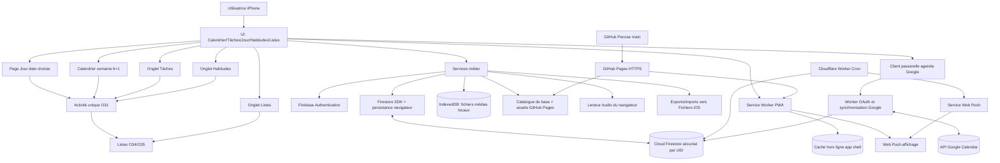

# ARCHITECTURE.md — Registre contractuel intégral

> **Projet :** `Pecose/organiseur-personnel` · **Date de référence :** 2026-11-01  
> **Statut : ARCHITECTURE CIBLE EN COURS D'IMPLÉMENTATION**. Les strates S0 à S4 sont typées ; S5 et S6 sont codées partiellement ; les cinq vues principales S7 sont assemblées en TypeScript natif. La décision D23 reporte tous les tests à la recette finale : **aucun module S5–S7 n'est déclaré validé ni déployé**. **Ne jamais confondre un contrat ou un test local avec une fonctionnalité déjà déployée.**  
> **Document de gouvernance :** [../AGENTS.md](../AGENTS.md) · **Périmètre fonctionnel :** [../ROADMAP.md](../ROADMAP.md).

## 0. Règle de changement obligatoire (BLOCAGE)

**Avant toute modification**, l'agent lit `AGENTS.md`, le présent fichier entier, puis `ROADMAP.md`. Il établit une correspondance entre son changement et les **identifiants enregistrés ici** (fichiers, modules, objets, fonctions, connexions, schémas, dépendances).  

- **Correspondance complète :** travail autorisé *dans le périmètre existant*, avec tests et mise à jour documentaire en cas de modification d'un contrat.
- **Objet, fonction, fichier, connexion, table, champ structurant, API, service, dépendance ou comportement absent, incompatible ou ambigu : STOP**. **Ne rien créer, modifier ou supprimer en anticipation.** Présenter une demande à l'utilisateur, puis **attendre une réponse explicite**.
- Après accord explicite : **modifier et versionner d'abord ce document**, avec identifiants et contrats, puis seulement créer ou modifier le code correspondant. Sans réponse, laisser le dépôt inchangé sur ce périmètre.
- Ne jamais interpréter le silence comme un accord ; pas de solution « temporaire » contournant l'approbation ; pas d'infrastructure payante ou hors `Pecose`.
- Un simple renommage, déplacement, suppression, changement de signature, nouvelle bibliothèque, nouvelle dépendance ou nouvelle interaction compte aussi comme **changement d'architecture** : même procédure.
- Les changements d'implémentation *internes* qui respectent **strictement** les signatures et relations enregistrées sont possibles, sous réserve des tests.

**Demande d'approbation type :**

> **ARRÊT — Architecture non couverte**  
> Besoin : … · Élément absent / incompatible : … · Type : module / objet / fonction / donnée / connexion / dépendance / autre.  
> Proposition : identifiant, chemin, interface (entrées → sorties), appelants, dépendances, effets de bord, tests et impacts sur sécurité/coût/synchronisation.  
> **Autorises-tu l'ajout ou la modification de cet élément dans `docs/ARCHITECTURE.md` avant son implémentation ?** [Oui / Non / À préciser]

## 1. Frontières, décisions prises, états

| Réf. | Contrat immuable sans nouvelle approbation |
|---|---|
| D01 | Application personnelle **PWA iOS via Safari**, installable depuis GitHub Pages, **pas d'IPA/App Store/Mac** |
| D02 | GitHub **`Pecose/organiseur-personnel`**, branche `main`, jamais `T-C-Umbral` |
| D03 | **0 €** : GitHub Pages, Firebase **Spark**, et plus tard Cloudflare Workers en offre gratuite ; pas de facturation activée |
| D04 | Agenda de l'application + **synchronisation bidirectionnelle facultative avec le Google Agenda principal choisi par l'utilisatrice**, après consentement ; pas de synchronisation Apple Calendar ; tâches ; musique Suno ; images ; thèmes |
| D05 | Agenda, tâches et métadonnées légères synchronisés par **Firebase Auth + Firestore** ; fichiers personnels **locaux** |
| D06 | Utilisable hors ligne **après première installation/cache**, sans PC allumé |
| D07 | Rappels **Web Push** avec programmation distante à prototyper ; **pas de réveil natif garanti hors ligne** |
| D08 | Réinstallation sur nouvel iPhone : connexion et restauration des données Firestore ; **réimport** des médias personnels |
| D09 | Ressources de base versionnées, sans écrasement des ressources importées ; aucun secret ni donnée privée dans le dépôt public |
| D10 | **Accord explicite du 3 novembre 2026** : **Vite 8** (outil de compilation TypeScript/ESM, sans framework UI imposé), **TypeScript 7** (compilateur) et **SDK modulaire officiel Firebase 13** (Firebase Auth + Cloud Firestore). Dépendances autorisées dans F06 `package.json` uniquement : `vite`, `typescript`, `firebase`. Aucune autre bibliothèque ou framework UI n'est autorisé par cet accord ; npm est l'outil d'installation. Node 22.12+ ou 24+ ; GitHub Pages sous `/organiseur-personnel/`, sans coût ni clé privée. Toute nouvelle dépendance, configuration de déploiement ou changement de contrat hors registre exige un nouvel accord |
| D11 | Google Agenda **dans les deux sens**, créations/modifications/suppressions et récurrences ; connexion OAuth Google **distincte** de Firebase Auth ; aucune synchronisation destructive lors de l'association initiale |
| D12 | Synchronisation Google **à l'ouverture et pendant l'utilisation** d'abord ; **à distance lorsque la PWA est fermée** seulement après mise en service d'un Worker/ordonnanceur gratuit, avec accès OAuth sécurisé. Ce n'est pas une synchronisation instantanée garantie |
| D13 | Pour Google Calendar, **moindre privilège, quotas gratuits, consentement et protection des jetons** ; si une exigence impose un paiement, une vérification payante ou un niveau de risque non accepté, STOP et décision de l'utilisateur |
| D14 | Cinq onglets **fixes et dans cet ordre** : **Calendrier · Tâches · Jour (central) · Habitudes · Listes**. Ouverture sur Jour à la date d'aujourd'hui. Musique, décoration et paramètres restent accessibles en navigation secondaire |
| D15 | Un **objet métier unique `Activity`** : tâche = sans horaire ni récurrence (date facultative) ; habitude = récurrence (avec ou sans heure) ; événement = horaire défini (avec ou sans récurrence). Un même objet peut apparaître dans plusieurs vues, **sans duplication** |
| D16 | Jour affiche uniquement les éléments prévus pour la date choisie : **sans horaire d'abord**, puis **avec horaire triés chronologiquement**. Aucun séparateur Habitudes/Tâches/Événements ni bloc « À planifier ». Les tâches sans date demeurent dans l'onglet Tâches |
| D17 | Chaque ligne : **icône personnalisable à gauche, ouvrant la fiche complète** ; **validation à droite**. Ajouter une heure propose une validation automatique préactivée, désactivable et réversible ; fin si prévue, sinon heure de début. Une validation automatique reste une **présomption** |
| D18 | À l'entrée sur Aujourd'hui, une **seule fenêtre groupée** peut proposer le report des **tâches de la veille sans horaire, non récurrentes et inachevées** : déplacer à aujourd'hui, conserver à hier ou redemander plus tard. Pas de report automatique ni de doublon |
| D19 | Importance facultative **1 à 3 étoiles** ; bilan mensuel des réalisations triées 3→2→1 puis chronologiquement, filtre par nombre d'étoiles, distinction entre réalisations confirmées et présumées |
| D20 | **Listes libres** indépendantes (courses, bagages…), associables à une activité via un ID stable ; cocher les articles ne termine pas automatiquement l'activité |
| D21 | Calendrier **semaine** : six cases lundi–samedi et dimanche accessible par **dépliage visible** ; noms si la place le permet, sinon compteurs. Toucher un jour affiche cette date sur Jour ; bouton « Aujourd'hui » pour revenir |
| D22 | Interface minimaliste : formes très arrondies, couleurs apaisantes, lecture claire ; gestes facultatifs et explicites, **aucun geste à deux doigts obligatoire** |
| D23 | **Décision explicite du 3 novembre 2026 : tests reportés à la phase de recette finale.** Autorisé à **coder progressivement** S5 puis S6–S10 selon les dépendances documentées, sans attendre l'exécution des suites de tests entre strates. Les strates ainsi parcourues demeurent **IMPLÉMENTATION NON VÉRIFIÉE / NON VALIDÉE**, jamais « testées » ou « terminées » par assimilation. **Aucun déploiement, aucune activation des règles Firestore réelles, aucun accès aux données privées ni utilisation de fonctionnalités sensibles** avant réussite des tests techniques, de sécurité entre UID, de restauration, de la PWA sur iPhone et de la recette finale. Aucun accès payant, aucune facturation. Le report des tests ne suspend pas les contrôles de cohérence des signatures et de l'architecture avant de coder ; nouvelles dépendances, fichiers, fonctions ou schémas continuent d'exiger un accord préalable, avec commit architectural séparé. |

**États :** `PLANNED` = spécifié mais absent du dépôt ; `IMPLEMENTED` = présent et conforme ; `DEPRECATED` = suppression autorisée et historisée. Les documents F00–F02 et F04–F05 existent, F03 est réservé. **État au 2026-11-02 :** S0 à S4 disposent maintenant de **35 objets actifs typés dans F17** : les 15 autonomes O01/O05/O07/O10/O13/O15–O18/O20/O22/O24/O29/O34/O37, les 10 composés O08/O11/O12/O14/O21/O25/O27/O28/O31/O35 et les 5 de S2 **O09/O23/O26/O32/O36**, ainsi que **O06/O30/O33** de S3 et **O19/O38** de S4 (plus le type technique `MonthlyAchievement`, réutilisant les champs O31/O32/O33). M28/M29/M45 sont présents dans F18, M67 seul dans F26, M124/M157 seuls dans F48, **M130 seul dans F49, M131 seul dans F51, M133 ajouté dans F48**. Les tests de S0/S1 existent dans F40/F54 ; **les tests de S2 (occurrences et groupes Jour) sont présents dans F55** ; les vérifications de structure S3 sont présentes dans F54, sans déploiement d'interface. Compilation TypeScript stricte et tests de comportement exécutés sur **copies locales de vérification** ; une vérification sur un clone intégral GitHub reste à planifier. **S3 est IMPLÉMENTÉE POUR SON PÉRIMÈTRE DE TYPES ET DE CALCUL PUR** : suite à **l'accord explicite du 2026-11-02**, `completion?: ActivityCompletion` a été enregistré dans F17 et dans ce registre par un **commit architectural séparé** (`1d37aa9174bdd7ff2509d8b5354f01626f5fc65a`), avant les commits du code. M133 est implémentée dans F48, avec tests de non-recochage et indépendance des mercredis ajoutés à F54. **18 tests ciblés réussis sur copie locale TypeScript stricte du prédicat** ; la compilation intégrale du dépôt GitHub et l'exécution de toutes les suites F40/F54/F55 restent à reproduire. Les lectures/écritures Firestore et les actions M132/M134/M154/M155/M158 ne sont **pas** implémentées : elles appartiennent aux strates S5/S6/S8, et aucune validation automatique en arrière-plan n'est revendiquée. **S4 : contrats terminaux publiés dans F17 et cas de recette T19 ajoutés dans F56**. O19 est un reçu de tentative sans secret, O38 une projection calculée non persistée. La règle de classement 3→2→1 (sans étoiles après) puis date, le filtre par étoiles et le comptage des `auto_assumed` sont illustrés par les fixtures de tests ; **la fonction métier M147 n'est pas implémentée**, car son accès M89 à Firestore appartient aux strates S5/S8. Une vérification ciblée du contrat et du tri a passé `tsc --strict` et Node sur une copie autonome, **pas** sur le contenu intégral cloné du dépôt : les tests F56 déposés sur GitHub restent à compiler/exécuter avec les autres suites avant de conclure à leur réussite. **Tous les autres fichiers et fonctions restent PLANNED**, sauf les anciennes références O02–O04 et fonctions M30–M40/M91/M101–M102, marquées SUPERSEDED.

**S5 — autorisation de dépendances enregistrée avant code (3 novembre 2026)** : Vite 8, TypeScript 7, Firebase Web SDK 13, **uniquement** dans F06 et les imports autorisés par F14/F27/F28/F29/F30. `npm run build` doit compiler via TypeScript strict puis produire les ressources Vite avec base de déploiement **`/organiseur-personnel/`**. Les noms et fonctions M16–M27/M89–M90 sont inchangés, de même que les collections O31–O36 ; `PublicFirebaseConfig`, `FirebaseClients`, `CollectionRef`, `CloudCollection`, `SnapshotMeta` et `Connectivity` sont les types techniques F17 déjà prévus §4.2. La configuration publique Firebase est renseignée uniquement depuis l'environnement Vite **`VITE_FIREBASE_*`**, avec les identifiants réels du projet, sans secret ni valeur inventée. En l'absence de configuration, échec explicite et **aucune tentative de connexion**. L'activation du cache persistent Firestore Safari est à effectuer sur appareil de confiance avec session authentifiée ; ne jamais promettre de synchronisation serveur sur la base d'un simple ACK local.

**Connexions autorisées D10/S5 :** F14 → F27 (M16) → SDK officiel `firebase/app`, `firebase/auth`, `firebase/firestore` ; F28 → Auth (M17–M20/M90) ; F29 → Firestore (M21–M24/M89) sur `users/{auth.uid}` exclusivement ; F30 (M26/M27) reflète cache/attente et connectivité ; F35 ↔ CacheStorage via F14 (M79/M80) lorsque le worker peut être généré correctement par Vite. Aucun Worker Cloudflare ni Google OAuth, aucune donnée privée en dépôt, aucun déploiement de règles F39 sans test d'émulateur T05 entre UID différents. Le SDK Firebase est distinct d'un serveur local, n'exige pas de Mac et doit rester sur le plan Spark. Les fichiers supplémentaires non enregistrés (ex. configuration Vite séparée, lockfile de versionnement, workflow GitHub Actions ou icônes F10 individuelles) restent soumis au registre préalable.

**S5 — premier lot technique publié le 2026-11-02 (PARTIEL, NON DÉPLOYÉ)** : F07 `tsconfig.json` (TypeScript strict, sans npm ni bundler), F08 `index.html` (page statique d'attente, sans fausse saisie utilisateur), F09 `manifest.webmanifest` (chemins Pages relatifs, **icônes F10 non fournies**), F11 `public/catalog/catalog.json` (liste vide, aucun média personnel publié), F17 `MediaDb = IDBDatabase` (type technique existant du contrat M46), F31 `openMediaDb` (M46 : les quatre stores autorisés et ouverture non destructive), F32 `loadBundledCatalog` (M50) et `resolveCatalogAsset` (M51), F39 `firestore.rules` (règles propriétaires explicites, documents serveur refusés), F41 `tests/storage.test.ts` (simulations de catalogue et indisponibilité de la base). Les chemins et signatures appartiennent déjà au registre §2/§4 ; **aucune bibliothèque ni nouveau store n'a été ajouté**.

**Limites historiques du premier lot S5 (2 novembre, avant l'accord D10 du 3 novembre) :** seul un contrôle de structure avait été réalisé, sans compilation globale, tests F41, émulateur Firestore, Safari iPhone ni déploiement. **Le choix Vite/TypeScript/Firebase a depuis été approuvé et codé dans le second lot détaillé ci-dessus**, ainsi que F35, mais les essais et déploiements cités restent non exécutés. Une configuration Firebase projet non vérifiée ne doit jamais être inventée et aucune donnée personnelle ne doit être importée avant les tests F39/T05. Aucun service Cloudflare ni Google OAuth n'est activé.

**S5 — second lot publié sur GitHub le 3 novembre 2026 (EN COURS)** : choix de dépendances D10 appliqué dans F06 `package.json` (versions ciblées Vite 8.3.5, TypeScript 7.0.2 et Firebase SDK 13.1.0). F14 `src/main.ts` utilise exclusivement les variables publiques `VITE_FIREBASE_*`, affiche un état explicite en absence de configuration et ne fabrique pas de compte ni de projet Firebase. F27 `initFirebase` (M16) protège l'initialisation unique ; F28 `signIn/signOut/sendPasswordReset/observeAuth/registerAccount` (M17–M20/M90) délègue à Firebase Auth sans journaliser de secrets. F29 `getUserCollection/putCloudRecord/removeCloudRecord/subscribeCloudRecords/fetchCloudRecords` (M21–M24/M89) vérifie l'UID de session, refuse les collections serveur et préserve les dernières données en cas d'erreur, avec état de synchronisation non confirmé. F30 `configurePersistence/deriveSyncStatus/observeSyncStatus` (M25–M27) demande explicitement si l'appareil est personnel avant d'activer le cache persistant. Les types techniques F17 `PublicFirebaseConfig/FirebaseClients/CloudCollection/CollectionRef/SnapshotMeta/Connectivity/Unsubscribe` sont inscrits au §4.2 et connectés aux SDKs approuvés.

F35 `src/pwa/service-worker.ts` implémente M79/M80 pour la base `/organiseur-personnel/`, précache le shell **public**, n'efface que ses anciens caches propres et **jamais** IndexedDB/Firestore. F06 compile ce worker dans `dist/service-worker.js` afin que son scope reste la racine de la PWA sans autre configuration Vite/Worker non approuvée. F08 relie F14 et affiche des états de préparation, F32/F41 emploient `./catalog/` à l'exécution puisque Vite transporte `public/catalog/` vers `dist/catalog/`. F42 `tests/security.test.ts` contient des scénarios d'**émulateurs locaux exclusivement** T05 : deux UID, lecture/écriture croisée refusée, document Google OAuth inaccessible, reçu de notification non modifiable. Ces tests n'installent ni ne configurent un émulateur ni une connexion Firebase réelle.

**État de validation réel :** commits et références vérifiés sur GitHub ; **aucun `npm install`, aucune compilation complète `npm run build`, aucun test Firebase Emulator, aucune publication GitHub Pages, aucune activation des règles F39 ni essai Safari iPhone n'ont été exécutés ici**, car les paquets ne sont pas disponibles dans l'environnement sans accès réseau npm, et les valeurs publiques du vrai projet Firebase n'ont pas été fournies. **S5 reste EN COURS**, S6 non commencé. La page actuelle est un socle technique, non un agenda utilisable. Un déploiement automatisé GitHub Pages nécessiterait un nouvel artefact/contrat dans l'architecture et l'autorisation correspondante ; ne pas l'ajouter implicitement. La configuration applicative Firebase ne doit être activée qu'après réussite des tests F39/T05.

**Politique révisée D23 :** les tests de compilation, émulateur et iPhone sont rassemblés en fin de construction sur demande explicite ; les développements intermédiaires sont autorisés sans transformer un code non testé en livraison validée. Le **déploiement réel Firestore** et toute écriture sur un projet utilisateur restent gelés jusqu'à la recette de sécurité. Les référentiels de tests existants restent en place, mais leur exécution est différée.

**S6 — premier lot publié le 3 novembre 2026 (CODÉ, NON TESTÉ, D23)** : les **types techniques F17** `ActivityDraft`, `ActivitySchedule`, `ChecklistDraft`, `ChecklistItemDraft` déjà enregistrés en §4.9 sont définis. **F48** implémente M121/M122/M123 (création/modification/tombstone d'une activité O31), M138–M142 (planification, récurrence, étoiles, icône et association de liste), M132/M134/M155 (état O33 d'une occurrence). **F22** ajoute M125, **F49** ajoute M126 ; les deux filtrent la collection O31 sans duplication. **F50** ajoute M143/M144/M146/M159/M160 pour les listes O34/O35 et les articles cochables indépendamment d'une activité. Les dépendances sont M16/F28 (session), M21–M22/M89/F29 (accès Firestore uniquement sous UID courant) et M157/F48 (validation O31). Les IDs des activités sont conservés entre les vues ; une suppression est un `deletedAt` et ne détruit ni la liste liée ni les réalisations historiques. Aucun de ces contrats n'introduit une nouvelle collection ou un fournisseur payant.

**S6 restant à coder** : M145 (suppression contrôlée d'une liste et détachement des activités), M158 (présomption automatique persistée), M41–M44 (rappels métier), import/CRUD média et préférences M47–M57/M64–M65/M95. Ces parties ne doivent pas être présentées comme terminées. **D23 : aucun test, compilation ou émulateur lancé au titre de ce lot**, aucune activation réelle de Firebase ; code non vérifié, erreurs possibles, aucune donnée personnelle traitée. La suppression définitive des listes et les écritures cloud ne doivent pas être utilisées avant la recette de sécurité et la confirmation utilisateur.

**S6 — deuxième lot publié le 3 novembre 2026 (CODÉ, NON TESTÉ, D23)** : F48 ajoute **M158** : évaluation de l'occurrence O32 calculée via M130, lecture de O33/M155, décision pure M133 et enregistrement de `auto_assumed` via M22, sans minuterie ni déclenchement automatique des notifications. **Risque identifié avant la recette :** l'enchaînement lecture-écriture n'est pas transactionnel sur plusieurs appareils ; une annulation M134 concurrente pourrait être écrasée. Ne pas utiliser les validations automatiques sur des données réelles avant correction et validation de l'idempotence.

**F50** ajoute **M145** : confirmation navigateur, détachement de toute activité associée par M142, puis **archivage conservateur** du document O34 ; les articles ne sont pas effacés. Ce comportement évite l'effacement irréversible avant recette et doit être confronté au contrat M145/M23 lors de la validation finale. **F23** ajoute **M41–M44** : consultation des rappels devenus dus, liaison à l'occurrence réelle, désactivation et réconciliation après changement de planning/catégorie O31. La signature `ownerType:'event'|'task'` de M42 désigne une **vue de l'unique Activity**, jamais une collection séparée. **Aucun envoi Web Push** ni Worker/S9 n'est implémenté.

**F31** ajoute M47/M48 : Blob local IndexedDB avec filtre MIME/taille et empreinte SHA-256, lecture locale sans réseau. **F24** ajoute M52–M57 : import audio personnel local via M47, titres/métadonnées O08 uniquement dans Firestore, playlists O09 et favoris ; pas de fichier sonore dans le cloud. **F26** ajoute M64/M65/M95 : import image personnel en local (réduction via API navigateur si disponible), galerie images locales et catalogue autorisé, édition des étiquettes O11 sans modification du binaire. F49 utilise directement la règle `recurrence` de O31 dans M126 pour supprimer un cycle d'import avec F48/M158, sans modifier la classification D15.

**Restant S6 : M49 (effacer un média uniquement après vérification fiable de toutes les références locales et O08 synchronisées), M69 (suppression contrôlée d'une image importée après M49) et les garanties de concurrence sur M158 et M145.** Aucun nouveau fichier, modèle, collection, SDK ou service payant n'a été introduit. Les tests, la compilation et les essais iPhone/Firebase sont **expressément reportés par D23** ; le code peut comporter des défauts et n'est pas utilisable en production. Ne supprimer aucun média personnel sans la future vérification des références.

**S7 — premier lot d'interface publié le 3 novembre 2026 (CODÉ, NON TESTÉ, D23)** : **F17** ajoute `CalendarDaySummary` (projection `{date,count,labels}` non persistée, prévue par §4.9). **F16** définit `AppState` exactement avec route O20, jour sélectionné O37, utilisateur O01/null, état O15, version O17, préférences O07 et implémente M13–M15 et M148. **F15** implémente M02–M04, navigation via fragments `#day/#calendar/#tasks/#habits/#lists` compatibles avec le chemin GitHub Pages `/organiseur-personnel/`. Les cinq onglets sont fixes dans l'ordre D14 et Jour est au centre ; les routes secondaires `music/decor/settings/signin/monthlyReview` ne créent pas d'onglets supplémentaires. F15 charge F19 sur demande pour couper le cycle statique d'import F15↔F19.

**F51** ajoute M129, qui prépare les occurrences O32 et états O33 de la date O37, depuis les collections O31/O33 existantes, et réutilise M130/M131 pour ne créer que deux groupes : **sans horaire**, puis **avec horaire ordonné**. Les tâches sans date restent accessibles seulement dans Tâches. **F21** implémente M127/M128/M156 : calendrier du lundi au dimanche, six jours en grille **3×2**, dimanche dépliable et résumé calculé avec une seule lecture d'activités par semaine pour limiter les requêtes Firebase Spark. Le clic sur une date change O37 et ouvre Jour, sans déplacer l'activité. **F19** implémente M05–M11/M149–M152 (cinq vues + secondaires de base), **F20** M12 (statut local/en attente/synchronisé/erreur), **F53** M153 (fiche unifiée titre, description, icône, étoiles, dates, horaires, répétition et liste associée). **F14** implémente M01 (bootstrap, Firebase public si configuré, session, routage et cache de production) ; **F08** contient les styles pastel, l'accessibilité élémentaire et les zones sécurisées pour iPhone. Les valeurs personnelles sont insérées dans le DOM via `textContent/value`, et pas via une interpolation HTML non fiable. Aucun framework ni nouvelle dépendance n'a été ajouté.

**S7 — deuxième lot d'interface publié le 3 novembre 2026 (CODE, NON TESTE, D23)** : F25 `src/features/player.ts` est ajouté conformément au registre §2/§4.4, avec **M58–M63/M99** : lecture de morceaux par ID existant, Blob local IndexedDB via M48 ou URL du catalogue autorisé via M51, file locale, pause, avance, retour, déplacement dans la piste et mode répété/aléatoire. Les URLs temporaires créées par le navigateur sont révoquées lorsque la piste change. Aucun lecteur ne transmet de fichier audio vers Firestore. **F19/M08** propose désormais un import audio M52, des commandes tactiles de lecteur, l'affichage de favoris via M57, la création de playlists vides via M55 et leur lecture M56. **F19/M09** propose l'import d'images M64, l'affichage des images locales M48 et des ressources du catalogue M51. Les aperçus locaux utilisent des URLs temporaires et des éléments `img`, sans téléversement. F08 ajoute des styles responsive pour les médias ; la déconnexion depuis F19/M10 met en pause le lecteur. Ces écrans demeurent **secondaires** et la barre D14 garde exactement cinq onglets.

**Limites S7 non levées :** les imports et contrôles médias sont **codés mais pas vérifiés sur Safari iPhone** ; l'audio en arrière-plan et l'autorisation de lecture après opérations asynchrones ne sont pas garantis. L'édition graphique M96–M98, les suppressions/reclassements M92–M94, les réglages complets de thèmes M66–M69 et les sauvegardes restent à développer selon les strates et dépendances inscrites. La création de playlists est présente, **l'ajout et le reclassement de pistes ne le sont pas encore**. La route Bilan mensuel reste une annonce en attendant M147/S8. Les tâches **sans date** ont un bouton de validation désactivé dans leur vue, faute de clé d'occurrence datée O32 ; aucune règle alternative n'a été inventée. La fiche d'édition n'a pas encore été vérifiée sur Safari pour l'heure locale/fuseaux, et la mise en cache des ressources de navigation différées devra être revue lors de la recette PWA. La sélection de date/échéances, les requêtes cloud, la fermeture de fiche et l'accessibilité doivent être validées en fin de développement, tout comme l'idempotence des coches M132/M134/M158 déjà signalée en S6. **Aucun test, compilation, lancement iPhone, déploiement Firebase ni publication GitHub Pages n'a été effectué pour cette strate** (D23). Les règles Firestore F39 restent inactives ; coût 0 €.

**S8 — première livraison du 3 novembre 2026 (PARTIELLE, CODÉE NON TESTÉE, D23)** : F22 `src/features/tasks.ts` implémente M135 `findMissedTasks(yesterday)` pour une tâche O31 planifiée **exactement hier**, sans horaire ni récurrence, sans O33 `manual_done` ou `auto_assumed`. La fonction lit M125 et O33 (M89), ne déplace ni ne duplique aucune tâche. F52 `src/features/monthlyReview.ts` implémente M147 `getMonthlyReview(month,stars?)` à partir des deux collections O31/O33 lues en une passe chacune, reconstruction des occurrences O32 par M130, contrôle des clés, tri étoiles décroissant puis date croissante, filtre optionnel et compteur des `auto_assumed`. O38 demeure une projection calculée **sans écriture ni collection Firestore supplémentaire**. Les données supprimées logiquement peuvent contribuer à l'historique de leurs réalisations antérieures.

**Historique : points S8 désormais autorisés dans la section ci-dessus** : les types techniques `CarryOverPrompt` et `CarryOverChoice` sont **nommés** au §4.9/F17 mais ne possèdent **aucun schéma de champs approuvé** ; M136/M137 et l'interface de confirmation ne doivent pas inventer ce contrat. De plus, M158/S6 utilise une lecture suivie d'une écriture non transactionnelle ; raccorder M154 à cette routine risquerait de recocher une occurrence `manually_undone` depuis un second appareil. Une **approbation d'architecture** est requise avant d'introduire une dépendance transactionnelle/une modification de la règle de persistance, puis un commit architectural séparé devra précéder le correctif. La route `monthlyReview` demeure un emplacement réservé en F15 ; l'écran de bilan ne doit être déclaré opérationnel ni relié à des données utilisateur avant la validation du flux. Les tests de compilation, de sécurité multi-appareils et de Safari restent **reportés à la recette finale D23**. Aucun projet Firebase réel, déploiement, règle ni service payant n'a été activé.

**S8 — APPROBATION EXPLICITE DU 3 NOVEMBRE 2026, CONTRATS À MODIFIER AVANT CODE (trois points)**

1. **F17 / O36 / M136–M137 / C30 / FL16 :** types techniques jusque-là simplement nommés, désormais fixés :
   - `CarryOverPrompt = { fromDate: LocalDate; toDate: LocalDate; candidates: Activity[] }` ; `fromDate` est **exactement hier** et `toDate` aujourd'hui en date civile de l'utilisatrice, aucune tâche avec horaire/récurrence, aucune tâche déjà complétée ou traitée ;
   - `CarryOverChoice = { activityId: string; fromDate: LocalDate; toDate: LocalDate; decision: 'move'|'keep'|'later' }` ; une proposition groupée, une décision par tâche et un clic final de confirmation utilisateur. O36 reprend ces champs et son identifiant documentaire **déterministe** `activityId + '@' + fromDate`, sans nouveau store. `move` change uniquement `plannedOn` du même O31, `keep` conserve hier, `later` inscrit le choix mais ne déplace rien. `later` peut être reproposé après **quatre heures** sur la même date uniquement ; M136 vérifie `decidedAt`/l'état O36 pour ne jamais réouvrir une fenêtre à chaque rechargement. Les décisions `move`/`keep` sont définitives pour cette date. Une tâche jamais présentée ou déjà traitée ne subit aucune écriture implicite. M137 vérifie le propriétaire UID, l'état courant, la correspondance des dates et la décision, et applique une mutation conditionnelle en **transaction Firestore** entre O31/O36 pour éviter les demi-reports ; les transactions peuvent échouer hors connexion et retournent alors une erreur explicite (pas de succès simulé).
2. **F48 / M132–M134/M154/M155/M158 / O33 / C31 / FL15 :** usage du `runTransaction` fourni par **`firebase/firestore` (SDK déjà approuvé)** pour les écritures de validation et leur annulation, sans nouveau package ni collection. M158 relit **dans la même transaction** O31 et O33, vérifie l'échéance M133 de l'occurrence correcte et **ne remplace jamais** un état existant `manual_done`, `auto_assumed` ou `manually_undone`. M134 pose le veto `manually_undone` transactionnellement et M132 écrit la coche manuelle avec la même protection contre les courses. M154 est invoquée à la reprise de l'application, et examine une fenêtre **bornée aux sept derniers jours civils dans le fuseau des préférences** et au plus **25 validations à tenter par reprise**, après lecture groupée O31/O33 ; l'écriture effective reste M158 transactionnelle. **Pas de timer de fond, pas de Push, pas d'écriture avec un autre UID.** Une transaction peut refuser l'usage hors ligne ; aucune annonce de sauvegarde serveur avant ACK.
3. **F15/F19/F52 / M147 / O38 / C32 / FL18 :** la route secondaire existante `monthlyReview` affiche le bilan de la période `YYYY-MM`, le filtre toutes/1/2/3 étoiles, l'ordre 3→2→1 puis date, le compteur présumé `auto_assumed` et l'état `manual_done` distinct. Aucun état O38 n'est persisté ; le bilan se recalcule sur O31/O32/O33. Il reste hors des cinq onglets principaux, accessible par les outils secondaires, sans données fictives et sans modifier les réalisations lors de l'affichage. Les erreurs/offline sont affichés, jamais déguisés en liste vide.

**Tests de recette différés selon D23 :** T16 (récurrence, course transactionnelle `auto_assumed` ↔ `manually_undone`, reprise plusieurs appareils et transaction hors ligne), T17 (choix groupés, `later`/temporisation, double soumission, cohérence O31/O36), T19 (filtre, dates, présumées vs confirmées), T20 (navigation et iPhone). **Coût 0 €, Firebase Spark, pas de clé de service ni de déploiement réel.** Les contrats restent autorisés pour le code seulement ; non validés avant la recette.

**Source de vérité :** `AGENTS.md` pour le processus, **ce fichier** pour les contrats d'architecture, `ROADMAP.md` pour l'ordre des livraisons. En cas de conflit : STOP et demande utilisateur.

## 2. Arborescence cible exhaustive (registre des artefacts)

Les chemins sont **proposés/planifiés**, non présumés existants. Les répertoires ne contiennent que les fichiers inscrits ci-dessous ; tout autre fichier source non généré nécessite un accord. Les fichiers générés `dist/**`, caches et artefacts de compilation ne sont **pas** des objets architecturaux.

```text
/                                         # dépôt Pecose/organiseur-personnel
├── README.md                              [F00] présentation
├── ROADMAP.md                             [F01] calendrier de réalisation (existe)
├── AGENTS.md                              [F02] consignes IA canoniques
├── .github/copilot-instructions.md        [F04] pointeur pour Copilot
├── docs/ARCHITECTURE.md                   [F05] présent registre
├── package.json                           [F06] scripts et dépendances (choix à valider)
├── tsconfig.json                          [F07] configuration TypeScript
├── index.html                             [F08] point d'entrée web
├── manifest.webmanifest                   [F09] manifeste PWA
├── public/icons/                          [F10] icônes installables, fichiers à cataloguer
├── public/catalog/catalog.json            [F11] registre médias par défaut
├── public/catalog/audio/                  [F12] 2–3 musiques de départ autorisées
├── public/catalog/images/                 [F13] 2–3 images de départ autorisées
├── src/main.ts                            [F14] bootstrap
├── src/app/router.ts                      [F15] routes et navigation
├── src/app/state.ts                       [F16] état transversal
├── src/domain/types.ts                    [F17] types contractuels
├── src/domain/dates.ts                    [F18] calendriers/fuseaux/récurrences
├── src/ui/screens.ts                      [F19] Jour/Calendrier/Tâches/Habitudes/Listes + écrans secondaires
├── src/ui/components.ts                   [F20] composants UI communs
├── src/features/agenda.ts                 [F21] calendrier semaine et adaptation Google
├── src/features/tasks.ts                  [F22] filtre Tâches sur activités unifiées
├── src/features/reminders.ts              [F23] logique rappels
├── src/features/music.ts                  [F24] catalogue musical et playlists
├── src/features/player.ts                 [F25] lecteur audio
├── src/features/decor.ts                  [F26] fonds, saisons et galerie
├── src/services/firebase.ts               [F27] initialisation Firebase client
├── src/services/auth.ts                   [F28] session Auth
├── src/services/cloudRepository.ts        [F29] accès Firestore par UID
├── src/services/sync.ts                   [F30] états de synchronisation
├── src/storage/mediaDb.ts                 [F31] IndexedDB pour médias personnels
├── src/storage/catalog.ts                 [F32] contenus fournis par défaut
├── src/services/push.ts                   [F33] inscription Push côté PWA
├── src/services/backup.ts                 [F34] exports/imports et validation
├── src/pwa/service-worker.ts              [F35] cache offline, push, mise à jour
├── src/pwa/update.ts                      [F36] vérification des versions
├── workers/reminders/src/index.ts         [F37] tâche Cloudflare Cron + Web Push (phase 4)
├── workers/reminders/wrangler.toml         [F38] déploiement Worker (sans secrets)
├── firestore.rules                        [F39] règles de confidentialité par UID
├── tests/domain.test.ts                   [F40] dates, récurrences, tâches
├── tests/storage.test.ts                  [F41] IndexedDB, import/export
├── tests/security.test.ts                 [F42] sécurité/règles Firestore
├── tests/offline.test.ts                  [F43] synchronisation et PWA
├── tests/reminders.test.ts                [F44] rappels, double-envoi, DST
├── src/features/googleCalendar.ts         [F45] façade métier, liaison/conciliation agenda Google
├── src/services/googleCalendarBridge.ts   [F46] appels HTTP sécurisés de la PWA vers le Worker
├── tests/googleCalendar.test.ts           [F47] OAuth, CRUD, conflits, synchronisation Google
├── src/features/activities.ts             [F48] entité unique, horaires, étoiles, statuts
├── src/features/habits.ts                 [F49] récurrences et occurrences
├── src/features/checklists.ts            [F50] listes indépendantes et leurs articles
├── src/features/day.ts                   [F51] date choisie, deux groupes, report
├── src/features/monthlyReview.ts          [F52] bilan mensuel des accomplissements
├── src/ui/dayComponents.ts                [F53] icône gauche, validation droite, édition
├── tests/activities.test.ts               [F54] activités, complétions, report, récurrences
├── tests/navigation.test.ts               [F55] onglets, semaine 6+1, date sélectionnée
└── tests/monthlyReview.test.ts            [F56] étoiles, filtres et états présumés
```

**F03 était l'alias `agent.md`, supprimé par demande explicite de l'utilisateur (2026-11-01) ; son identifiant reste réservé pour traçabilité et ne doit pas être réutilisé.**

**Règle :** les fichiers `F06`–`F56` sont des contrats de destination, **pas** un engagement sur une bibliothèque non choisie. Un renommage vers une structure imposée par un bundler/framework exige une demande d'approbation préalable. Les tests peuvent utiliser des fichiers temporaires générés uniquement hors du dépôt versionné.

## 3. Modèle de domaine : objets, champs, relations et propriétaires

Types conceptuels de `F17`. Les ID sont stables et générés côté client, p. ex. UUID ; dates d'instants en UTC et fuseau IANA explicite. Champs optionnels `?`. Seul l'UID d'authentification est utilisé comme autorité dans les chemins cloud.

| Objet | ID | Champs fonctionnels (contrat) | Relations et lieu |
|---|---|---|---|
| `AuthUser` | O01 | `uid:string; email:string|null` | Firebase Auth ; 1 utilisateur logique |
| `CalendarEvent` | O02 | **SUPERSEDED (jamais implémenté)** : projection externe Google Calendar, remplacée par O31 | Ne pas créer de source métier `events` parallèle |
| `TaskList` | O03 | **SUPERSEDED (jamais implémenté)** : listes libres O34 | Identifiant historique réservé |
| `Task` | O04 | **SUPERSEDED (jamais implémenté)** : activité unifiée O31 | Identifiant historique réservé |
| `RecurrenceRule` | O05 | `frequency:daily|weekly|monthly|yearly; interval; until?; count?; weekdays?` | O31 `Activity` ; occurrences O32, heure locale et fuseau |
| `Reminder` | O06 | `id; activityId; occurrenceKey; scheduledFor; leadMinutes; timeZone; enabled; dispatchStatus` | `uid → reminders/{id}` ; O31/O32 ; Worker |
| `ProfilePreferences` | O07 | `themeId; backgroundImageId?; autoSeason; locale; timeZone; notificationEnabled; updatedAt` | `uid → preferences/profile` |
| `TrackMetadata` | O08 | `id; title; artist?; album?; source:bundled|imported; catalogId?; mediaId?; artworkId?; duration?; favorite; updatedAt` | Cloud léger pour métadonnées ; binaire O10 en local |
| `Playlist` | O09 | `id; name; trackIds[]; updatedAt` | `uid → playlists/{id}`; référence O08 |
| `LocalMediaBlob` | O10 | `id; kind:audio|image; blob; mimeType; byteSize; checksum; importedAt` | **IndexedDB seulement**, jamais Firestore |
| `ImageMetadata` | O11 | `id; name; source:bundled|imported; catalogId?; mediaId?; tags[]; updatedAt` | local ; configuration sélectionnée dans O07 |
| `ThemeDefinition` | O12 | `id; name; season?; colors; backgroundImageId?` | catalogue intégré + préférences |
| `CatalogEntry` | O13 | `id; revision; kind:audio|image; url; title; checksum; redistributionAllowed` | `public/catalog/catalog.json`, médias inclus |
| `PushSubscriptionRecord` | O14 | `id; endpoint; p256dh; auth; deviceLabel?; expiresAt?; updatedAt` | données cloud protégées, O01 propriétaire ; endpoint sensible |
| `SyncStatus` | O15 | `state:local|pending|synced|error; pendingCount; lastServerAckAt?; message?` | état runtime, jamais preuve de synchro avant ACK serveur |
| `BackupEnvelope` | O16 | `schemaVersion; exportedAt; dataType; ownerUid?; records; checksums?` | export/import JSON et archive média, validation stricte |
| `AppVersion` | O17 | `version; cacheRevision; catalogRevision; releasedAt` | embarquée dans app + manifeste/catalogue |
| `PlaybackState` | O18 | `trackId?; queueIds[]; position; paused; repeatMode; shuffle` | runtime et éventuel stockage local, pas de lecture distante |
| `DispatchReceipt` | O19 | `reminderId; occurrenceKey; attemptedAt; outcome; retryAfter?` | anti-doublon pour Worker, accès serveur sécurisé |
| `UiRoute` | O20 | `name:calendar|tasks|day|habits|lists|music|decor|settings|signin|monthlyReview; params?` | Les cinq premières routes correspondent aux onglets D14 ; les autres sont secondaires |
| `MediaArchiveManifest` | O21 | `schemaVersion; createdAt; mediaEntries[]; metadata; checksums` | export/import des fichiers personnels |
| `NotificationTestResult` | O22 | `supported; permitted; subscribed; sent?; message?` | retour état des diagnostics, pas garantie de livraison |

### Modèle unifié (D14–D22, approuvé, non implémenté)

**Priorité contractuelle :** O31–O38 remplacent les anciens O02/O03/O04 jamais implémentés. Une tâche qui reçoit un horaire ou une répétition **conserve son ID**.

| Objet | ID | Champs essentiels | Dépendances et stockage |
|---|---|---|---|
| `Activity` | O31 | `id; uid; title; description?; iconId?; imageId?; stars?:1|2|3; plannedOn?:LocalDate; startAt?:ISOInstant; endAt?:ISOInstant; timeZone; recurrence?:RecurrenceRule; autoComplete:boolean; checklistId?; deletedAt?; updatedAt; googleLink?:GoogleEventLink` | **Source canonique** : `users/{uid}/activities/{id}`. Horaire et répétition indépendants. |
| `ActivityOccurrence` | O32 | `activityId; occurrenceKey; localDate; startsAt?; endsAt?; recurring:boolean` | Vue **calculée** d'O31/O05 sur une plage bornée ; clés stables pour les récurrences |
| `ActivityCompletion` | O33 | `id; activityId; occurrenceKey; status:pending|manual_done|auto_assumed|manually_undone; completedAt?; overriddenAt?; updatedAt` | `users/{uid}/activityCompletions/{id}` ; état **par occurrence**, l'annulation manuelle interdit la recochage automatique |
| `Checklist` | O34 | `id; name; iconId?; archived?; updatedAt` | `users/{uid}/checklists/{id}` ; liste autonome et réutilisable |
| `ChecklistItem` | O35 | `id; checklistId; text; checked; position; updatedAt` | `users/{uid}/checklistItems/{id}` ; `checklistId` clé étrangère, validation indépendante d'O31 |
| `CarryOverDecision` | O36 | `id; activityId; fromDate; toDate; decision:move|keep|later; promptedAt; decidedAt?; updatedAt` | `users/{uid}/carryOverDecisions/{id}` ; action consentie, journal anti-doublon |
| `DaySelection` | O37 | `selectedDate:LocalDate; today:LocalDate; source:startup|calendar|navigation` | État UI F16 uniquement ; par défaut date réelle aujourd'hui |
| `MonthlyReview` | O38 | `month:YYYY-MM; starFilter?:1|2|3; entries:MonthlyAchievement[]; assumedCount` | Vue calculée O31/O32/O33 ; classement par étoiles et date, présumés distingués |

**Vues, sans duplication :** « Tâches » = sans heure ni récurrence, avec ou sans date ; « Habitudes » = récurrence, horaire facultatif ; « Événements » = heure définie, avec ou sans récurrence, visibles dans Calendrier (il n'existe **pas** d'onglet Événements). « Jour » = occurrences prévues à la date sélectionnée, sans heure d'abord puis horaires croissants. « Listes » = O34/O35. Les tâches sans aucune date ne polluent pas Jour.

**Temps :** `LocalDate` = date civile `YYYY-MM-DD` dans le fuseau IANA choisi ; `ISOInstant` = instant UTC. Une date seule n'est **pas** une heure à minuit. Pour une récurrence hebdomadaire à 19 h, l'heure locale est conservée à travers les changements d'heure, sans copier la tâche chaque semaine.

**Validation :** au choix d'une heure, l'UI propose `autoComplete=true` par défaut, que l'utilisatrice peut décocher ; échéance = `endAt` si présente, sinon `startAt`. Une échéance dépassée vaut `auto_assumed`, pas preuve d'exécution réelle ; bouton de droite permet la confirmation ou l'annulation. Une annulation `manually_undone` reste effective même après rafraîchissement. Sans heure : coche manuelle.

**Report :** uniquement les activités datées de **la veille**, **sans heure**, **sans récurrence** et non terminées. À l'ouverture d'Aujourd'hui, proposer une **fenêtre commune** avec décision pour chaque élément : aujourd'hui, rester hier, plus tard. Jamais de report sans accord ; même identifiant, pas de double proposition au prochain rafraîchissement. « Plus tard » peut être reproposé ultérieurement avec modération.

**Listes et étoiles :** la fiche d'une activité ouverte en touchant son **icône gauche** permet titre, description, icône/image, date, heure, répétition, notification, validation auto, étoiles 1–3, lien à une liste O34. Cocher ses articles n'achève pas l'activité. Le bilan du mois trie d'abord 3 étoiles, puis 2, puis 1 ; à importance égale, date chronologique. Filtre 1/2/3 étoiles ; les validations présumées sont étiquetées.

**Calendrier :** six carrés visibles lundi–samedi ; dimanche dépliable (poignée ou bouton visible, pas de geste caché). Cases montrant des événements et habitudes, ou leurs compteurs si peu de place. Toucher une date ouvre Jour sur celle-ci ; retour Aujourd'hui par bouton explicite.

**Google Agenda :** conversion des événements horaires O31 ↔ API Google via O24 ; aucune exportation automatique des tâches sans heure ni des habitudes locales non explicitement reliées. Les exceptions des séries importées doivent conserver l'identité de l'occurrence. Ne pas créer de collection distincte d'événements.

### Extension Google Agenda approuvée (toujours PLANIFIÉE)

| Objet | ID | Champs fonctionnels (contrat) | Relations et lieu |
|---|---|---|---|
| `GoogleCalendarConnection` | O23 | `uid; calendarId:'primary'; googleAccountLabel?; status:disconnected|authorizing|active|reauthorization_required|error; lastSyncAt?; lastError?` | statut non secret visible au propriétaire ; lié à O01, O25 |
| `GoogleEventLink` | O24 | `calendarId; googleEventId; etag?; remoteUpdatedAt?; pending: none|upsert|delete; source:app|google` | sous-objet O31 ; identité stable et absence de doublons |
| `GoogleSyncCursor` | O25 | `uid; calendarId; nextSyncToken?; lastFullSyncAt?; lastIncrementalSyncAt?` | Firestore **serveur uniquement** ; reprise API incrémentale |
| `CalendarSyncConflict` | O26 | `id; uid; localEventId; googleEventId?; kind:update|delete|recurrence|mapping; localVersion; googleVersion; detectedAt; status:open|resolved` | document privé ; résolution explicite obligatoire |
| `EncryptedGoogleOAuthGrant` | O27 | `uid; calendarId; ciphertext; keyVersion; scopes[]; issuedAt; revokedAt?` | Firestore **serveur uniquement**, jeton de renouvellement chiffré avec clé Worker secret ; jamais accessible à la PWA |
| `GoogleOAuthState` | O28 | `stateId; uid; nonce; redirectPath; expiresAt; consumedAt?` | Firestore **serveur uniquement**, usage unique et durée courte |
| `GoogleCalendarChange` | O29 | `calendarId; eventId; etag?; status:confirmed|cancelled; updatedAt; start?; end?; recurrence?; payload` | représentation transitoire provenant de l'API Google, non publiée telle quelle |
| `CalendarSyncRun` | O30 | `uid; calendarId; startedAt; finishedAt?; pulled; pushed; conflicts; status:ok|partial|error; details?` | rapport technique minimisé, pas de données personnelles en journaux publics |

**Décisions de synchronisation :** l'utilisatrice autorise explicitement la liaison à **son Google Agenda principal**. `GoogleEventLink` assure un appariement stable, `deletedAt` évite de perdre une suppression locale avant qu'elle ne soit propagée (tombstone). Aucun événement Google existant n'est supprimé lors de l'association initiale. Les événements avec récurrences/exceptions doivent être testés avant l'activation bidirectionnelle. Les modifications concurrentes se matérialisent en O26 et **ne sont pas écrasées silencieusement**. Google Agenda n'est pas un stockage pour les tâches, images ou musiques.

**Schémas Firestore planifiés (pas encore créés) :**
```text
users/{uid}/activities/{activityId}           → O31, source métier unique
users/{uid}/activityCompletions/{id}         → O33, complétion par occurrence
users/{uid}/checklists/{checklistId}         → O34, listes libres
users/{uid}/checklistItems/{id}               → O35, lignes cochables avec checklistId
users/{uid}/carryOverDecisions/{id}          → O36, traçabilité des reports
# Anciennes collections events/tasks/lists : SUPERSEDED, ne pas créer
users/{uid}/reminders/{reminderId}           → O06
users/{uid}/playlists/{playlistId}           → O09
users/{uid}/tracks/{trackId}                 → O08 métadonnées seulement
users/{uid}/preferences/profile             → O07
users/{uid}/pushSubscriptions/{deviceId}    → O14, contrôle d'accès renforcé
users/{uid}/dispatchReceipts/{receiptId}    → O19, écriture serveur uniquement
users/{uid}/googleCalendarConnection/status → O23, lecture du propriétaire, écriture serveur
users/{uid}/googleCalendarSync/state        → O25, lecture/écriture serveur uniquement
users/{uid}/googleOAuthGrant/primary         → O27, **aucune** lecture/écriture client
users/{uid}/googleCalendarConflicts/{id}     → O26, lecture propriétaire, résolution via Worker
serverOAuthStates/{stateId}                  → O28, lecture/écriture serveur uniquement, TTL court
```
Les écritures clients sont autorisées *uniquement* dans leur `users/{auth.uid}` et pour les collections explicitement permises, sauf `dispatchReceipts` et tous les documents Google marqués **serveur** (Worker). La simple présence sous `users/{uid}` ne doit **jamais** donner un accès client global. Les règles F39 doivent interdire la lecture des jetons chiffrés et des états OAuth, même au propriétaire authentifié. Les règles de lecture/écriture spécifiques doivent être testées avant tout déploiement. Les collections additionnelles nécessitent autorisation utilisateur.

**Stores IndexedDB planifiés :**
`mediaBlobs` (O10) ; `imageMetadata` (O11) ; `playbackState` (O18) ; `localMeta` (version schéma, catalogue installé et journaux de migration). Les données métier cloud sont mises en cache par **la persistance Firestore du SDK**, pas dans une seconde copie IndexedDB écrite en concurrence. Une modification non authentifiée ou sans cache initialisé exige un état d'erreur explicite, pas une promesse de synchronisation invisible.

### Contraintes de cohérence

- `id` et `updatedAt` obligatoires ; suppression explicite propagée ; conflits multi-appareils **à tester et documenter**, ne pas supposer une fusion parfaite.
- `RecurrenceRule` est une règle, pas une duplication infinie d'événements ; `occurrenceKey` stable pour éviter les rappels doublons.
- Références audio/playlist vers médias absents : préserver la playlist et afficher « fichier à réimporter ».
- Les fichiers de départ sont référencés par O13, les imports par O10 ; mise à jour du catalogue n'efface pas O10.
- Cloud = données personnelles et métadonnées légères ; **aucun fichier MP3/image personnelle** dans Firestore.
- Format de `BackupEnvelope` et migrations doivent être versionnés ; ne jamais écraser sans validation et confirmation de restauration.

## 4. Registre complet des fonctions publiques planifiées

Contrat commun : fonctions TypeScript typées ; `Result<T, AppError>` désigne réussite ou erreur explicite et non exception silencieuse. Les sorties `void` sont indiquées. **Chaque fonction nommée nouvelle, y compris utilitaire ou méthode de classe non listée, requiert approbation préalable**. Les callbacks imposés par les APIs de navigateur peuvent rester anonymes et locaux s'ils n'ajoutent aucune responsabilité architecturale.

### 4.1 Démarrage, navigation, composants (F14–F20)

| ID | Fonction (entrées → sortie) | Dépendances et effet |
|---|---|---|
| M01 | `bootstrapApp(): Promise<Result<void>>` | M16, M20, M25, M79, M03, M04 ; initialise Firebase, session, persistance, PWA et route |
| M02 | `navigate(route:UiRoute): void` | O20, M03, M04 ; change route |
| M03 | `resolveRoute(path:string): UiRoute` | O20 ; pure |
| M04 | `renderRoute(route:UiRoute): void` | M05–M11 et M149–M152 ; cinq onglets et écrans secondaires O20 |
| M05 | `renderHome(): void` | Page **Jour** centrale, M129/M131/O37, pas une page d'accueil supplémentaire |
| M06 | `renderAgenda(): void` | Calendrier hebdomadaire M127/M150, dimanche dépliable |
| M07 | `renderTasks(): void` | Filtre Tâches sur O31, M125 |
| M08 | `renderMusic(): void` | M50–M63/M92–M94/M99 ; écran **secondaire** hors cinq onglets |
| M09 | `renderDecor(): void` | M64–M69/M95–M98 ; écran **secondaire** hors cinq onglets |
| M10 | `renderSettings(): void` | M17–M20, M26–M27, M70–M78 ; compte/sauvegarde |
| M11 | `renderSignIn(): void` | M17, M19, M20, M90 ; connexion/inscription/récupération |
| M12 | `renderCommonStatus(status:SyncStatus): void` | O15 ; bannière d'état |
| M13 | `setAppState(patch:Partial<AppState>): void` | F16 ; mutation état UI |
| M14 | `getAppState(): Readonly<AppState>` | F16 ; lecture état UI |
| M15 | `watchAppState(listener:(s:AppState)=>void): Unsubscribe` | F16 ; publication d'état |

`AppState` = agrégat strictement UI : route O20, date sélectionnée O37, utilisateur O01 ou null, sync O15, version O17 et paramètres O07. `Unsubscribe=()=>void`; `AppError` et `Result` sont définis dans F17. Les adaptateurs de composants doivent respecter les mêmes contrats quel que soit le framework UI finalement validé.

### 4.2 Authentification, Firestore, synchronisation (F27–F30, F39)

| ID | Fonction (entrées → sortie) | Dépendances et effet |
|---|---|---|
| M16 | `initFirebase(config:PublicFirebaseConfig): Result<FirebaseClients>` | SDK Firebase, configuration publique ; 1 seule instance |
| M17 | `signIn(email:string,password:string): Promise<Result<AuthUser>>` | Firebase Auth ; session |
| M18 | `signOut(): Promise<Result<void>>` | Firebase Auth ; purge état privé visible |
| M19 | `sendPasswordReset(email:string): Promise<Result<void>>` | Firebase Auth ; e-mail récupération |
| M20 | `observeAuth(cb:(u:AuthUser|null)=>void): Unsubscribe` | Firebase Auth ; session courante |
| M21 | `getUserCollection(uid:string,kind:CloudCollection): CollectionRef` | SDK Firestore, règles O01 ; chemins autorisés seulement |
| M22 | `putCloudRecord<T>(uid:string,kind:CloudCollection,id:string,data:T): Promise<Result<void>>` | M21 ; écritures locales/puis serveur SDK |
| M23 | `removeCloudRecord(uid:string,kind:CloudCollection,id:string): Promise<Result<void>>` | M21 ; suppression synchronisée |
| M24 | `subscribeCloudRecords<T>(uid:string,kind:CloudCollection,cb:(records:T[],metadata:SnapshotMeta)=>void): Unsubscribe` | M21 ; cache et snapshots serveur |
| M25 | `configurePersistence(): Promise<Result<void>>` | Firestore SDK navigateur ; mode hors ligne |
| M26 | `deriveSyncStatus(meta:SnapshotMeta,connectivity:Connectivity): SyncStatus` | O15 ; ne pas annoncer synced sans confirmation |
| M27 | `observeSyncStatus(cb:(s:SyncStatus)=>void): Unsubscribe` | M24, M26 ; mise à jour UI |

`CloudCollection` = `activities|activityCompletions|checklists|checklistItems|carryOverDecisions|reminders|playlists|tracks|preferences|pushSubscriptions|dispatchReceipts` (anciennes collections `events|tasks|lists` non utilisées). `dispatchReceipts` est réservé aux opérations serveur : M22/M23 **ne doivent pas** l'autoriser côté client. `FirebaseClients`, `PublicFirebaseConfig`, `SnapshotMeta`, `Connectivity`, `AppState` sont des types techniques de F17. **Aucune clé privée dans le navigateur ni dans le dépôt.**

### 4.3 Agenda, tâches, récurrences, rappels (F18, F21–F23)

| ID | Fonction (entrées → sortie) | Dépendances et effet |
|---|---|---|
| M28 | `normalizeInstant(localDate:string,timeZone:string): Result<string>` | Date/zone IANA ; sortie UTC ISO |
| M29 | `expandOccurrences(rule:RecurrenceRule,base:string,range:DateRange): Occurrence[]` | O05 ; expansion bornée |
| M30 | **SUPERSEDED (jamais implémenté)** : ancienne séparation tâche/événement | Voir M121–M160, O31–O38 ; ne pas implémenter |
| M31 | **SUPERSEDED (jamais implémenté)** : ancienne séparation tâche/événement | Voir M121–M160, O31–O38 ; ne pas implémenter |
| M32 | **SUPERSEDED (jamais implémenté)** : ancienne séparation tâche/événement | Voir M121–M160, O31–O38 ; ne pas implémenter |
| M33 | **SUPERSEDED (jamais implémenté)** : ancienne séparation tâche/événement | Voir M121–M160, O31–O38 ; ne pas implémenter |
| M34 | **SUPERSEDED (jamais implémenté)** : ancienne séparation tâche/événement | Voir M121–M160, O31–O38 ; ne pas implémenter |
| M35 | **SUPERSEDED (jamais implémenté)** : ancienne séparation tâche/événement | Voir M121–M160, O31–O38 ; ne pas implémenter |
| M36 | **SUPERSEDED (jamais implémenté)** : ancienne séparation tâche/événement | Voir M121–M160, O31–O38 ; ne pas implémenter |
| M37 | **SUPERSEDED (jamais implémenté)** : ancienne séparation tâche/événement | Voir M121–M160, O31–O38 ; ne pas implémenter |
| M38 | **SUPERSEDED (jamais implémenté)** : ancienne séparation tâche/événement | Voir M121–M160, O31–O38 ; ne pas implémenter |
| M39 | **SUPERSEDED (jamais implémenté)** : ancienne séparation tâche/événement | Voir M121–M160, O31–O38 ; ne pas implémenter |
| M40 | **SUPERSEDED (jamais implémenté)** : ancienne séparation tâche/événement | Voir M121–M160, O31–O38 ; ne pas implémenter |
| M41 | `getDueReminders(now:string): Promise<Result<Reminder[]>>` | M89/M29 ; rappel local visible |
| M42 | `reconcileReminders(ownerType:'event'|'task',ownerId:string): Promise<Result<void>>` | M22/M23, O06 ; cohérence de liens |
| M43 | `saveReminder(input:Reminder): Promise<Result<Reminder>>` | M22 ; planification O06 |
| M44 | `disableReminder(reminderId:string): Promise<Result<void>>` | M22 ; désactive |
| M45 | `formatZonedTime(instant:string,timeZone:string): string` | zone locale ; pure |

`DateRange={from:string,to:string}` et `Occurrence={key:string,startsAt:string}` restent des types F17. Les anciens `TaskFilter` et `TodayOverview` sont remplacés par les vues du modèle O31/O32. Calculer les récurrences en fuseau local, traiter changements d'heure et fins de mois, **pas d'envoi push depuis un minuteur navigateur**.

### 4.4 Médias, playlist, lecteur, décoration (F24–F26, F31–F32)

| ID | Fonction (entrées → sortie) | Dépendances et effet |
|---|---|---|
| M46 | `openMediaDb(): Promise<Result<MediaDb>>` | IndexedDB ; création/migration des stores |
| M47 | `storeMedia(file:File,kind:'audio'|'image'): Promise<Result<LocalMediaBlob>>` | M46 ; valide MIME/taille, calcule checksum |
| M48 | `readMedia(mediaId:string): Promise<Result<Blob>>` | M46 ; retourne binaire local |
| M49 | `removeMedia(mediaId:string): Promise<Result<void>>` | M46 ; supprime binaire après contrôle références |
| M50 | `loadBundledCatalog(): Promise<Result<CatalogEntry[]>>` | F11 ; manifeste versionné sans contenus privés |
| M51 | `resolveCatalogAsset(catalogId:string): Result<string>` | M50 ; URL média préchargé ou chargeable |
| M52 | `importAudio(file:File,metadata:Partial<TrackMetadata>): Promise<Result<TrackMetadata>>` | M47, M54 ; crée O08 |
| M53 | `listTracks(query?:string): Promise<Result<TrackMetadata[]>>` | M89/M46/M50 ; catalogue et titres |
| M54 | `saveTrackMetadata(track:TrackMetadata): Promise<Result<void>>` | M22 ; O08 léger uniquement |
| M55 | `savePlaylist(playlist:Playlist): Promise<Result<void>>` | M22 ; O09 |
| M56 | `listPlaylists(): Promise<Result<Playlist[]>>` | M89 ; O09 |
| M57 | `setTrackFavorite(trackId:string,favorite:boolean): Promise<Result<void>>` | M54 ; O08 |
| M58 | `playTrack(trackId:string): Promise<Result<void>>` | M48/M51/M53 ; élément audio navigateur |
| M59 | `pausePlayback(): void` | élément audio local ; O18 |
| M60 | `seekPlayback(seconds:number): Result<void>` | élément audio ; O18 |
| M61 | `nextTrack(): Promise<Result<void>>` | O18/M58 ; file locale |
| M62 | `previousTrack(): Promise<Result<void>>` | O18/M58 ; file locale |
| M63 | `setPlaybackMode(mode:'normal'|'repeat'|'shuffle'): void` | O18 ; état runtime |
| M64 | `importImage(file:File): Promise<Result<ImageMetadata>>` | M47 ; optimiser image puis stocker |
| M65 | `listImages(): Promise<Result<ImageMetadata[]>>` | M46/M50 ; galerie |
| M66 | `selectTheme(themeId:string): Promise<Result<void>>` | O07/O12, M22 ; préférence |
| M67 | `resolveSeason(date:string,timeZone:string): Season` | F18 ; pure |
| M68 | `getActiveTheme(date:string,preferences:ProfilePreferences): ThemeDefinition` | O07/O12, M67 |
| M69 | `removeImportedImage(imageId:string): Promise<Result<void>>` | M49, O11 ; jamais supprimer catalogues |

`MediaDb` et `Season` sont des types F17. Les métadonnées cloud peuvent survivre à la perte des binaires locaux ; l'UI affiche les pistes manquantes. Lire l'audio avec écran verrouillé et passage de piste n'est **pas garanti** sur iOS PWA : test physique obligatoire. Une future fonction d'édition d'image non listée devra être proposée/validée avant création, même si la roadmap évoque l'amélioration.

### 4.5 Export, restauration, service worker, notifications (F33–F38)

| ID | Fonction (entrées → sortie) | Dépendances et effet |
|---|---|---|
| M70 | `exportDataJson(scope:BackupScope): Promise<Result<Blob>>` | M89 ; O16 ; export avec schéma et date |
| M71 | `validateBackup(file:File): Promise<Result<BackupEnvelope>>` | O16 ; validate schema, taille, intégrité |
| M72 | `restoreData(backup:BackupEnvelope,mode:'merge'|'replace'): Promise<Result<RestoreReport>>` | M22/M23 ; confirmation utilisateur avant écrasement |
| M73 | `exportMediaArchive(): Promise<Result<Blob>>` | M46/M48 ; O21 + fichiers personnels |
| M74 | `importMediaArchive(file:File): Promise<Result<RestoreReport>>` | M46/M47, O21 ; validation/dédoublonnage |
| M75 | `requestPushPermission(): Promise<Result<PermissionState>>` | iOS PWA installée + geste utilisateur |
| M76 | `subscribeToPush(): Promise<Result<PushSubscriptionRecord>>` | M75, PushManager navigateur, M22 |
| M77 | `unsubscribeFromPush(): Promise<Result<void>>` | M23, PushManager ; retire abonnement |
| M78 | `testPushSubscription(): Promise<Result<NotificationTestResult>>` | O22, M76 ; **pas** de garantie de livraison |
| M79 | `registerServiceWorker(): Promise<Result<void>>` | F35 ; HTTPS/Pages |
| M80 | `cacheAppShell(revision:string): Promise<Result<void>>` | F35, O17 ; cache versionné |
| M81 | `handlePushMessage(payload:PushPayload): Promise<void>` | F35 ; affiche notification autorisée |
| M82 | `checkAppUpdate(): Promise<Result<AppVersion|null>>` | O17, Pages HTTPS ; détecte nouvelle version |
| M83 | `applyAppUpdate(): Promise<Result<void>>` | F35/F36 ; cache contrôlé, **jamais** IndexedDB utilisateur |
| M84 | `runReminderCron(now:string): Promise<Result<DispatchSummary>>` | Worker F37, M85–M88 ; déclenche périodiquement |
| M85 | `fetchDueReminders(now:string): Promise<Result<ReminderDispatchCandidate[]>>` | accès serveur Firestore ; aucune clé navigateur |
| M86 | `claimReminderOccurrence(candidate:ReminderDispatchCandidate): Promise<Result<boolean>>` | O19 ; réservation atomique anti-doublon |
| M87 | `sendWebPush(candidate:ReminderDispatchCandidate): Promise<Result<PushDeliveryResult>>` | subscriptions O14, VAPID secrets Cloudflare |
| M88 | `recordDispatchResult(candidate:ReminderDispatchCandidate,result:PushDeliveryResult): Promise<Result<void>>` | O19 ; succès/erreur et retry maîtrisé |

`BackupScope`, `RestoreReport`, `PermissionState`, `PushPayload`, `DispatchSummary`, `ReminderDispatchCandidate`, `PushDeliveryResult` sont des types techniques F17 ; leur structure concrète sera la plus petite permettant ces signatures, **sans ajouter de champ métier nouveau sans approbation**. Les archives multimédias doivent être exportables via le partage iOS/Fichiers ; aucune sauvegarde cloud automatique de ces fichiers n'est promise.

### 4.6 Portée des tests (F40–F44)

| ID | Fonctions ou scénarios contrôlés | Critère de réussite |
|---|---|---|
| T01 | M28/M29/M45, récurrences et fuseaux | changements heure, cas limites, occurrences stables |
| T02 | M121–M123/M132/M138–M139 | CRUD O31, complétion par occurrence, rappels cohérents |
| T03 | M46–M49/M64/M69 | imports, tailles, MIME, suppression, migrations |
| T04 | M70–M74 | exports versionnés, restauration sans perte ni écrasement surprise |
| T05 | M21–M27 et F39 | données non accessibles entre deux UID, statut sincère |
| T06 | M79–M83 | hors ligne, mise à jour sans perte de média |
| T07 | M75–M88 | consentement, doubles envois, erreurs, clés jamais exposées |
| T08 | M58–M63 | comportement iPhone réel, écran verrouillé, playlists |
| T09 | réinstallation | comptes, données rétablies, médias personnels signalés manquants |
| T10 | M103–M120, F47 | OAuth distinct Firebase, état unique, tokens hors navigateur, révocation, accès par UID |
| T11 | M109–M112, F47 | création/modification/suppression dans les deux sens, pas de doublons, conflits visibles |
| T12 | M109/M118, F47 | pagination, syncToken périmé 410, quotas 429, reprise sans perte locale |
| T13 | M114, F47 | synchro PWA fermée seulement après Cron, ordre et idempotence, zéro dépense |
| T14 | M111/M112, F47 | récurrences Google et exceptions, fuseaux, changement d'heure, annulations |
| T15 | M124–M131/M148–M153 ; F55 | cinq onglets D14, Jour au centre, date choisie, semaine 6+1, deux groupes |
| T16 | M130–M134/M138–M139/M154/M155/M158 ; F54 | habitude récurrente à 19 h, validation suggérée, correction persistante |
| T17 | M135–M137 ; F54 | report de la veille avec consentement, regroupement, sans doublon ni répétition |
| T18 | M140–M146/M159–M160 ; F54 | étoiles, icône gauche, liste liée, coche séparée de celle de l'activité |
| T19 | M147 ; F56 | bilan par étoiles puis chronologie, filtres et présomptions signalées |
| T20 | F53/M149 ; iPhone réel | esthétique douce/arrondie, éléments lisibles, zones tactiles accessibles |

**Convention :** toute nouvelle fonction doit apparaître dans ce registre avant de passer dans le code ; tout nouvel écran doit être enregistré comme artefact et ses interactions ici. Il est interdit de cacher un appel réseau ou une nouvelle responsabilité dans un callback ou un « helper » anonyme pour éviter cette procédure.


### 4.7 Opérations complémentaires explicitement prévues (F17, F21–F26, F28–F29, F37)

Ces opérations complètent la couverture des écrans et des scénarios de la roadmap. Elles sont **PLANNED** comme les précédentes.

| ID | Fonction (entrées → sortie) | Dépendances et effet |
|---|---|---|
| M89 | `fetchCloudRecords<T>(uid:string,kind:CloudCollection): Promise<Result<T[]>>` | M21 ; lecture ponctuelle depuis cache/serveur conformément à la stratégie offline |
| M90 | `registerAccount(email:string,password:string): Promise<Result<AuthUser>>` | Firebase Auth ; création compte avec consentement |
| M91 | **SUPERSEDED (jamais implémenté)** | Voir O34/O35 et M143–M146/M159–M160 |
| M92 | `deletePlaylist(playlistId:string): Promise<Result<void>>` | M23 ; supprime la liste, pas les pistes |
| M93 | `removeTrack(trackId:string,deleteLocalFile:boolean): Promise<Result<void>>` | M23, M49, M55, M56 ; nettoie références playlists, protège média partagé |
| M94 | `reorderPlaylist(playlistId:string,trackIds:string[]): Promise<Result<void>>` | M55 ; valide pistes et ordre |
| M95 | `updateImageMetadata(image:ImageMetadata): Promise<Result<void>>` | M46 ; renomme/classe/tague O11 en local |
| M96 | `setBackground(imageId:string): Promise<Result<void>>` | M66, O07/O11/O12 ; fond personnel sélectionné |
| M97 | `cropImage(blob:Blob,rect:CropRect): Promise<Result<Blob>>` | API Canvas/Blob navigateur ; édition locale, contrôles limites |
| M98 | `composeDecorImage(layers:DecorLayer[]): Promise<Result<Blob>>` | M97, Canvas ; composition simple image/texte (phase ultérieure) |
| M99 | `setPlaybackQueue(trackIds:string[]): Result<void>` | O18, M53 ; file d'attente interne |
| M100 | `handlePushTestRequest(authToken:string,deviceId:string): Promise<Result<NotificationTestResult>>` | Worker F37 ; vérifie Firebase ID token et UID avant test push, aucune API publique non authentifiée |
| M101 | **SUPERSEDED (jamais implémenté)** | Validation unifiée M157 |
| M102 | **SUPERSEDED (jamais implémenté)** | Validation unifiée M157 |

`CropRect` = coordonnées numériques bornées ; `DecorLayer` = calque local `image|text` avec position, dimensions et contenu non exécutable (types F17). Les signatures d'une éventuelle bibliothèque d'édition d'image ne sont **pas** approuvées : seules les APIs natives du navigateur sont enregistrées.

### 4.8 Google Agenda bidirectionnel (F21, F37, F45–F47)

Toutes les fonctions ci-dessous sont **PLANNED**, pas implémentées. F45 est la façade métier PWA ; F46 transporte des requêtes signées vers le Worker F37 ; **seul F37** contacte Google Calendar et détient les jetons. Les objets O23–O30, schémas et règles sont obligatoires.

| ID | Fonction (entrées → sortie) | Dépendances et effet |
|---|---|---|
| M103 | `startGoogleCalendarLink(): Promise<Result<AuthorizationUrl>>` | F45→F46, Firebase ID token, M105 ; action volontaire |
| M104 | `buildGoogleOAuthUrl(uid:string,stateId:string): Result<AuthorizationUrl>` | Worker, scope restreint, redirect URI et état |
| M105 | `beginGoogleOAuth(idToken:string): Promise<Result<AuthorizationUrl>>` | Worker vérifie Firebase UID, crée O28 puis M104 |
| M106 | `completeGoogleOAuthCallback(code:string,state:string): Promise<Result<GoogleCalendarConnection>>` | Worker valide O28, échange OAuth, chiffre grant via M116, initialise O23 |
| M107 | `unlinkGoogleCalendar(uid:string): Promise<Result<void>>` | F46→Worker, token Firebase, révoque/détruit O27, conserve les événements locaux |
| M108 | `requestGoogleCalendarSync(reason:'startup'|'edit'|'manual'): Promise<Result<CalendarSyncRun>>` | F45/F46→Worker ; UID vérifié, statut O23, flux C20 |
| M109 | `pullGoogleCalendarChanges(uid:string,cursor:GoogleSyncCursor): Promise<Result<GoogleCalendarChange[]>>` | Worker Google events.list, pagination, syncToken, 410→resync contrôlée |
| M110 | `pushGoogleCalendarEvent(uid:string,event:Activity): Promise<Result<GoogleEventLink>>` | Worker events.insert/patch/delete, ETag, idempotence, O24/O31 ; créneaux Google seulement |
| M111 | `mapGoogleEvent(change:GoogleCalendarChange,local?:Activity): Result<Activity>` | normalise dates/annulations/récurrences et lien O24/O31 ; pas d'écrasement silencieux |
| M112 | `reconcileGoogleCalendar(uid:string,changes:GoogleCalendarChange[]): Promise<Result<CalendarSyncRun>>` | O31/O24/O26, M109–M111 ; déduplication, tombstones, conflits |
| M113 | `resolveGoogleCalendarConflict(conflictId:string,choice:'keepLocal'|'keepGoogle'|'keepBoth'): Promise<Result<void>>` | F45→F46→Worker, O26 ; approbation explicite de l'utilisatrice |
| M114 | `runGoogleCalendarCron(now:string): Promise<Result<CalendarSyncRun[]>>` | Worker planifié (phase différée), M109/M110/M112, quotas et idempotence |
| M115 | `readGoogleCalendarStatus(): Promise<Result<GoogleCalendarConnection>>` | F45/F46, O23 ; compte et erreurs visibles |
| M116 | `encryptGoogleOAuthGrant(uid:string,token:OAuthTokenResponse): Promise<Result<EncryptedGoogleOAuthGrant>>` | Worker secret de chiffrement, O27 ; aucun plaintext stocké |
| M117 | `refreshGoogleCalendarToken(uid:string): Promise<Result<string>>` | Worker secret, O27 ; renouvellement, gestion expiration/retrait de consentement |
| M118 | `parseGoogleSyncError(error:unknown): GoogleCalendarSyncError` | erreurs Google 401/403/409/410/429 et réauthentification |
| M119 | `queryGoogleCalendarConflicts(uid:string): Promise<Result<CalendarSyncConflict[]>>` | F45/F46→Worker, O26 ; statut lisible dans l'Agenda |
| M120 | `validateGoogleOAuthState(state:string): Promise<Result<GoogleOAuthState>>` | Worker, O28 TTL usage unique, contrôle CSRF/liaison UID |

`AuthorizationUrl`, `OAuthTokenResponse` et `GoogleCalendarSyncError` sont des types techniques de F17. `F37` ne doit être déployé qu'une fois l'infrastructure gratuite validée. Les tentatives de création de endpoints non inscrits sont bloquées par la règle §0.

### 4.9 Activités, cinq onglets, reports, listes et bilan (F19–F22, F48–F56)

**Toutes les fonctions M121–M160 sont PLANIFIÉES** et réservées au modèle unique O31. M30–M40, M91 et M101–M102 désignent les anciennes signatures, non implémentables. Les onglets sont des filtres et non des bases de données indépendantes.

| ID | Fonction (entrée → sortie) | Dépendances et effet |
|---|---|---|
| M121 | `createActivity(input:ActivityDraft): Promise<Result<Activity>>` | M157/M22/O31 ; ID stable |
| M122 | `updateActivity(activity:Activity): Promise<Result<Activity>>` | M157/M22/O31 ; conserve liens, ID et historique |
| M123 | `deleteActivity(id:string): Promise<Result<void>>` | M23/O31/O24 ; tombstone, gérer sync Google sans supprimer liste |
| M124 | `classifyActivity(activity:Activity): ('task'|'habit'|'event')[]` | O31 ; vue multi-catégories, aucun doublon |
| M125 | `listTasks(): Promise<Result<Activity[]>>` | M89/M124 ; sans horaire ni récurrence |
| M126 | `listHabits(): Promise<Result<Activity[]>>` | M89/M124 ; récurrences, horaires facultatifs |
| M127 | `getCalendarWeek(monday:LocalDate): Promise<Result<CalendarDaySummary[]>>` | M156 ; six jours + dimanche dépliable |
| M128 | `selectCalendarDate(date:LocalDate): void` | M148/M02 ; bascule vers Jour à la date choisie |
| M129 | `getDayEntries(date:LocalDate): Promise<Result<ActivityOccurrenceView[]>>` | M89/M130/M155 ; occurrences de ce jour uniquement |
| M130 | `expandActivityOccurrences(activity:Activity,range:DateRange): ActivityOccurrence[]` | O31/O32/O05/F18 ; occurrences bornées, heure locale |
| M131 | `groupDayEntries(entries:ActivityOccurrenceView[]): DayGroups` | O32 ; sans horaire puis avec horaire croissant |
| M132 | `setOccurrenceCompletion(key:string,mode:'manual_done'|'pending'): Promise<Result<ActivityCompletion>>` | M22/O33 ; coche droite par occurrence |
| M133 | `shouldAutoComplete(occ:ActivityOccurrenceView,now:string): boolean` | O31/O32/O33 ; inspecte `occ.completion?` correspondant à l'occurrence ; horaire activé, échéance atteinte, refus manuel prioritaire ; **pure** |
| M134 | `undoOccurrenceCompletion(key:string): Promise<Result<ActivityCompletion>>` | M22/O33 ; `manually_undone` bloque toute nouvelle autovalidation |
| M135 | `findMissedTasks(yesterday:LocalDate): Promise<Result<Activity[]>>` | M125/O31/O33 ; inachevées, datées hier, sans récurrence/heure |
| M136 | `getCarryOverPrompt(today:LocalDate): Promise<Result<CarryOverPrompt>>` | M135/O36 ; une proposition groupée et non intrusive |
| M137 | `applyCarryOver(choices:CarryOverChoice[]): Promise<Result<void>>` | M122/M22/O36 ; move/keep/later, ID inchangé, aucun doublon |
| M138 | `setActivitySchedule(id:string,schedule:ActivitySchedule): Promise<Result<Activity>>` | M122/O31 ; date seule ou horaires, propose auto par défaut |
| M139 | `setActivityRecurrence(id:string,rule:RecurrenceRule|null): Promise<Result<Activity>>` | M122/M130/O05/O31 ; combinaisons heure + cycles |
| M140 | `setActivityStars(id:string,stars:1|2|3|null): Promise<Result<Activity>>` | M122/O31 ; priorité du bilan |
| M141 | `setActivityIcon(id:string,iconId:string): Promise<Result<Activity>>` | M122/O31 ; icône personnalisable |
| M142 | `attachChecklist(activityId:string,checklistId:string|null): Promise<Result<Activity>>` | M122/O31/O34 ; association réutilisable |
| M143 | `listChecklists(): Promise<Result<Checklist[]>>` | M89/O34 ; onglet Listes |
| M144 | `saveChecklist(input:ChecklistDraft): Promise<Result<Checklist>>` | M22/O34 ; CRUD nom/icône |
| M145 | `deleteChecklist(id:string): Promise<Result<void>>` | M23/M142/O34/O35 ; détacher des activités, confirmation |
| M146 | `setChecklistItemChecked(id:string,checked:boolean): Promise<Result<ChecklistItem>>` | M22/O35 ; ne coche pas l'activité liée |
| M147 | `getMonthlyReview(month:string,stars?:1|2|3): Promise<Result<MonthlyReview>>` | M89/O31/O32/O33/O38 ; tri 3→2→1 puis date |
| M148 | `setSelectedDay(date:LocalDate,source:DaySelection['source']): void` | O37/F16/M13 ; jour actif, retour Aujourd'hui |
| M149 | `renderDay(date:LocalDate): void` | M129/M131/F53 ; vue centrale, deux groupes |
| M150 | `renderCalendarWeek(monday:LocalDate,showSunday:boolean): void` | M127/M128 ; cases 6+1 |
| M151 | `renderHabits(): void` | M126 ; onglet Habitudes |
| M152 | `renderChecklists(): void` | M143/M160 ; onglet Listes |
| M153 | `openActivityEditor(activityId:string): void` | F53/O31/M138–M142 ; clic sur icône gauche, tous les champs |
| M154 | `reconcileDueAutoCompletions(now:string): Promise<Result<number>>` | M129/M133/M158/O33 ; au retour de l'app, pas une alarme OS |
| M155 | `getOccurrenceCompletion(key:string): Promise<Result<ActivityCompletion|null>>` | M89/O33 ; override prioritaire |
| M156 | `summarizeCalendarDay(date:LocalDate): Promise<Result<CalendarDaySummary>>` | M129/O31/O32 ; libellés ou compteurs |
| M157 | `validateActivity(input:unknown): Result<Activity>` | O31/O05/O34 ; dates/heures/récurrences/stars/liens |
| M158 | `markAutoCompletion(key:string,at:string): Promise<Result<ActivityCompletion>>` | M22/M133/O33 ; statut `auto_assumed` |
| M159 | `saveChecklistItem(input:ChecklistItemDraft): Promise<Result<ChecklistItem>>` | M22/O35 ; créer/modifier/réordonner |
| M160 | `getChecklistDetails(id:string): Promise<Result<{list:Checklist;items:ChecklistItem[]}>>` | M89/O34/O35 ; accès via onglet et activité |

**Types techniques dans F17, pas de nouveaux fichiers :** `LocalDate`, `ISOInstant`, `ActivityDraft`, `ActivitySchedule`, `ActivityOccurrenceView`, `DayGroups`, `CalendarDaySummary`, `CarryOverPrompt`, `CarryOverChoice`, `ChecklistDraft`, `ChecklistItemDraft`, `MonthlyAchievement`. **Contrat révisé et approuvé de `ActivityOccurrenceView` (F17)** : `{ activity: Activity; occurrence: ActivityOccurrence; completion?: ActivityCompletion }`. Le champ `completion` est facultatif pour les vues encore en attente ; lorsqu'il est fourni, il doit être l'état O33 de la **même** occurrence (`activityId` et `occurrenceKey` identiques). **M133** : retourne `false` si l'option `autoComplete` est désactivée, si l'occurrence n'a pas d'horaire, si l'instant `now` est invalide, si l'échéance n'est pas encore passée, si l'état de complétion n'est pas `pending` (notamment `manual_done`, `auto_assumed` ou `manually_undone`), ou si les clés ne correspondent pas. Échéance = `endsAt` lorsqu'elle existe, sinon `startsAt` ; à l'égalité, l'échéance est considérée comme atteinte. Cette fonction reste **pure** sans écriture ni lecture Firestore. Le stockage O33 par occurrence, la persistance des annulations M134 et la réconciliation M154/M158 restent des étapes ultérieures. La validation auto à heure dépassée s'applique lors de l'utilisation/reprise de l'app ; les rappels push restent indépendants. Côté Google, M109–M112 et O24 emploient l'O31 canonique.

## 5. Connexions et dépendances (registre intégral)

### 5.1 Graphe des flux



### 5.2 Connexions identifiées

| Connexion | Émetteur → récepteur | Donnée/protocole | Protection / contrat |
|---|---|---|---|
| C01 | U → UI → modules F21–F26 | actions et champs typés | validation locale ; accessibilité |
| C02 | UI → F28 Auth | e-mail/mot de passe, réinitialisation | Firebase SDK ; aucun mot de passe logué |
| C03 | F21/F22/F23/F24/F26/F48–F50 → F29 | O31–O36 et métadonnées autorisées | `uid` et validation métier |
| C04 | F29 → Firebase Firestore | documents par `users/{uid}/…` | TLS + règles F39 ; SDK persistant hors ligne |
| C05 | F30 → UI | O15 et événements de cache/ACK | statut exact de synchronisation |
| C06 | F24/F26 → IndexedDB F31 | O10/O11/O18 | fichiers localement, pas de synchronisation cloud binaire |
| C07 | F32 → Pages/catalog | O13, médias de base | manifest/checksum/droits ; cache selon taille |
| C08 | F25 → HTMLAudioElement/Media Session (si disponible) | Blob/URL audio + commandes | révocation URLs ; limites iOS testées |
| C09 | F34 ↔ Fichiers iOS | O16/O21, archives via File API/partage | consentement, validation, pas d'accès silencieux à iCloud |
| C10 | F35 ↔ CacheStorage/Pages | app shell et versions O17 | pas de purge IndexedDB |
| C11 | PWA installée → PushManager | permission et abonnement O14 | geste explicite, HTTPS |
| C12 | F33 → Firestore | O14 | privée par UID, endpoint non public |
| C13 | Cloudflare Cron → Firestore | requête rappels O06 + receipts O19 | secrets Worker ; autorisation serveur seulement |
| C14 | Cloudflare Worker → Web Push → service worker | notif. due, payload minimal | VAPID, anti-doublon, erreurs |
| C15 | dépôt Pecose `main` → GitHub Pages | HTML/JS/assets HTTPS | jamais publier secrets/données personnelles |
| C16 | F36 → Pages/version | O17 | nouvelles versions sans suppression des imports |
| C17 | F34 → F29 | restauration O31–O36 et métadonnées légères | confirmation d'écrasement, règles par UID |
| C18 | F18/F23 → rappels O06 | occurrences + échéances | DST, fuseau, clé occurrence stable |
| C19 | UI test push → Worker HTTP M100 | Firebase ID token + deviceId, réponse O22 | jeton vérifié côté Worker, UID propriétaire, limites de requêtes ; aucune route publique anonyme |
| C20 | PWA F45/F46 → Worker F37 | connexion Google, sync, statut, résolution | Firebase ID token vérifié, UID, HTTPS, quotas et origine validée |
| C21 | Worker OAuth → Google Accounts OAuth | `code` et `state` → jeton | callback validé par O28 à usage unique, secret Worker ; grant O27 chiffré |
| C22 | Worker F37 ↔ API Google Calendar | `events.list/insert/patch/delete`, `syncToken`, `etag` | scope `calendar.events.owned`, token renouvelé côté Worker |
| C23 | Worker F37 ↔ Firestore | O31/O23–O28 + états de sync | permissions serveur distinctes du client ; jamais d'accès public aux secrets |
| C24 | Cron Cloudflare → Google Calendar/Firestore | synchronisation périodique distante | activable en phase différée ; idempotence et limites gratuites |
| C25 | F45 → écran Agenda/Paramètres | connexion, dernier passage, conflits O26 | consentement, visibilité des erreurs et résolution explicite |
| C26 | F45 → F21/F23 | changements d'événements, annulation, rappels | O31 + O24, même ID, pas de boucles |
| C27 | Onglets F19 → O37/F51 | date sélectionnée vers Jour | M128/M148 ; cinq onglets fixes avec Jour central |
| C28 | Vue Jour F53 → F48/F49 | O31/O32/O33 | deux groupes seulement, icône gauche et validation droite |
| C29 | Activité O31 ↔ liste O34/O35 via F50 | checklistId et articles | validation des articles indépendante du parent |
| C30 | F51 → O36 via M135–M137 | report des tâches inachevées hier | fenêtre groupée, confirmation, ID stable |
| C31 | F48 → O33 via M133/M154/M158 | autovalidation d'éléments horaires | présomption modifiable ; annulation ne se réactive pas seule |
| C32 | F52 → O31/O33/O38 | bilan mensuel et étoiles | tri 3→2→1 puis chronologie ; présomptions signalées |
| C33 | Google F45/F21 → O31/O24 | événements horaires vers API Google | n'envoyer ni tâches sans heure ni habitudes non liées sans choix explicite |

### 5.3 Contrat de sécurité Google Calendar

- L'identité Firebase (adresse e-mail/mot de passe) **reste indépendante** de l'autorisation OAuth Google Calendar. Ne pas activer le fournisseur `Google` de Firebase Auth sans nouvelle demande explicite.
- Scope recommandé pour l'agenda **principal appartenant à l'utilisatrice** : `https://www.googleapis.com/auth/calendar.events.owned` (lecture/écriture des événements des agendas possédés), avec consentement explicite. Si le calendrier choisi n'est pas possédé, STOP et demande d'évolution du périmètre. Ne jamais demander le scope global `calendar` sans besoin documenté.
- OAuth 2.0 : **authorization code avec `state` anti-CSRF, nonce, expiration et vérification UID**, échange du code seulement dans le Worker. Le callback vérifie l'état unique : il n'est pas nécessairement porteur du Firebase ID token mais **ne doit jamais être accepté sans corrélation avec une initiation authentifiée**.
- Ne jamais conserver de `client_secret`, `refresh_token` ou clé de chiffrement dans GitHub, Pages ou IndexedDB ; chiffrer les grants dans O27, clé gérée par secrets Worker. Ne pas afficher un jeton dans les URL de retour ou journaux.
- En mode OAuth **Testing**, les refresh tokens pour scopes Calendar peuvent expirer **après sept jours**. Valider les conditions d'un fonctionnement personnel continu, les règles d'écran de consentement Google, la catégorie des scopes et une éventuelle vérification avant de promettre la synchronisation persistante ; pas de passage automatique en production non vérifiée.
- Synchronisation : `events.list` avec `nextSyncToken` et pagination, gestion des éléments `cancelled`, réponse `410 Gone` par reconstruction contrôlée (sans effacer les données Firestore de l'utilisatrice), et écritures `events.insert/patch/delete` conditionnées à l'appariement et aux versions. Tout appel est idempotent autant que possible.
- Mode PWA ouverte : demande de synchro via F46 au Worker (authentification Firebase, contrôle UID, limitation de débit), puis écoute Firestore. Mode PWA fermée : ordonnanceur périodique Worker **uniquement après configuration future de Cloudflare** ; pas de promesse de temps réel ni de travail en arrière-plan depuis le navigateur.
- Pas de conflit traité par « dernière écriture gagne » sans discussion. Résolution explicite dans l'interface et **pas d'effacement de calendrier entier** à la première connexion.
- **Ressources techniques officielles :** [Google Calendar incremental sync](https://developers.google.com/workspace/calendar/api/guides/sync), [scopes](https://developers.google.com/workspace/calendar/api/auth), [OAuth tokens](https://developers.google.com/identity/protocols/oauth2).

**Aucune connexion non inscrite** (API Deezer, Calendar Apple, Cloud Storage Firebase, serveur PC, API d'images payante, télémétrie, analytique ou publicité) n'est autorisée sans accord utilisateur et modification préalable de ce document.

## 6. Flux de bout en bout obligatoires

### FL13 — Navigation et journée sélectionnée
À l'ouverture : O37 sélectionne **aujourd'hui**, M149 affiche Jour. Le calendrier M150 montre six jours lundi–samedi, le dimanche étant dépliable. Toucher une date M128/M148 ouvre Jour sur celle-ci ; M129/M130 calcule les occurrences applicables et M131 les sépare **seulement** en sans horaire / avec horaire chronologique. Icône gauche M153 : fiche complète ; coche droite M132/M134 : statut de cette occurrence.

### FL14 — Transformation sans clone
Créer une activité O31 non horaire et non cyclique (Tâche) → ajouter une date (Tâche datée sur Jour) → ajouter un horaire (Événement planifié) → ajouter éventuellement une répétition (Habitude à heure fixe). L'identifiant d'activité ne change **jamais** ; les onglets sont des filtres, donc pas d'objet « tâche » à déplacer.

### FL15 — Validation automatique et correction
Lorsqu'un créneau est fixé, proposer autovalidation **activée par défaut**, désactivable. Après fin programmée, ou après heure de début s'il n'y a pas de fin : M133/M154/M158 crée O33 `auto_assumed` à la reprise de l'app ; la coche droite M134 annule et produit `manually_undone`, qui ne redevient **pas** automatiquement cochée. Les tâches sans heure et les habitudes non horaires restent manuelles.

### FL16 — Proposer les tâches oubliées de la veille
À l'entrée sur Aujourd'hui : M135 détecte seulement les tâches datées **d'hier**, non répétées, sans horaire et inachevées. M136 présente **une fenêtre unique** avec tous les candidats, chacun pouvant être reporté, conservé hier ou ignoré provisoirement. M137 inscrit O36 et modifie la date du **même** O31 seulement après confirmation. Pas d'auto-report, pas de doublons ni de relances à chaque rendu.

### FL17 — Liste associée
Depuis l'icône d'une activité O31, ouvrir la fiche M153 et la liste liée M142/M160 → consulter/cocher O35 via M159/M146. Une liste reste accessible dans l'onglet Listes et peut être liée à d'autres activités. Les articles cochés ne modifient pas O33 sans action explicite.

### FL18 — Bilan mensuel
M147 lit les réalisations O33 sur le mois et construit O38 à partir des activités O31 accomplies dans le mois : priorité 3 étoiles, 2, 1 puis ordre chronologique ; filtres 1/2/3 étoiles ; éléments `auto_assumed` présentés comme présumés et corrigibles.

### FL01 — Première installation
GitHub Pages HTTPS → téléchargement shell/manifeste/assets → M79+M80 → Safari « Ajouter à l'écran d'accueil » → M16/M25 → M17 → M20 → UI M04 → consultation des données. Offline seulement lorsque ressources et persistance initiale sont réellement prêtes.

### FL02 — Création/modification d'une activité unifiée
UI valide → M121/M122/M157 (O31) → M22 (Firestore SDK + cache persistant) → **local/pending** via M24/M26/M27 → ACK serveur → **synced** ; si erreur, conserver les données et la possibilité de réessayer. M42 rapproche les rappels O06 via activityId.

### FL03 — Changement d'iPhone
Installer depuis URL GitHub Pages → M17 même compte → M24 récupère données cloud → UI retrouve agenda/tâches/préférences/playlists. Les binaires O10 n'étant **pas** cloud, afficher éléments manquants, puis M74 restaure l'archive locale si disponible.

### FL04 — Import musique/image
Sélection utilisateur Fichiers/Photos → contrôle MIME/taille/droits → M47 → O10 IndexedDB → M52/M54 ou M64 → UI. Les catalogues intégrés C07 et les fichiers importés restent indépendants.

### FL05 — Rappel à heure future
M43 enregistre O06 → Firestore → Cron Worker M84/M85 → M86 claim occurrence → M87 Web Push → M88 journal → service worker M81 → notification. En cas d'absence de réseau, mode Concentration ou refus permission, **livraison non garantie**.

### FL06 — Mise à jour
Publication sur `Pecose/main` → Pages version O17 → M82 détecte → affichage mise à jour → consentement → M83 recharge cache app ; IndexedDB utilisateur et Firestore restent intacts ; nouveaux catalogues ajoutés sans écraser imports.

### FL08 — Notification de test
La PWA installée obtient le consentement via M75/M76 → requête HTTPS authentifiée C19 → M100 vérifie le jeton Firebase et le propriétaire de O14 → M87 pousse le message → M78 affiche O22 ; succès d'envoi ≠ garantie d'affichage iOS.

### FL09 — Première connexion à Google Agenda
Paramètres → `M103` → Firebase ID token → Worker `M105` vérifie utilisateur/état → OAuth Google sur le seul agenda principal `M104` → callback avec `code/state` validé `M106` → grant chiffré O27 → statut O23 → première récupération `M109` → rapprochement contrôlé, **sans suppression automatique d'événements préexistants**.

### FL10 — Modification bidirectionnelle d'un événement
**Depuis la PWA :** `M121/M122/M123` enregistre O31 + O24 pending → Firestore → `M108` puis `M110` vers Google → mise à jour version et lien, ou conflit O26. **Depuis Google Agenda :** `M109` récupère les changements via syncToken → `M111` mappe sur O31 → `M112` rapproche → Firestore → mise à jour en temps réel ou prochaine ouverture dans la PWA. Suppressions propagées avec tombstones ; erreurs et conflits visibles.

### FL11 — Synchronisation PWA fermée (livraison différée)
Après validation/configuration gratuite de Cloudflare : Cron `M114` → récupération des changements Google + mutations en attente, avec vérifications versions/idempotence ; mise à jour Firestore. Si aucune infrastructure de fond activée, synchronisation **à l'ouverture et pendant utilisation uniquement**. Retards possibles, pas de réveil garanti.

### FL12 — Déconnexion Google Agenda
Paramètres → `M107` : arrêt de la synchronisation et révocation/suppression de O27 avec consentement. **Conserver** les événements locaux/Firestore par défaut, sans supprimer les événements Google. Reconnexion future par OAuth volontaire.

### FL07 — Sauvegarde indépendante
M70 export JSON des données légères ; M73 export archive des médias personnels ; sauvegarde par l'utilisatrice dans Fichiers/iCloud Drive ; M71/M72 et M74 valident/restaurent sur un autre appareil. **Synchronisation automatique ≠ historique de sauvegardes.**

## 7. Invariants de sécurité, coûts et validation

- **Dépôt public** : zéro secret (clé privée, compte de service, VAPID secret, mot de passe, données de l'utilisatrice). Les paramètres Firebase frontend non secrets peuvent y figurer ; sécuriser l'accès avec F39.
- **Firestore** : autorisation UID stricte ; tests de refus croisés ; pas de règles universelles ouvertes ; index/requêtes/quotas évalués avant mise en production.
- **Cloudflare** : pas de compte nécessaire maintenant ; Worker planifié pour notifications **et** synchronisation Google à distance. Aucun secret, callback ou ordonnanceur activé à ce stade.
- **Code de l'application** : hébergé sur GitHub Pages ; Firebase Hosting non requis. Pas de processus Windows permanent.
- **Ergonomie** : cinq onglets fixes, Jour central et deux groupes seulement ; icône gauche ouvre l'édition et validation à droite ; aucune multiplication des objets métiers.
- **Validation/report** : horaires → auto proposé et annulable ; tâches oubliées de la veille → proposition groupée consentie, aucune duplication.
- **Médias** : pas de droits publics présumés sur les chansons Suno ; vérifier avant dépôt public. Fichiers personnels uniquement sur téléphone et archive volontaire.
- **iOS** : Web Push seulement PWA installée et autorisée ; livraison et lecture arrière-plan à confirmer sur appareil réel ; pas de réveil natif garanti.
- **Gratuité** : si un changement requiert Blaze, domaine payant, API payante, vérification Google payante, build iOS ou quota dépassé : **STOP + demande utilisateur** ; ne jamais activer de facturation.
- **Protection contre la perte** : mise à jour et export testés ; suppression d'un utilisateur ou restauration « replace » exige une confirmation UI ; service worker ne doit pas effacer la base.
- **Respect vie privée** : données minimisées, aucun journal contenant titres de rendez-vous ou autres informations sensibles côté Worker.

## 8. Procédure stricte de maintenance documentaire

1. Lire `AGENTS.md`, **ce registre complet**, `ROADMAP.md` et le code éventuellement présent.
2. Identifier les références F/O/M/C/FL/D/T et les objectifs G de `ROADMAP.md` touchés. Réconcilier **planifié vs réellement présent** ; ne jamais inventer une implémentation.
3. Si tout existe et la signature/dépendance ne change pas : modifier seulement dans le contrat, tester, noter l'état `IMPLEMENTED`.
4. Sinon : **arrêter** et soumettre une demande d'approbation avec nouvelle référence, justification et impact (fichiers, données, fonctions, connexions, coût, droits).
5. Après autorisation : **commit préalable de `docs/ARCHITECTURE.md`** ; seulement après, implémenter la modification dans un commit séparé. Adapter `ROADMAP.md` si le périmètre ou l'ordre change.
6. Vérifier qu'aucun fichier source suivi n'est absent de l'arborescence, qu'aucun modèle ou champ essentiel n'est non documenté, que toute fonction publique/méthode ajoutée apparaît dans §4 et tout flux réseau/stockage dans §5.
7. Rendre compte à l'utilisateur des changements documentaires, du code, des tests et des questions bloquantes. Ne jamais dire « terminé » sans pouvoir constater le résultat.

**Limite de la documentation :** ce registre décrit **l'architecture cible complète actuellement prévue**, pas une analyse automatique d'un code qui n'existe pas encore. La synchronisation du registre avec les futures sources reste une obligation de chaque agent et doit être vérifiée à chaque intervention.
